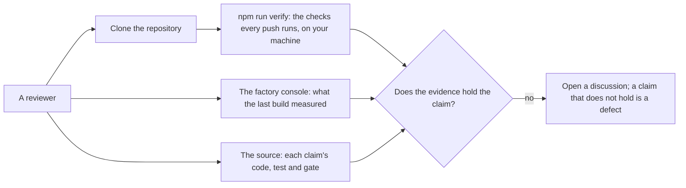

# Reviewing this work

This page is for someone deciding whether to trust the Student Advocate, or the factory that built it, without taking anyone's word. Each claim below says where its evidence is, how to check it yourself in a few minutes, and where it stops. Nothing here asks you to run the cloud pipeline; everything it records is public.



## Reproduce the checks

```sh
git clone https://github.com/russlittle/ZTHR.git && cd ZTHR && git checkout reference-implementation
npm ci
npm run verify
```

`verify` runs what every push runs before anything is admitted: the type check, every test, every gate against its committed proof, every locked journey, the documentation checks, the facts check and the dependency audit. It needs Node 22 and about fifteen minutes. It does not run the nightly walks or mutation testing, which take hours; those run as `npm run explore`, `npm run crawl` and `npm run mutation`, and their last results are on the factory console.

## Each claim, and how to check it

| Claim | Where the evidence is | Check it yourself |
| --- | --- | --- |
| <!--fact:gates-->28<!--/fact--> gates, each proven to fail on every defect planted for it | `tools/gates.ts`, `control/proofs.json`; [Gates](testing/gates.md) | `npm run gates` prints each gate with its proof. Change a gate's check and run `GATES_VERIFY=1 npm run gates`: it fails until the new proof is committed. |
| <!--fact:journeys-->47<!--/fact--> locked user journeys | `control/journeys`, `control/lock.json`; [Journeys](testing/journeys.md) | `npm run journeys`. Edit a card's text and run it again: the lock fails. |
| Only a person changes locked intent, people, resets, floors and required checks | `tools/person-signed.ts`, the `person-signed` build step; [Security](security.md) | Look up any commit that touched `control/journeys` on GitHub: it must show "Verified" and a listed person as author. |
| Every number in the docs is current | `tools/facts.ts`, the `facts-current` gate; [Facts](testing/facts.md) | `npx tsx tools/facts.ts` lists every fact and its value; count any of them yourself. |
| The guide's <!--fact:guide_entries-->268<!--/fact--> entries pass the same admission checks | `apps/advocate/src/guide/admission.ts`, the `guide-admission` gate; [Resource guide](flows/resource-guide.md) | The public feed at `/reference/guide/v1/services.json` names each entry's source and the date it was checked. Call five of them. |
| Tests notice when the code is wrong | `stryker.config.json`, `control/mutation-scope.json`; [Mutation testing](testing/mutation.md) | The factory console's Mutation page shows each module's score and every mutant that survived. |
| Every field is classified, and planted markers never leak | `apps/advocate/src/domain/schema.ts`, `test/harness/trace.ts`; [Sensitive data](flows/sensitive-data.md) | The console's Sensitive data page shows where each marker turned up. |
| Production dependencies are audited and listed | `tools/deps.ts`, `control/register.yaml` | `npx tsx tools/deps.ts` prints every advisory and writes the bill of materials. |
| The live site is scanned | the `Security scan of the live app` workflow | Run OWASP ZAP's baseline scan against the public app yourself; its alerts should match the workflow's. |

## Where the evidence stops

These are stated in the case study too. A reviewer should weigh them, not discover them.

- **The full button walk is a nightly rotation.** A push is admitted after a spot check of four students. A phase is certified only when all twelve students hold a full walk for the current code; the case study states how many do.
- **The planted-marker trace covers a sample.** <!--fact:trace_fields-->21<!--/fact--> of the <!--fact:sensitive_fields-->87<!--/fact--> personal, sensitive and secret fields carry markers so far.
- **Accessibility is automated.** Every rule of WCAG 2.2 A and AA that can be checked automatically is checked on every change; people who use screen readers have not yet tested it.
- **Safety held-out phrasings are few, and written by an agent.** <!--fact:heldout_crisis-->5<!--/fact--> crisis phrasings are held out from the screen's rules. Phrasings from people who do crisis work are needed.
- **The tests and the code have the same author.** Gates, mutation testing, held-out sets, published tables as oracles and planted markers are the checks the author cannot shape. Review by models from other families is designed and switched off.
- **Network control is a check on the code, not a sandbox.** A gate finds direct network calls in the app's code; it does not see what a dependency does.
- **Sign-off rests on GitHub.** A compromised account or key of a listed person would pass.
- **The resource guide's found entries have not been checked by a person.** Each is checked against its system of record when found, and its source is re-read weekly.

## Verified by

<!-- verified-by:start -->
- [`tools/test/review.test.ts`](../tools/test/review.test.ts) (3 test definitions)
<!-- verified-by:end -->
