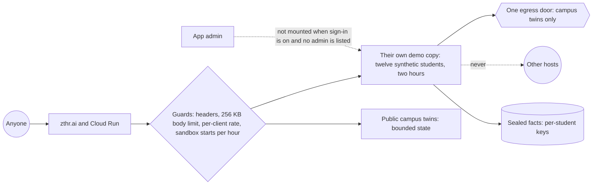

# Security

The Student Advocate is public, and the demonstration lets anyone in without signing in. This page says what an
attacker can reach, what stops them, and where each guard is proven. The public demonstration holds only synthetic
students; the same guards protect a real deployment, which adds Google sign-in and refuses to start without its keys.

## What someone can try, and what happens

| They try | What stops it | Proven by |
| --- | --- | --- |
| Flood the server with requests | A per-client rate (600 a minute by default, room for a classroom behind one campus address); over it, 429 with Retry-After | guard tests |
| Start thousands of demo sessions to push real visitors out | Each client address may start 40 sandboxes an hour; the server keeps at most 150, oldest idle first | guard tests |
| Send huge bodies to exhaust memory | Bodies over 256 KB are refused before any handler reads them | guard tests |
| Fill the public twins with bookings or requests | Names and keys are length-limited; each twin keeps at most 5,000 and drops the oldest | guard tests, contract |
| Grow one demo copy without limit by text | At most 200 conversations per copy; messages cut at 1,600 characters | API tests |
| Inject script into a page | Every value is escaped by the page parts; the content security policy allows scripts from this origin and Google sign-in only, never inline | guard tests, browser walk |
| Frame the app to trick clicks | `frame-ancestors 'none'` and `X-Frame-Options: DENY` | guard tests |
| Downgrade a visitor to plain HTTP | `Strict-Transport-Security` for a year on every HTTPS answer; every cookie is `Secure` over HTTPS | guard tests |
| Make the server call other hosts (SSRF), including through webhooks | One egress door; the demonstration reaches only the campus twins, production only an allow-list; anything else is refused and recorded | `no-hidden-egress` gate, egress tests |
| Forge a session or token | Sessions are HMAC-signed and compared in constant time; API tokens are stored only as hashes and scoped | auth and API tests |
| Act cross-site with a visitor's cookies | Cookies are `SameSite=Lax` and `HttpOnly`; state changes are POSTs | auth tests |
| Read another student's data | Every route is scoped to the sandbox and the student; the walks check for other students' names on every screen | walks, red team |
| Pull sensitive facts out of logs, exports or the admin | Planted markers in every sensitive field are searched for in every sink on every build | `sensitive-data` gate |
| Reach the admin in production | No admin listed means no admin mounted; listed admins must be signed in | role tests |
| Talk the assistant into harm | Crisis words route to 988 first; held-out attacks the rules never saw | red team, `safety-router` gate |

## Dependencies

Production dependencies are audited on every change. Findings that cannot be fixed without a breaking upgrade are
registered rather than hidden, each with a reason and an expiry: the schema library's memory exhaustion on oversized
collections (the 256 KB body limit bounds every input the app validates until the upgrade lands), and advisories in
the test runner, which never ships in the application image.

## Reporting a problem

Email russ@zthr.ai. The published site serves the same contact at `/.well-known/security.txt`.

## Verified by

<!-- verified-by:start -->
- [`apps/advocate/test/guard.test.ts`](../apps/advocate/test/guard.test.ts) (9 test definitions)
<!-- verified-by:end -->
