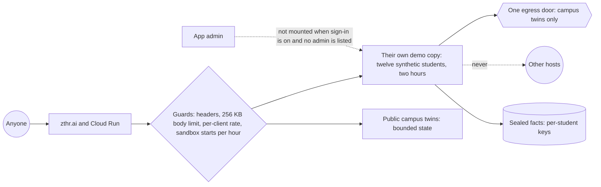
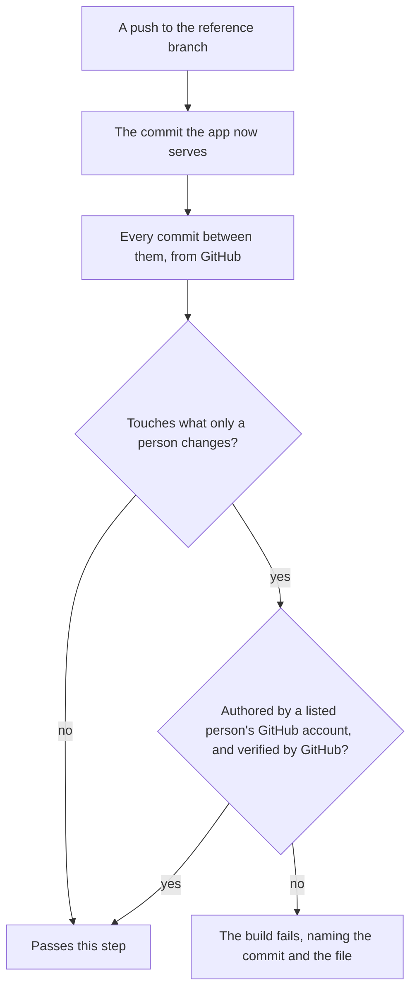

# Security

The Student Advocate is public, and the demonstration lets anyone in without signing in. This page says what an
attacker can reach, what stops them, and where each guard is proven. The public demonstration holds only synthetic
students; the same guards protect a real deployment, which adds Google sign-in and refuses to start without its keys.

## What someone can try, and what happens

| They try | What stops it | Proven by |
| --- | --- | --- |
| Flood the server with requests | A per-client rate (600 a minute by default, room for a classroom behind one campus address); over it, 429 with Retry-After | guard tests |
| Start thousands of demo sessions to push real visitors out | Each client address may start 40 sandboxes an hour; the server keeps at most 150, oldest idle first | guard tests |
| Send huge bodies to exhaust memory | Bodies over 256 KB are refused before any handler reads them | guard tests |
| Fill the public twins with bookings or requests | Names and keys are length-limited; each twin keeps at most 5,000 and drops the oldest | guard tests, contract |
| Grow one demo copy without limit by text | At most 200 conversations per copy; messages cut at 1,600 characters | API tests |
| Inject script into a page | Every value is escaped by the page parts; the content security policy allows scripts from this origin and Google sign-in only, never inline | guard tests, browser walk |
| Frame the app to trick clicks, or load its pages into another site's process | `frame-ancestors 'none'`, `X-Frame-Options: DENY`, and cross-origin opener and resource policies of `same-origin` | guard tests |
| Downgrade a visitor to plain HTTP | `Strict-Transport-Security` for a year on every HTTPS answer; every cookie is `Secure` over HTTPS | guard tests |
| Make the server call other hosts (SSRF), including through webhooks | One egress door; the demonstration reaches only the campus twins, production only an allow-list; anything else is refused and recorded | `no-hidden-egress` gate, egress tests |
| Forge a session or token | Sessions are HMAC-signed and compared in constant time; API tokens are stored only as hashes and scoped | auth and API tests |
| Act cross-site with a visitor's cookies | The app's cookies are `SameSite=Lax` and `HttpOnly`; state changes are POSTs; a browser's POST from another site is refused, except Google posting a sign-in back, which carries its own double-submit token | auth and guard tests |
| Read another student's data | Every route is scoped to the sandbox and the student; the walks check for other students' names on every screen | walks, red team |
| Pull sensitive facts out of logs, exports or the admin | Planted markers in a sample of the sensitive fields are searched for in every sink on every build; the rest are next | `sensitive-data` gate |
| Reach the admin in production | No admin listed means no admin mounted; listed admins must be signed in | role tests |
| Talk the assistant into harm | Crisis words route to 988 first; held-out attacks the rules never saw | red team, `safety-router` gate |

## Scanning the live app

Every week and after each zthr.ai deploy, OWASP ZAP's baseline scan reads the deployed app as an outsider would. A high-risk alert fails the run. What it reports at lower risk is either fixed or registered:

- **Cookie flags on `GAESA`.** That cookie is Cloud Run's own session affinity, set by Google's front end so a visitor stays on one server; the app cannot set its flags. Every cookie the app sets is `HttpOnly`, `SameSite=Lax` and `Secure` over HTTPS.
- **Inline styles allowed** by the content security policy. Inline scripts are not; page parts set small styles inline. Registered.
- **No anti-forgery token in forms.** Cross-site posts are refused by origin and by `SameSite` cookies; a per-form token is registered as the next layer.

## Dependencies

The application image installs production packages only: five libraries and the TypeScript loader it runs on. The test runner, the mutation tools and the browsers never ship in it.

- **Every build audits them.** The `dependencies` step reads npm's advisories for every production package. A high or critical advisory passes only while it is registered in `control/register.yaml` with the packages it covers, an owner, a reason and an expiry that has not passed; any other fails the build, naming the package. Lower advisories are recorded.
- **Every build lists them.** The same step writes a CycloneDX bill of materials, `sbom.cdx.json`, with each production package's version and package URL, kept with the build's evidence.
- **Registered now:** the schema library's memory exhaustion on oversized collections. Its fix is a breaking upgrade, and the 256 KB body limit bounds every input the app validates until that upgrade lands. Advisories in the test runner are registered too, though it is not in the image.

## Changes only a person makes

Some changes loosen what the factory holds the code to: a locked journey card or the lock itself, the people who may sign, a ratchet reset, a mutation floor, the list of required checks, and the rule below. An agent may not make them, and the build enforces that rather than trusting it.

- **Verified** means GitHub checked the commit's signature: the person's own signing key, or GitHub's own signature on a change made in its web editor. Agents commit as `claude-agent` and hold no person's key.
- The list of protected paths and each person's GitHub account live in `tools/person-signed.ts`, which is itself protected, as is `control/required-checks.yaml`, so the rule cannot be loosened by the change it judges.
- The check fails closed: if the app does not report the commit it serves, or GitHub does not answer, the build does not pass.
- **Its limits.** A person's account or key that is compromised passes. The pipeline definition itself (`cloudbuild.yaml`) is not protected: removing the step would be caught by the zero-bypass gate, which checks that every required check runs, but that gate's code is agent-editable, and its committed proof is the pin a reviewer sees change.

## Reporting a problem

Email russ@zthr.ai. The published site serves the same contact at `/.well-known/security.txt`.

## Verified by

<!-- verified-by:start -->
- [`apps/advocate/test/guard.test.ts`](../apps/advocate/test/guard.test.ts) (13 test definitions)
- [`tools/test/deps.test.ts`](../tools/test/deps.test.ts) (3 test definitions)
- [`tools/test/person-signed.test.ts`](../tools/test/person-signed.test.ts) (4 test definitions)
<!-- verified-by:end -->
