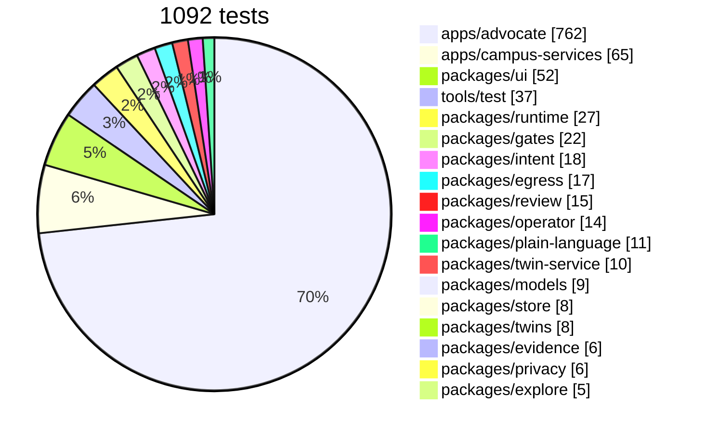
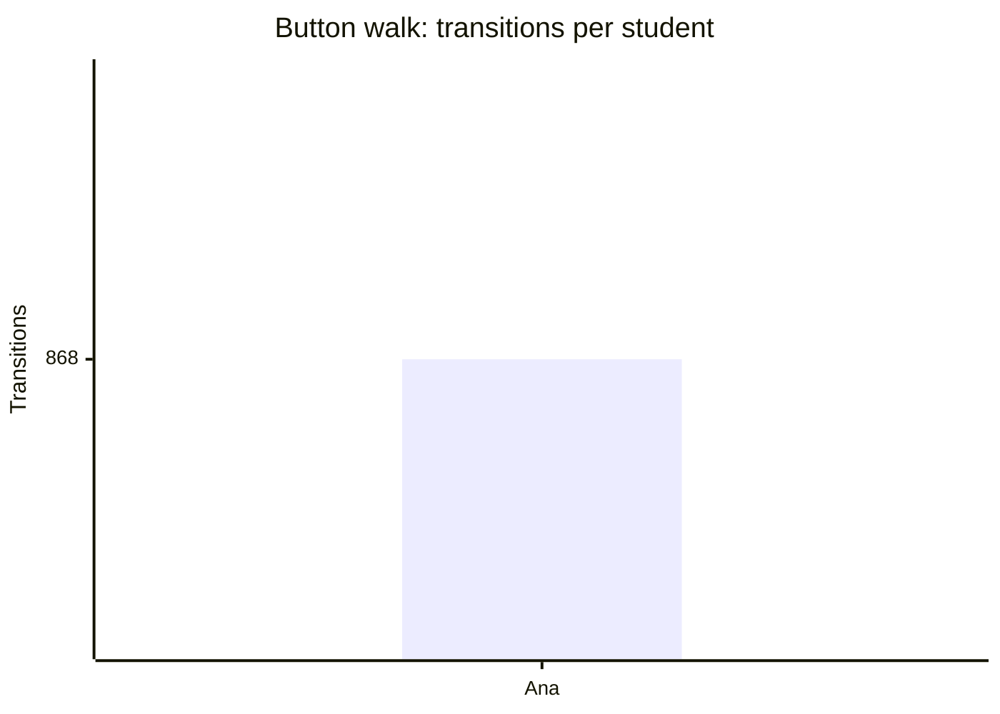
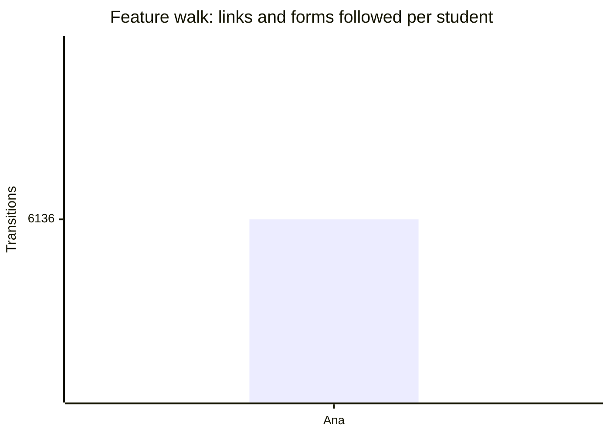

# Coverage

<!-- generated by tools/docs.ts from the last walk, crawl and test reports; do not edit by hand -->

## Tests by package

## Button walk

255 states and 2,604 transitions across 3 seeds; some seeds were cut short; 0 violations.

| Verb | Times tried |
| --- | --- |
| `say` | 1,104 |
| `need` | 432 |
| `situation` | 240 |
| `show-draft` | 51 |
| `today` | 48 |
| `screen` | 48 |
| `find-help` | 48 |
| `week` | 48 |
| `settings` | 48 |
| `review-deadlines` | 48 |
| `add-shifts` | 48 |
| `upload-syllabus` | 48 |
| `campus-food` | 48 |
| `free-food` | 48 |
| `study-spots` | 48 |
| `leave-by` | 48 |
| `jobs-fit` | 48 |
| `mentors` | 48 |
| `delete-account` | 48 |
| `start-resource` | 42 |
| `dial` | 6 |
| `call` | 6 |
| `screen-more` | 3 |

## Feature walk

2,283 page-states and 18,408 links and forms across 3 seeds; 0 violations. Routes reached: `/advocate/s/:id`, `/advocate/s/:id/action`, `/advocate/s/:id/ask`, `/advocate/s/:id/dates`, `/advocate/s/:id/drafts`, `/advocate/s/:id/help`, `/advocate/s/:id/letter`, `/advocate/s/:id/meals`, `/advocate/s/:id/money`, `/advocate/s/:id/resource/:rid`, `/advocate/s/:id/say`, `/advocate/s/:id/share`, `/advocate/s/:id/shifts`, `/advocate/s/:id/syllabus`, `/advocate/s/:id/week`, `/advocate/s/:id/you`.

## Verified by

<!-- verified-by:start -->
- [`apps/advocate/test/walks.test.ts`](../../apps/advocate/test/walks.test.ts) (2 test definitions)
<!-- verified-by:end -->
