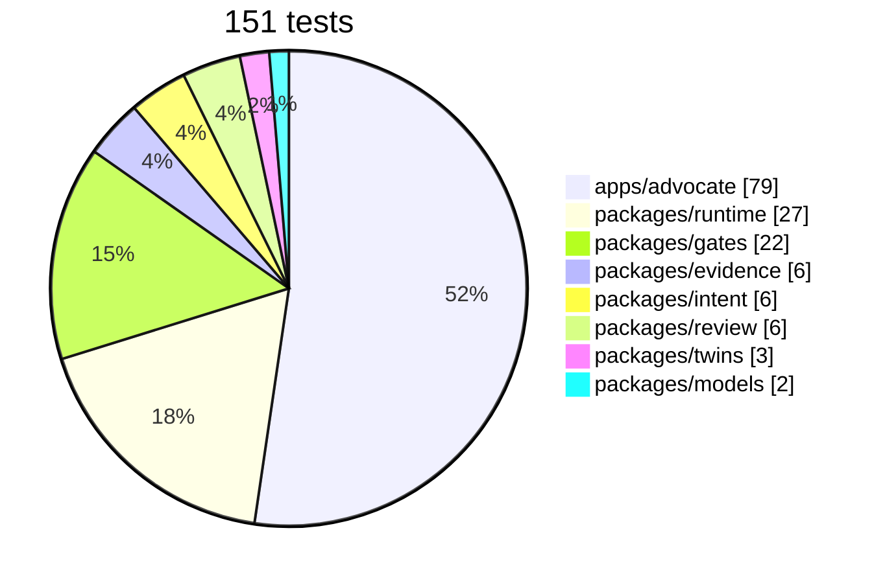
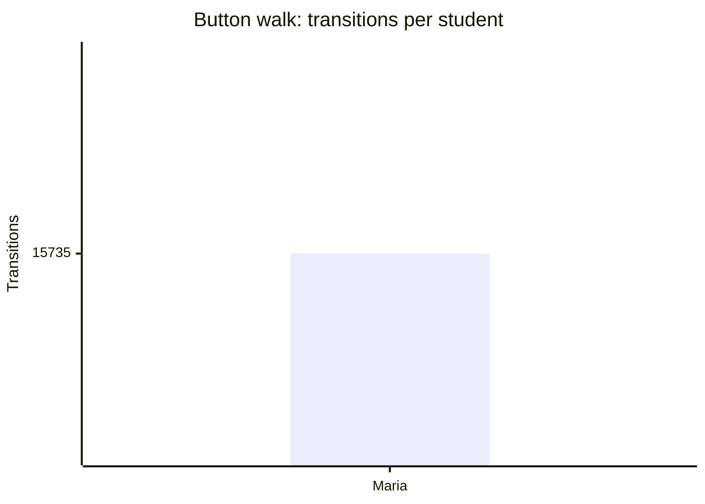
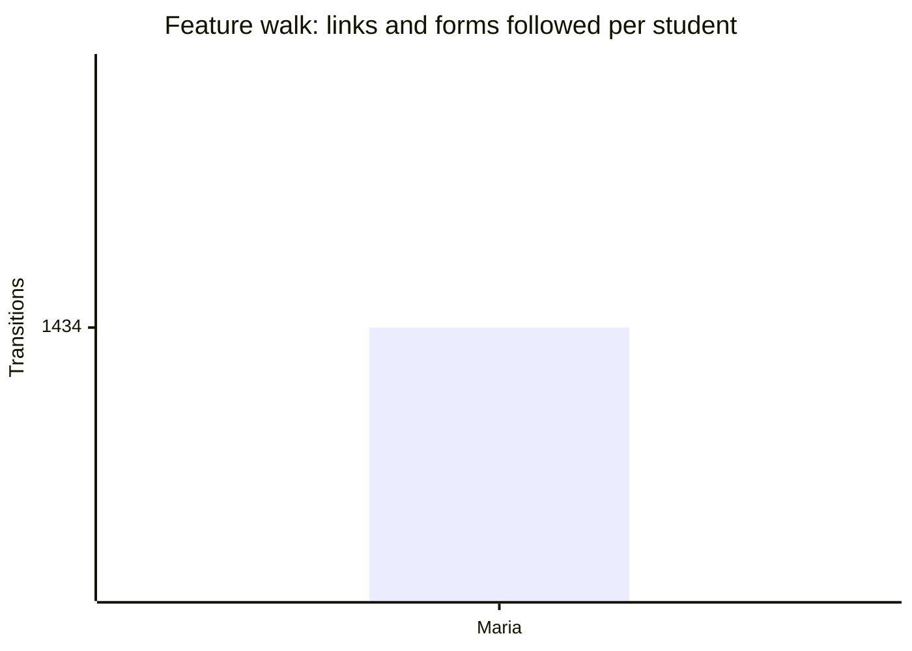

# Coverage

<!-- generated by tools/docs.ts from the last walk, crawl and test reports; do not edit by hand -->

## Tests by package

## Button walk

1,434 states and 36,731 transitions across 3 seeds; every seed ran to its fixpoint; 0 violations.

| Verb | Times tried |
| --- | --- |
| `need` | 12,879 |
| `situation` | 7,155 |
| `show-draft` | 1,494 |
| `find-help` | 1,473 |
| `today` | 1,431 |
| `screen` | 1,431 |
| `week` | 1,431 |
| `settings` | 1,431 |
| `review-deadlines` | 1,431 |
| `add-shifts` | 1,431 |
| `upload-syllabus` | 1,431 |
| `delete-account` | 1,431 |
| `start-resource` | 882 |
| `share` | 462 |
| `call` | 357 |
| `hold-block` | 126 |
| `plan` | 98 |
| `start-program` | 84 |
| `dial` | 84 |
| `why-qualify` | 42 |
| `calendar-steps` | 42 |
| `edit-steps` | 42 |
| `draft-instructor-note` | 42 |
| `approve` | 21 |

## Feature walk

528 page-states and 4,302 links and forms across 3 seeds; 0 violations. Routes reached: `/advocate/s/:id`, `/advocate/s/:id/action`, `/advocate/s/:id/drafts`, `/advocate/s/:id/help`, `/advocate/s/:id/money`, `/advocate/s/:id/resource/:rid`, `/advocate/s/:id/say`, `/advocate/s/:id/share`, `/advocate/s/:id/shifts`, `/advocate/s/:id/week`, `/advocate/s/:id/you`.

## Verified by

<!-- verified-by:start -->
- [`apps/advocate/test/walks.test.ts`](../../apps/advocate/test/walks.test.ts) (2 test definitions)
<!-- verified-by:end -->
