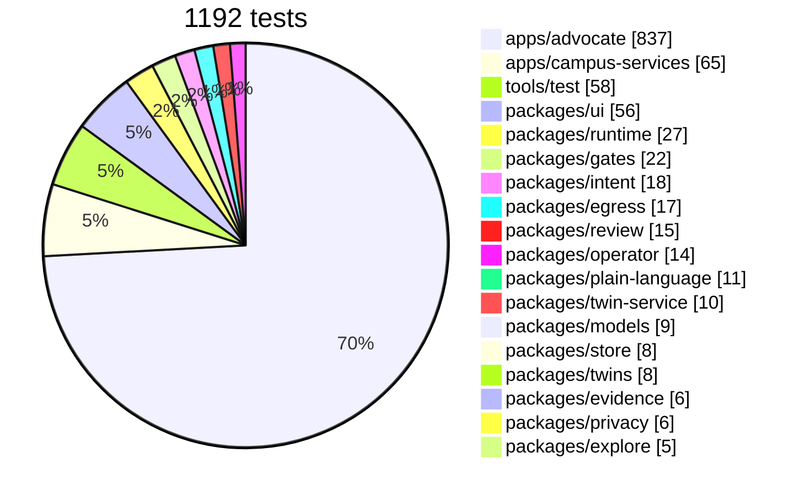
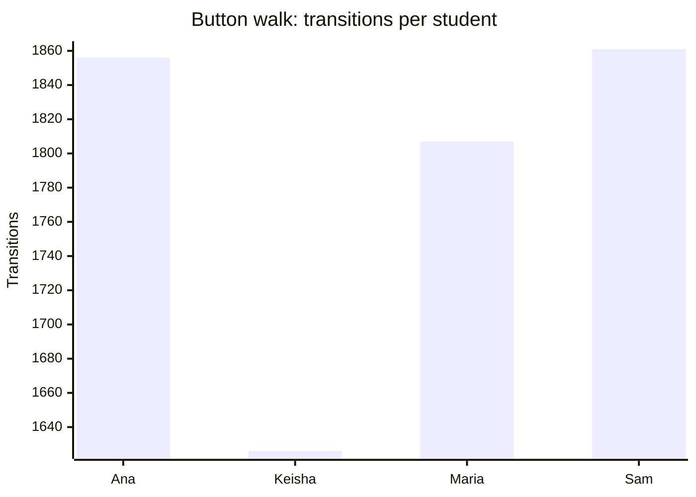
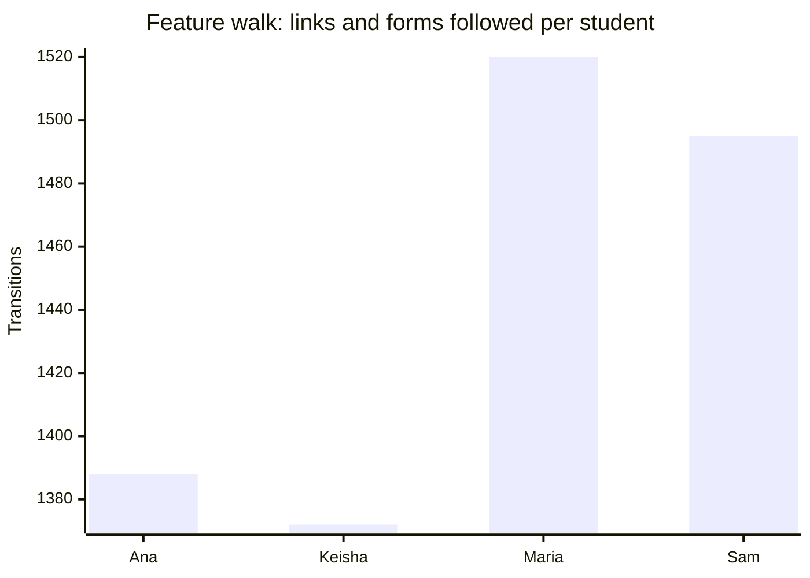

# Coverage

<!-- generated by tools/docs.ts from the last walk, crawl and test reports; do not edit by hand -->

## Tests by package

## Button walk

1,977 states and 27,844 transitions across 12 seeds; some seeds were cut short; 0 violations.

| Verb | Times tried |
| --- | --- |
| `say` | 11,753 |
| `need` | 4,599 |
| `situation` | 2,555 |
| `show-draft` | 547 |
| `find-help` | 519 |
| `today` | 511 |
| `screen` | 511 |
| `week` | 511 |
| `settings` | 511 |
| `review-deadlines` | 511 |
| `add-shifts` | 511 |
| `upload-syllabus` | 511 |
| `campus-food` | 511 |
| `free-food` | 511 |
| `study-spots` | 511 |
| `leave-by` | 511 |
| `jobs-fit` | 511 |
| `mentors` | 511 |
| `delete-account` | 511 |
| `start-resource` | 246 |
| `call` | 88 |
| `dial` | 56 |
| `set-stop` | 39 |
| `add-date` | 32 |
| `draft` | 32 |
| `share` | 32 |
| `mentor-intro` | 24 |
| `playbook` | 24 |
| `book-room` | 14 |
| `ask` | 12 |
| `remind` | 12 |
| `contact` | 12 |
| `plan-next` | 12 |
| `find-tutor` | 12 |
| `screen-more` | 11 |
| `plan` | 10 |
| `start-program` | 7 |
| `calendar-steps` | 6 |
| `edit-steps` | 6 |
| `why-qualify` | 5 |
| `meals` | 4 |
| `fair-chance` | 4 |
| `jobs-fair-chance` | 4 |
| `career` | 4 |
| `approve` | 4 |
| `next-bus` | 3 |
| `draft-instructor-note` | 2 |

## Feature walk

1,800 page-states and 17,325 links and forms across 12 seeds; 0 violations. Routes reached: `/advocate/s/:id`, `/advocate/s/:id/action`, `/advocate/s/:id/advisor`, `/advocate/s/:id/ask`, `/advocate/s/:id/dates`, `/advocate/s/:id/delete`, `/advocate/s/:id/drafts`, `/advocate/s/:id/help`, `/advocate/s/:id/letter`, `/advocate/s/:id/meals`, `/advocate/s/:id/money`, `/advocate/s/:id/resource/:rid`, `/advocate/s/:id/say`, `/advocate/s/:id/school`, `/advocate/s/:id/school/drop`, `/advocate/s/:id/share`, `/advocate/s/:id/shifts`, `/advocate/s/:id/syllabus`, `/advocate/s/:id/week`, `/advocate/s/:id/you`.

## Verified by

<!-- verified-by:start -->
- [`apps/advocate/test/walks.test.ts`](../../apps/advocate/test/walks.test.ts) (2 test definitions)
<!-- verified-by:end -->
