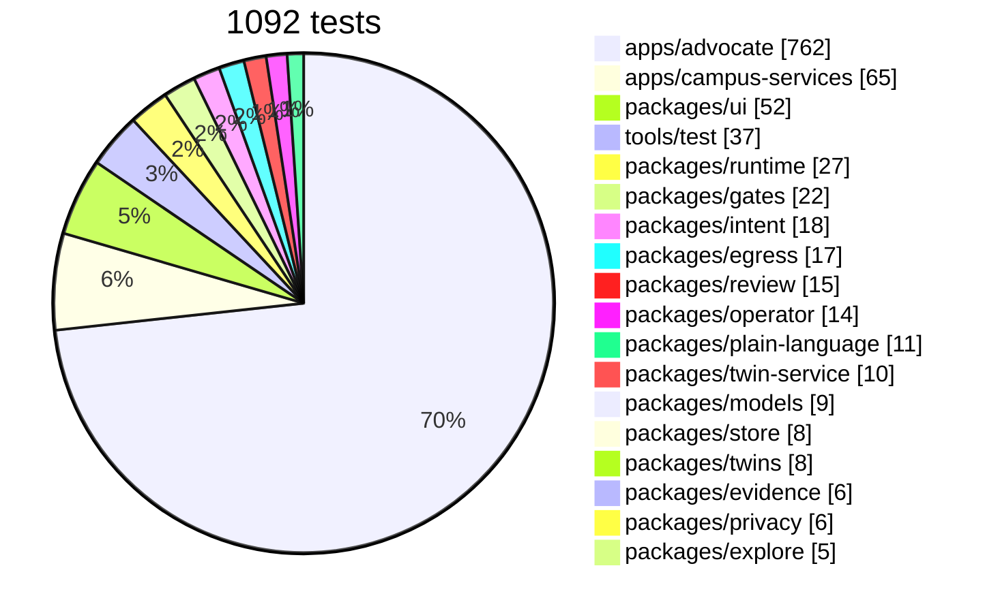
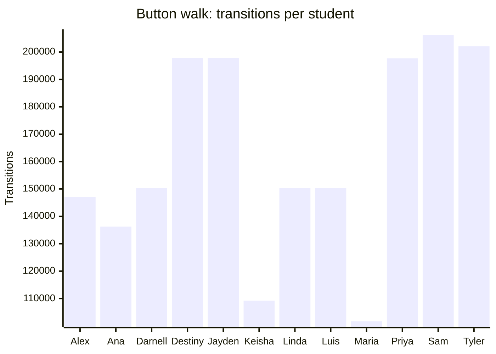
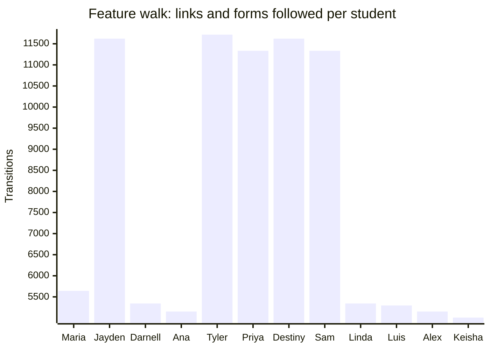

# Coverage

<!-- generated by tools/docs.ts from the last walk, crawl and test reports; do not edit by hand -->

## Tests by package

## Button walk

128,244 states and 5,841,396 transitions across 36 seeds; every seed ran to its fixpoint; 0 violations.

| Verb | Times tried |
| --- | --- |
| `say` | 2,564,160 |
| `need` | 1,153,872 |
| `situation` | 641,040 |
| `show-draft` | 132,528 |
| `find-help` | 129,792 |
| `today` | 128,208 |
| `screen` | 128,208 |
| `week` | 128,208 |
| `settings` | 128,208 |
| `review-deadlines` | 128,208 |
| `add-shifts` | 128,208 |
| `upload-syllabus` | 128,208 |
| `delete-account` | 128,208 |
| `start-resource` | 55,296 |
| `call` | 30,024 |
| `share` | 28,296 |
| `playbook` | 14,400 |
| `draft` | 8,640 |
| `dial` | 7,680 |
| `plan` | 4,644 |
| `hold-block` | 4,464 |
| `start-program` | 3,312 |
| `ask` | 2,880 |
| `remind` | 2,880 |
| `contact` | 2,880 |
| `plan-next` | 2,880 |
| `find-tutor` | 2,880 |
| `meals` | 2,880 |
| `fair-chance` | 2,880 |
| `career` | 2,880 |
| `add-date` | 2,880 |
| `calendar-steps` | 2,448 |
| `edit-steps` | 2,448 |
| `draft-instructor-note` | 2,448 |
| `why-qualify` | 1,656 |
| `approve` | 1,440 |
| `screen-more` | 1,224 |

## Feature walk

34,146 page-states and 283,704 links and forms across 36 seeds; 0 violations. Routes reached: `/advocate/s/:id`, `/advocate/s/:id/action`, `/advocate/s/:id/ask`, `/advocate/s/:id/dates`, `/advocate/s/:id/drafts`, `/advocate/s/:id/help`, `/advocate/s/:id/money`, `/advocate/s/:id/resource/:rid`, `/advocate/s/:id/say`, `/advocate/s/:id/share`, `/advocate/s/:id/shifts`, `/advocate/s/:id/syllabus`, `/advocate/s/:id/week`, `/advocate/s/:id/you`.

## Verified by

<!-- verified-by:start -->
- [`apps/advocate/test/walks.test.ts`](../../apps/advocate/test/walks.test.ts) (2 test definitions)
<!-- verified-by:end -->
