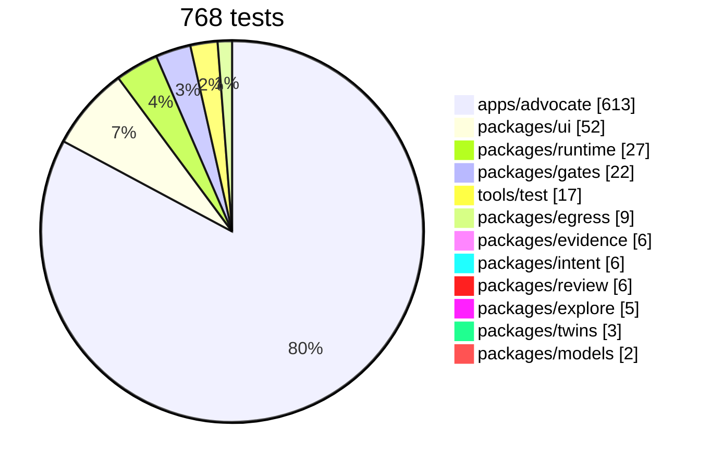
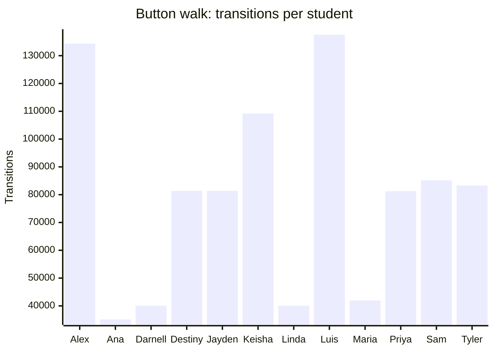
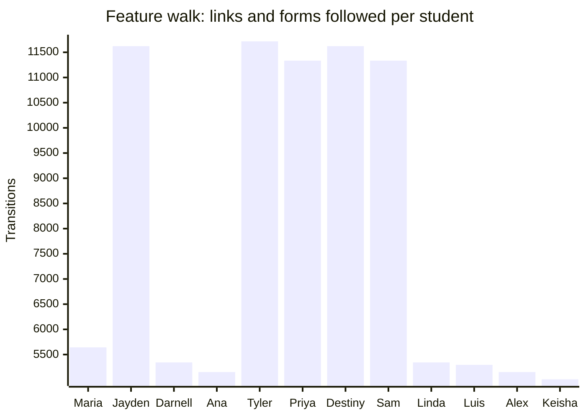

# Coverage

<!-- generated by tools/docs.ts from the last walk, crawl and test reports; do not edit by hand -->

## Tests by package

## Button walk

67,074 states and 2,851,974 transitions across 36 seeds; every seed ran to its fixpoint; 21920 violations.

| Verb | Times tried |
| --- | --- |
| `say` | 1,139,016 |
| `need` | 603,342 |
| `situation` | 335,190 |
| `show-draft` | 69,522 |
| `find-help` | 67,830 |
| `today` | 67,038 |
| `screen` | 67,038 |
| `week` | 67,038 |
| `settings` | 67,038 |
| `review-deadlines` | 67,038 |
| `add-shifts` | 67,038 |
| `upload-syllabus` | 67,038 |
| `delete-account` | 67,038 |
| `start-resource` | 30,312 |
| `call` | 17,100 |
| `share` | 15,696 |
| `playbook` | 8,280 |
| `dial` | 4,416 |
| `draft` | 2,520 |
| `plan` | 2,322 |
| `hold-block` | 2,232 |
| `start-program` | 1,728 |
| `ask` | 1,656 |
| `remind` | 1,656 |
| `contact` | 1,656 |
| `plan-next` | 1,656 |
| `find-tutor` | 1,656 |
| `calendar-steps` | 1,224 |
| `edit-steps` | 1,224 |
| `draft-instructor-note` | 1,224 |
| `why-qualify` | 864 |
| `approve` | 828 |
| `screen-more` | 792 |
| `meals` | 648 |
| `add-date` | 648 |
| `fair-chance` | 216 |
| `career` | 216 |

## Feature walk

34,146 page-states and 283,704 links and forms across 36 seeds; 0 violations. Routes reached: `/advocate/s/:id`, `/advocate/s/:id/action`, `/advocate/s/:id/ask`, `/advocate/s/:id/dates`, `/advocate/s/:id/drafts`, `/advocate/s/:id/help`, `/advocate/s/:id/money`, `/advocate/s/:id/resource/:rid`, `/advocate/s/:id/say`, `/advocate/s/:id/share`, `/advocate/s/:id/shifts`, `/advocate/s/:id/syllabus`, `/advocate/s/:id/week`, `/advocate/s/:id/you`.

## Verified by

<!-- verified-by:start -->
- [`apps/advocate/test/walks.test.ts`](../../apps/advocate/test/walks.test.ts) (2 test definitions)
<!-- verified-by:end -->
