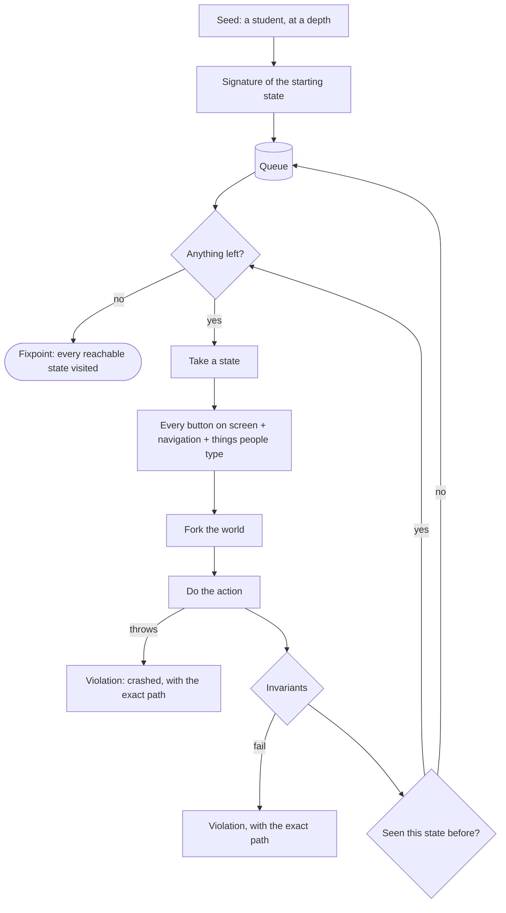
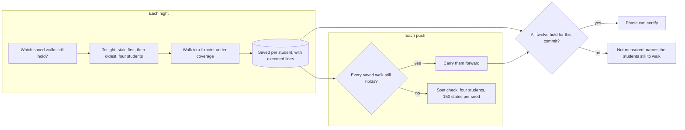
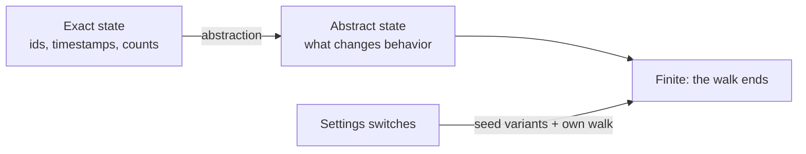
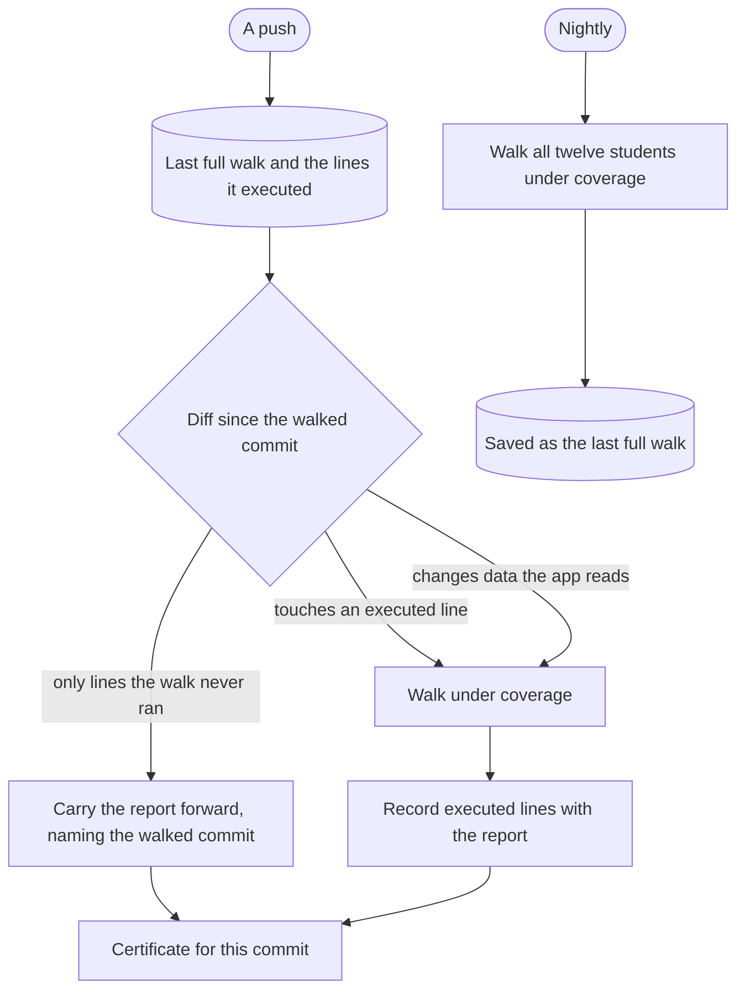

# Exhaustive walks

A journey proves one path works. The walks prove there is no path that breaks. They drive the Advocate the way
people do, from every state they can reach, until nothing new is left.

## The algorithm

## Two walks

| Walk | Drives | Actions from each state | Checked at every step |
| --- | --- | --- | --- |
| Button walk (`tools/explore.ts`) | The Advocate directly | Every button on the last message, app navigation, help tiles, 16 things students type (including "1", "2", "3") | No dead end; no crash; tone gate passes at the student's depth and grade; no doubled periods or template holes; no citizenship question; no sealed fact; no other student's name; idempotent buttons are idempotent |
| Feature walk (`tools/crawl.ts`) | The web app over HTTP | Every link and every form on the page | Status 200; one title and one h1; a main landmark; every control labeled; every link and button named; no "undefined", "NaN" or template holes; no other student's data; no dead-end page |

Each runs for every student, at their own depth and again at brief and walk-me-through, to a fixpoint. Full walks
run on a nightly rotation of four students: first those whose saved walk no longer holds, then those walked longest
ago. Each student's walk is saved with the lines it executed, and stays valid for later commits until a change
touches one of those lines or the data the app reads. A phase certifies only when all twelve students have a full
walk that still holds for the commit. Every push is checked too: if every saved walk still holds, they carry
forward; otherwise a spot check walks four students whose settings differ most, bounded at 150 states per seed,
and fails the build on any violation. Each student at each depth is an independent walk, so more compute means
more students a night.

## Why it ends

The exact state of a student multiplies independent features together (every combination of drafts, reminders and
held time) and never reaches a fixpoint. The walk uses an abstract state: each deadline's status, each playbook's
step, whether a draft is waiting, whether a question is pending, which sources are on, and the buttons on screen.
Settings are independent switches, so they are set by the seeds and walked on their own instead of being multiplied
into every path.

## Walk only when the walk could see the change

A walk runs under coverage, which records every source line it executed. On a later commit the change is diffed
against the walked commit, and a walk is needed only if a hunk touches or borders an executed line, or changes data
the app reads while it runs (playbooks, colleges, scouts, dependency versions). A change inside a function the walk
never ran, such as an API handler the page walk never calls, cannot alter what the walk saw, so the earlier report
is carried forward for the new commit and says so. The nightly run walks every student regardless and saves the
coverage that pushes are compared against, one student at a time.

The one sanctioned skip is marked in the pipeline script, and the \`zero-bypass\` gate reads the scripts the
required steps run, so any other way of skipping a walk fails the build.

## What the walks found and fixed

Every finding is a fixture now; it cannot come back.

| Finding | Walk | Fix |
| --- | --- | --- |
| About twenty buttons went nowhere | button | One action registry for app, text and API; `no-dead-ends` gate |
| Replying "1" by text did nothing | button | Numbered replies run the last message's choices |
| Crisis plans too long for brief answers | button | Brief plans list names and numbers only |
| Catalog steps above an eighth-grade reading level | button | Catalog rewritten; web addresses no longer count as words |
| "1:30 p.m.." doubled periods | feature, then tone gate | `sentence()` helper; the tone gate rejects doubled periods |
| Re-uploading a syllabus duplicated every date | feature | Same title, date and course is the same deadline |
| Pages without a heading | feature | Every page has exactly one h1 |
| Holding the same time twice made two holds | button | Holds, reminders and drafts are idempotent |

## Verified by

<!-- verified-by:start -->
- [`apps/advocate/test/walks.test.ts`](../../apps/advocate/test/walks.test.ts) (2 test definitions)
- [`tools/test/walk-coverage.test.ts`](../../tools/test/walk-coverage.test.ts) (9 test definitions)
- [`tools/test/walk-rotation.test.ts`](../../tools/test/walk-rotation.test.ts) (4 test definitions)
<!-- verified-by:end -->
