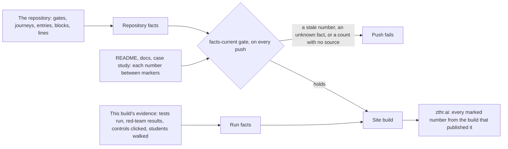
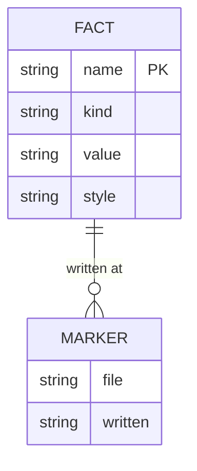

# Facts

Every number the README, the docs and the case study state has one source. A reader who counts the gates, the locked journeys or the guide's entries gets the number the page states, and a page never states a number its evidence does not hold.



## How a number is written

In Markdown, a number is written between markers, which render as nothing:

```md
a guide of <!--fact:guide_entries-->268<!--/fact--> checked entries
```

- **Repository facts** are counted from the repository: entries in the guide, gates (from their proofs), locked journey cards, reusable blocks, campus services, phases, patterns, modules in mutation scope, held-out crisis phrasings, and lines of code and documentation. The `facts-current` gate fails a push when any of them is stale. A rounded figure, such as "about 28,500 lines", holds while it is within five percent.
- **Run facts** are measured by a build: tests run, red-team attacks held, controls clicked in a real browser and how deep, browser stops checked for accessibility, and how many students have a full button walk that still holds. The site build writes each one from that same build's evidence. With no evidence, a run fact reads "not measured", never the last number someone typed.
- **A count with no marker** fails the gate. A number before "tests", "gates", "journeys", "entries", "blocks", "modules", "students" or "lines of" is a claim, and a claim needs a source. A quoted example of wording, code, and the generated test lists are not claims.



## Keeping it current

```sh
npx tsx tools/facts.ts            # every fact, its kind and value
npx tsx tools/facts.ts --write    # rewrite every marked repository fact to its current value
npx tsx tools/facts.ts --check    # what the gate checks
```

An agent working in the repository runs `--write` before it commits; the repository's agent settings run `--check` when a session ends, so a stale number is caught before a push.

## Verified by

<!-- verified-by:start -->
- [`tools/test/facts.test.ts`](../../tools/test/facts.test.ts) (5 test definitions)
<!-- verified-by:end -->
