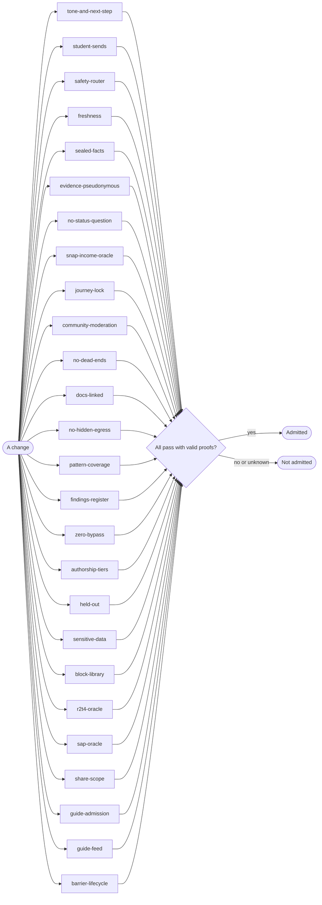

# Gates

<!-- generated by tools/docs.ts from tools/gates.ts; do not edit by hand -->

A gate counts only after it proves it can fail: each one carries planted defects, and its proof is pinned to a
hash of its definition. 26 gates guard the Advocate.

| Gate | Protects | Proven against |
| --- | --- | --- |
| `tone-and-next-step` | No message to a student scolds, reads above their level, or reports a problem without a next step (PRD P3, P4). | planted scolding message; planted message with no next step |
| `student-sends` | Nothing reaches an outside party without a single-use approval token for that exact content (PRD P9). | planted dispatcher that ignores tokens |
| `safety-router` | Crisis messages, including held-out phrasings, route to 988 before any model (PRD SAF-1). | planted router that only knows one phrase |
| `freshness` | A catalog entry past its freshness window is never offered as available (PRD P11). | planted finder that ignores freshness |
| `sealed-facts` | A sealed fact never appears in a message unless the student released it to a playbook that needs it (PRD P10). | planted message quoting the sealed fact |
| `evidence-pseudonymous` | The evidence store holds no student identifiers or content. | planted evidence row with a phone number |
| `no-status-question` | The team never asks about citizenship or immigration status (PRD NAV-7). | planted citizenship question |
| `snap-income-oracle` | SNAP income results match the published FY2027 table at and just over every limit (record-derived oracle, Pattern 17). | planted off-by-one limit |
| `journey-lock` | No change can edit or remove the journey cards it is judged by (Pattern 18). | planted lock missing a card |
| `community-moderation` | Harmful or risky posts never surface in the community (PRD COM-5). | planted community with no filters |
| `no-dead-ends` | Every button any agent offers works, in the app and by text (PRD P3, P8). | planted registry missing a handler; planted handler that answers with no next step |
| `docs-linked` | Every test file names the document it verifies, that document exists, and every document is verified by a test. | planted test file with no doc; planted link to a missing doc |
| `no-hidden-egress` | Only the model client and the egress block may reach the network; domain, agent and server code cannot (PRD P2). | planted fetch in a domain file |
| `pattern-coverage` | All 33 ZTHR patterns are implemented, each points at files that exist, and each is proven by a test (and a gate where it names one). | planted map missing a pattern; planted proof that does not exist |
| `findings-register` | Every finding we have not fixed is written down with a reason, an owner and an expiry, and none has expired (Pattern 13). | planted expired finding; planted finding with no owner |
| `zero-bypass` | Every required check runs in the live pipeline, none may fail and none can be skipped (Pattern 7). | planted pipeline without the gates step; planted step allowed to fail; planted step that swallows failure; planted script that skips its walk without carrying evidence |
| `authorship-tiers` | Every file belongs to an authorship tier and every tier names a guard that enforces it; the open tier comes last (Pattern 6). | planted tier with no guard; planted open tier first |
| `held-out` | No rule is written against its own evaluation set: a held-out line that appears in a rule is caught, to be retired (Pattern 32). | planted rule written against a held-out line |
| `sensitive-data` | Every field the app keeps is classified, and a planted marker in each personal, sensitive and secret field turns up only where its class may go. | planted field with no class; planted income marker in the evidence log; planted field the trace never exercised |
| `block-library` | Every block has its own tests, a page saying what to use it for and what not, at least one consumer, a mutation score at or above its floor, and no copy of its code inside an app. | planted block with no tests; planted block nothing uses; planted block under its mutation floor; planted block with no purpose page; planted app copy of a block function |
| `r2t4-oracle` | The withdrawal estimate reproduces the Federal Student Aid Handbook's worked case to the cent, earns everything after 60%, and waives grant overpayments of $50 or less (34 CFR 668.22). | planted count that keeps scheduled breaks in the term; planted estimate with no 50% grant protection |
| `sap-oracle` | Satisfactory Academic Progress is measured exactly at each college's declared GPA, pace and 150% limit, with W counted as attempted and transfer credit as both attempted and earned (34 CFR 668.34). | planted measure that leaves W out of attempted credits; planted rounding of pace to a whole percent |
| `share-scope` | A link the student shares shows only the parts they chose, never a sealed fact, stops working when turned off or expired, and is never stored in a form that could be read back. | planted link that shows every part; planted link that keeps working after it is turned off; planted message that repeats the link |
| `guide-admission` | Every guide entry passes every admission check, and an entry with no source, a bad phone number, dense wording, a made-up barrier or an impossible date is held by the check named for it. | planted catalog with an entry that has no source; planted gate that admits everything; planted gate that no longer checks phone numbers |
| `guide-feed` | The public guide feed matches its published schema, carries no student (no name, phone, id or answer), and shows a "did it help" count only from five answers up. | planted feed that carries the student name; planted feed that shows a count from one answer; planted feed with an entry missing its source |
| `barrier-lifecycle` | A need a student raised stays open until the student resolves it: nothing else closes it, its urgency never drops while open, "not today" only pauses reminders, and it is never duplicated. | planted open that lowers urgency; planted "not today" that closes the barrier; planted check-in that closes a quiet barrier |

## Verified by

<!-- verified-by:start -->
- [`packages/gates/test/hardening.test.ts`](../../packages/gates/test/hardening.test.ts) (6 test definitions)
<!-- verified-by:end -->
