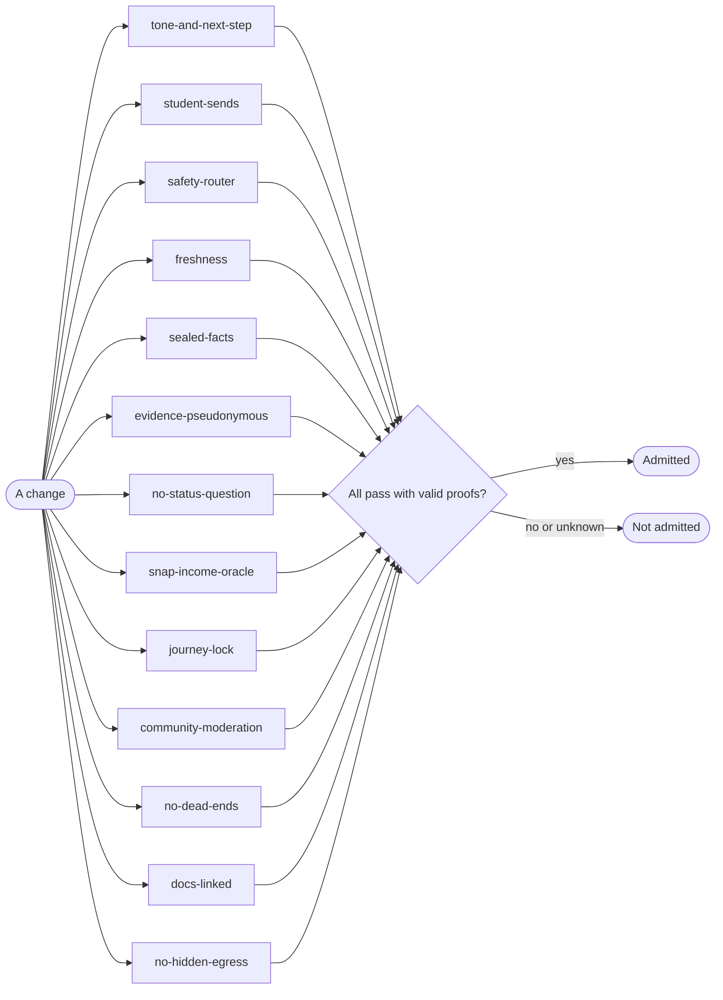

# Gates

<!-- generated by tools/docs.ts from tools/gates.ts; do not edit by hand -->

A gate counts only after it proves it can fail: each one carries planted defects, and its proof is pinned to a
hash of its definition. 13 gates guard the Advocate.

| Gate | Protects | Proven against |
| --- | --- | --- |
| `tone-and-next-step` | No message to a student scolds, reads above their level, or reports a problem without a next step (PRD P3, P4). | planted scolding message; planted message with no next step |
| `student-sends` | Nothing reaches an outside party without a single-use approval token for that exact content (PRD P9). | planted dispatcher that ignores tokens |
| `safety-router` | Crisis messages, including held-out phrasings, route to 988 before any model (PRD SAF-1). | planted router that only knows one phrase |
| `freshness` | A catalog entry past its freshness window is never offered as available (PRD P11). | planted finder that ignores freshness |
| `sealed-facts` | A sealed fact never appears in a message unless the student released it to a playbook that needs it (PRD P10). | planted message quoting the sealed fact |
| `evidence-pseudonymous` | The evidence store holds no student identifiers or content. | planted evidence row with a phone number |
| `no-status-question` | The team never asks about citizenship or immigration status (PRD NAV-7). | planted citizenship question |
| `snap-income-oracle` | SNAP income results match the published FY2027 table at and just over every limit (record-derived oracle, Pattern 17). | planted off-by-one limit |
| `journey-lock` | No change can edit or remove the journey cards it is judged by (Pattern 18). | planted lock missing a card |
| `community-moderation` | Harmful or risky posts never surface in the community (PRD COM-5). | planted community with no filters |
| `no-dead-ends` | Every button any agent offers works, in the app and by text (PRD P3, P8). | planted registry missing a handler; planted handler that answers with no next step |
| `docs-linked` | Every test file names the document it verifies, that document exists, and every document is verified by a test. | planted test file with no doc; planted link to a missing doc |
| `no-hidden-egress` | Only the model client and the egress block may reach the network; domain, agent and server code cannot (PRD P2). | planted fetch in a domain file |

## Verified by

<!-- verified-by:start -->
- [`packages/gates/test/hardening.test.ts`](../../packages/gates/test/hardening.test.ts) (6 test definitions)
<!-- verified-by:end -->
