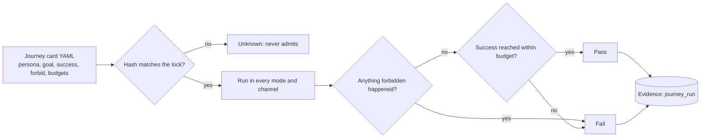

# Intent journeys

Each journey is a card a person wrote in plain words: whose goal, what success looks like, what must never happen,
and the budget of actions and time. Cards are locked by hash; changing one needs a person's sign-off. A journey
passes only if every declared depth (brief, standard, walk me through) and channel (app, text) passes.

## Verified by

<!-- verified-by:start -->
- [`packages/intent/test/intent.test.ts`](../../packages/intent/test/intent.test.ts) (6 test definitions)
<!-- verified-by:end -->
