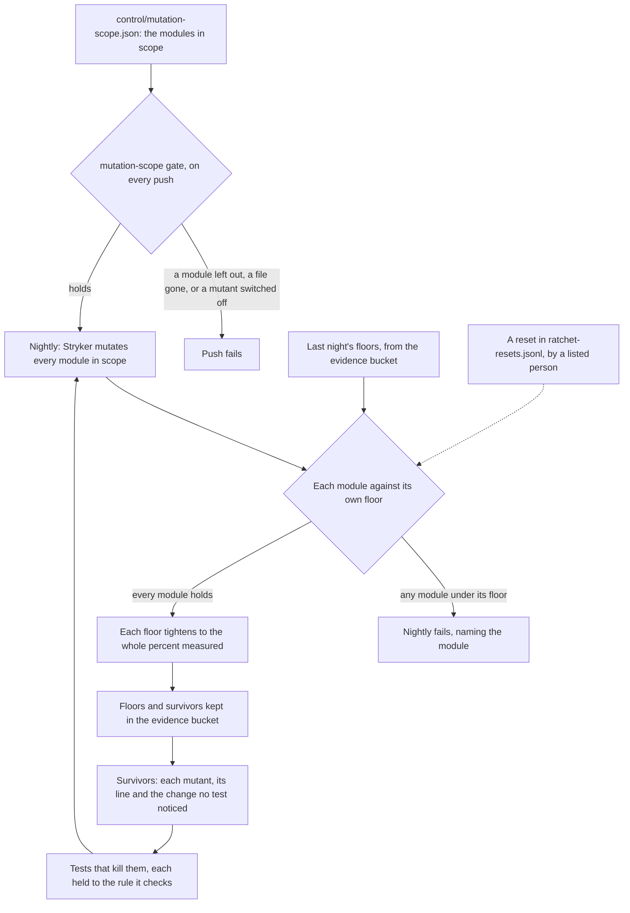
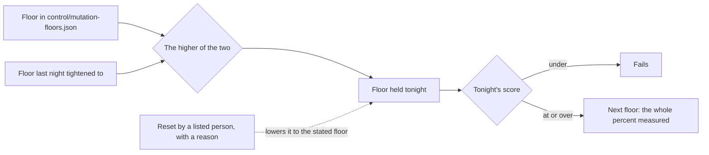
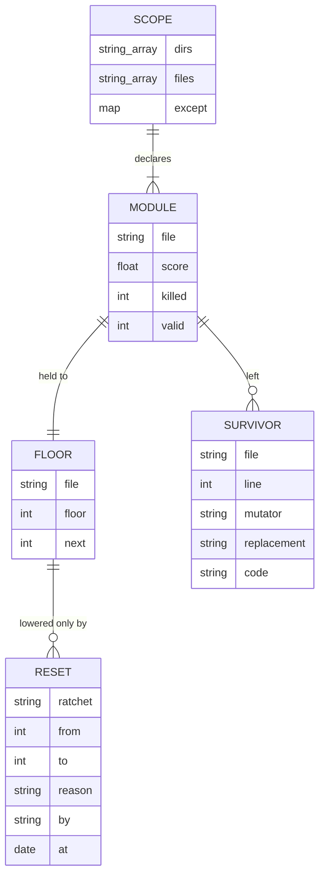

# Mutation testing and ratchets

Tests that pass prove little unless they fail when the code is wrong. Mutation testing makes thousands of small wrong versions of the code that matters most and counts how many the tests catch. A mutant no test notices is a change to behavior that would ship unseen.

In scope is every module that decides something a student or a gate relies on: verdicts, ratchets and gates; approvals, the governor, safety routing and the sealed store; eligibility and the tone rubric; and the guide's admission, barriers, signals, record and feed, with the resource finder. The scope is declared in `control/mutation-scope.json`, by directory, so a new module in one of those directories is in scope from the commit that adds it.

## The loop

Mutation testing is a standing loop, not a score to report. Each night measures every module, holds each to its own floor, and writes what survived as the next work. The next day's tests kill those survivors, and the floors rise with them.



### Floors, module by module

One overall score lets a strong module hide a weak one. Each module therefore has its own floor, and the overall floor in `control/ratchets.json` holds as well.



- **Tightening is automatic.** A module that measures 83.4% sets its next floor at 83%, kept in the evidence bucket, with no commit needed.
- **Loosening takes a person.** Lowering a floor in the repository below last night's floor holds only with a matching entry in `control/ratchet-resets.jsonl`, by a person listed in `control/people.json`, with a reason. Without one, last night's floor stays.
- **A new module starts where it measures.** Debt may stay; it may not grow.



### What counts

| Mutant | Counted as |
|---|---|
| Killed, or timed out | Caught |
| Survived, or covered by no test | Not caught, and listed as the next work |
| Compile or runtime error, ignored | Not counted |

Static data (the barrier list, the support packages, the program tables) is left out of mutation and checked against its sources by the gates named for it. Each exception sits in `control/mutation-scope.json` with its reason.

### Nothing switched off

A `Stryker disable` comment turns mutants off where tests are weak. It would raise a score without catching anything, so the `mutation-scope` gate fails on any such comment in a module in scope. An equivalent mutant, one that changes nothing a caller can see, is fixed by simplifying the code until the mutant can no longer be made.

## Writing tests that kill survivors

A survivor is a missing statement of a rule, so the test that kills it states the rule.

- **Every limit gets a value on each side.** For example, freshness of 365 days is admitted and 366 is held.
- **A planted fault fails its own check and no other**, so a check that passes everything cannot hide behind another check that fails.
- **The text a person reads is asserted.** A held entry's detail and a barrier's history events are both checked word for word.
- **The test never reads the code's own output as the expected value.** Expected values come from the rule, worked by hand.

## Running it

```sh
npx stryker run                                  # every module in scope, against the whole suite (nightly)
npx tsx tools/mutation.ts                        # each module against its floor; writes the next floors and the survivors
npx stryker run stryker.guide.json               # the guide and the finder alone, against their own tests
```

Mutation runs nightly on an 8-CPU Cloud Build machine. The factory console's Mutation page shows each module's score and its survivors.

## Evidence

| Check | What it holds | Where |
|---|---|---|
| Scope (gate) | Every module in scope is mutated; no mutated file is missing; no mutant is switched off; every exception has a reason | `mutation-scope` |
| Floors (tests) | Scores, the floor held, tightening, resets by a listed person only, and survivors with their lines | `tools/test/mutation.test.ts` |
| Floors (nightly) | Every module at or above its own floor | the `mutation` step, a required check |
| Ratchet logic (tests) | Tightening and ledger resets | `packages/gates/test/gates.test.ts` |

## Verified by

<!-- verified-by:start -->
- [`packages/gates/test/gates.test.ts`](../../packages/gates/test/gates.test.ts) (16 test definitions)
- [`tools/test/mutation.test.ts`](../../tools/test/mutation.test.ts) (6 test definitions)
<!-- verified-by:end -->
