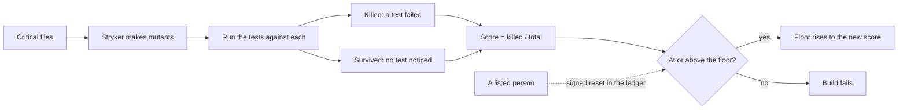

# Mutation testing and ratchets

Tests that pass prove little unless they fail when the code is wrong. Mutation testing makes thousands of small
wrong versions of the code that matters most (verdicts, ratchets, gates, approvals, the governor, eligibility, the
tone rubric) and counts how many the tests catch. The score may only go up: a ratchet holds the floor, and only a
listed person can reset it, in a ledger.

Mutation runs nightly on an 8-CPU Cloud Build machine.

## Verified by

<!-- verified-by:start -->
- [`packages/gates/test/gates.test.ts`](../../packages/gates/test/gates.test.ts) (16 test definitions)
<!-- verified-by:end -->
