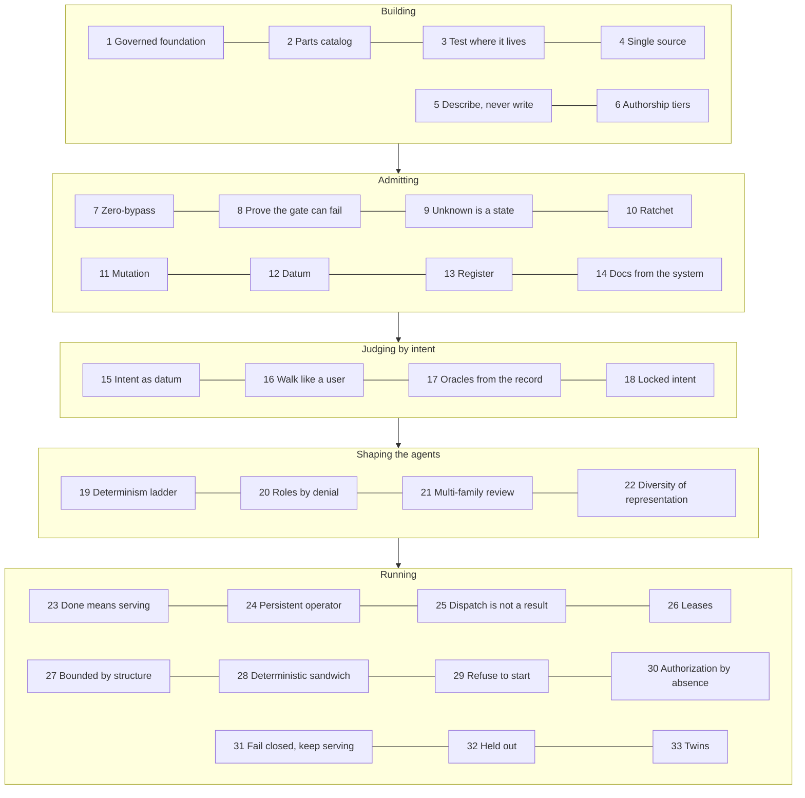

# The 33 patterns, in operation

Every pattern in the ZTHR pattern language is implemented here, and each one points at the files that implement it
and the tests that prove it. The map is `control/patterns.yaml`; the `pattern-coverage` gate fails if a pattern is
missing, a file it names does not exist, or it is not proven by a test.

## Where to see each one

| # | Pattern | In this repository | Proven by |
| --- | --- | --- | --- |
| 1 | Governed foundation | Sign-in, consent ledger, evidence, refuse-to-start, the pipeline | runtime and auth tests |
| 2 | Parts catalog with purpose notes | Each package has a block page with Use it for and Not for | pattern tests |
| 3 | Test the part where it lives | Blocks are exercised inside the Advocate by the walks | schema and browser-walk tests |
| 4 | Single source, generated mirrors | The data model, colleges and gate catalog are declared once; docs are generated and checked | schema and college tests |
| 5 | Describe, never write | The builder drafts proposals; only `certify` or `signoff` writes them | builder and role tests |
| 6 | Authorship tiers by consequence | `control/authorship.yaml`: locked, person, proven, admitted, generated, open | `authorship-tiers` gate |
| 7 | Zero-bypass admission | `control/required-checks.yaml` compared with the live pipeline | `zero-bypass` gate |
| 8 | Prove the gate can fail | Every gate has planted defects; proofs pinned to its definition | gate tests |
| 9 | Unknown is a state | Verdicts, journeys and campus feeds all carry unknown | gate and campus tests |
| 10 | Ratchet | Mutation and journey floors that only tighten | gate tests |
| 11 | Mutation-measured tests | Stryker on the core files, nightly | gate tests |
| 12 | Measure from the datum | Scout precision datum, fixed floors | gate and builder tests |
| 13 | Register, don't suppress | `control/register.yaml` with owners and expiries | `findings-register` gate |
| 14 | Documentation derived from the system | Generated docs, two-way test and doc links | `docs-linked` gate |
| 15 | Intent as the primary datum | Locked journey cards in every mode and channel | intent tests |
| 16 | Walk like a user | Browser walk by accessible name, light and dark | browser-walk tests |
| 17 | Oracles from the record | SNAP limits from the table; open-now from posted hours | `snap-income-oracle` gate |
| 18 | Locked intent | Cards locked by hash; loosening needs a listed person | `journey-lock` gate |
| 19 | The determinism ladder | Letters explained by rules first; open-now computed, not asked | letter and campus tests |
| 20 | Roles defined by what they are denied | `control/roles.yaml`, each denial with its test | role tests |
| 21 | Multi-family review | `control/review.yaml` panel (not configured in this build; registered) | review tests |
| 22 | Diversity of representation | Store, API, export, calendar feed and screen must agree | reconciliation tests |
| 23 | Done means serving | `/healthz` reports the commit; the pipeline checks it after deploy | pattern tests |
| 24 | The persistent operator | Operator jobs on a schedule; holds name the loss | campus tests |
| 25 | A dispatch is not a result | Writes sent with idempotency keys, confirmed by lookup | campus tests |
| 26 | Leases | Heartbeat-backed job leases | campus tests |
| 27 | Bounded by structure | Fixed job list, one network door, delivery gates | role tests |
| 28 | The deterministic sandwich | Letter explainer around the model | letter tests |
| 29 | Refuse to start misconfigured | Production will not start without keys and sign-in | runtime tests |
| 30 | Authorization by absence | No admin listed means no admin mounted | role and API tests |
| 31 | Fail closed, keep serving the user | Unknown feeds answered plainly; crisis routing first | campus and red-team tests |
| 32 | Held out means held out | `control/heldout`, never in a rule | `held-out` gate |
| 33 | Twin what you don't own | Twins with probes; synthetic campus services with contracts | twin and service tests |

## Verified by

<!-- verified-by:start -->
- [`apps/advocate/test/reconcile.test.ts`](../../apps/advocate/test/reconcile.test.ts) (1 test definitions)
- [`apps/advocate/test/roles.test.ts`](../../apps/advocate/test/roles.test.ts) (11 test definitions)
- [`tools/test/patterns.test.ts`](../../tools/test/patterns.test.ts) (10 test definitions)
<!-- verified-by:end -->
