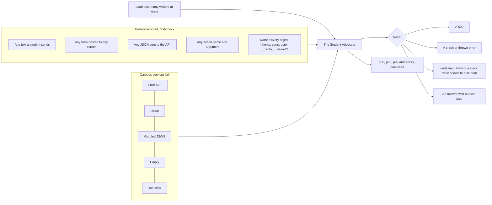

# Robustness: generated inputs, failing services, load and restore

Examples prove what the author thought of. Robustness is about what nobody thought of, so its inputs are
generated, the services fail on purpose, and the load is measured rather than estimated.

## What is tested

| Test | What it proves |
| --- | --- |
| Any text | A student can send anything: empty strings, five thousand characters, scripts, SQL, characters outside the basic plane, control characters. Every answer is plain and offers a next step. |
| Any form | Every screen that accepts a form answers below 500 for any fields with any values. |
| Any JSON | Every write route of the integration API answers below 500 for any body, valid JSON or not. |
| Any action | Any action name, including names every JavaScript object inherits, either runs or is refused. |
| Rules for every input | GPA stays between 0 and 4. Pace stays between 0% and 100%. Earned never exceeds attempted. The withdrawal estimate always balances and only grows with time. A course grade stays between its lowest and highest category. |
| Fault matrix | Each of the five campus services fails five ways while three students use every screen and ask about food, buses, rooms, jobs and mentors. Every screen still answers, and every answer says plainly what it can't see. |
| Restore | A snapshot and restore of the whole app gives every student an identical export and consent ledger. |
| Load | `tools/load.ts` sends many visitors at once, each with its own demo copy, through the screens a student uses, and fails on any 500 or a 95th percentile over budget. |

The run count is set by `FUZZ_RUNS`, 200 on every change and more on the nightly run.

## What it found

The generators found three defects that hand-written tests had not:

- **An action named `valueOf` crashed the app.** User text reached the action registry, the draft templates, the
  contact list and the share scopes as a property name, and names every JavaScript object inherits resolved to
  built-in functions. Every lookup keyed by user input now checks that the key is the registry's own.
- **A class name with emoji-range characters crashed a redirect.** Cutting input to a length could split a
  character in half, and the broken half made building the next address throw. User input is now cut by whole
  characters, and any broken character is repaired.
- **A crafted scope name was accepted on a shared link.** The check that a scope exists used `in`, which also
  matches inherited names. A link could be saved with a scope called `toString`, and the student's list of links
  then printed program text. It showed nothing extra, but the check now uses the object's own keys.
