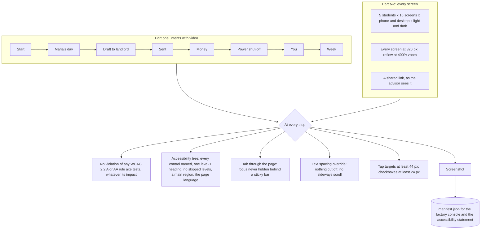

# Walking in a real browser

The browser walk drives the app by accessible names only, the way a person using a screen reader would. It reads
every stop as structure and as pixels (a screenshot). The structure check is WCAG 2.2 at level AA: every A and AA
rule axe can test, plus what axe cannot test, which is what a screen reader is actually given. The intent part
records video.



| WCAG 2.2 success criterion | How the walk checks it |
| --- | --- |
| 1.1.1 Non-text content, 4.1.2 Name, role, value | axe, and every link, button, field, checkbox and image has a name in the accessibility tree |
| 1.3.1 Info and relationships, 2.4.6 Headings and labels | axe, one level-1 heading, no skipped heading levels, every field labelled |
| 1.4.3 Contrast (minimum), 1.4.11 Non-text contrast | axe, in light and dark; checks axe cannot decide (contrast over a gradient) are counted for review |
| 1.4.10 Reflow | Every screen at 320 CSS pixels with no sideways scroll |
| 1.4.12 Text spacing | Line height 1.5, letter spacing .12em, word spacing .16em, paragraph spacing 2em: nothing cut off or scrolling |
| 2.1.1 Keyboard, 2.4.7 Focus visible | Tabbing every control; a visible focus ring on every theme |
| 2.4.11 Focus not obscured (minimum) | At each tab stop, the focused control is checked against what is drawn on top of it |
| 2.5.8 Target size (minimum) | axe, and a stricter 44 px for buttons and tabs |
| 3.1.1 Language of page | The page states its language; Spanish students' pages say Spanish |
| 2.4.1 Bypass blocks | A skip link to the main region on every page |

## Every control, to depth

The walk sees every screen; the deep click-through (`tools/ui/deep.ts`) presses every control. For five students it opens Today, clicks every link and button, then every one on each screen those lead to, down to eight levels. A form that asks for a choice is tried with a different choice; a form that needs an answer gets a valid one, so the submit itself is tested. Controls that leave the app or end the account (calls, texts, sign out, delete everything) are checked separately and never pressed in the crawl.

```mermaid
flowchart LR
  today[Today, per student] --> find[Find every link and button in main and the tab bar]
  find --> click[Click it once, on the screen where it was found]
  click --> check{Loaded, one heading, no artifacts,<br/>no browser errors, something changed,<br/>no 'not available'?}
  check -- yes --> next[Queue the new screen, one level deeper]
  check -- no --> fail[Build fails, naming the path of clicks]
  next --> find
```

A control fails if it answers with an error, lands on a screen without exactly one level-1 heading, shows a programming artifact, logs a browser error, does nothing, or answers "not available". Any failure stops the build.

## Verified by

<!-- verified-by:start -->
- [`tools/test/ui-walk.test.ts`](../../tools/test/ui-walk.test.ts) (5 test definitions)
<!-- verified-by:end -->
