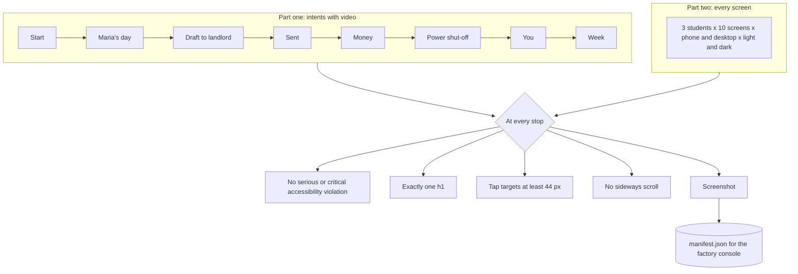

# Walking in a real browser

The browser walk drives the app by accessible names only, the way a person with a screen reader would, and reads
every stop twice: as structure (accessibility rules, headings, tap targets, no sideways scrolling) and as pixels
(screenshots). The intent part records video.

## Verified by

<!-- verified-by:start -->
- [`tools/test/ui-walk.test.ts`](../../tools/test/ui-walk.test.ts) (3 test definitions)
<!-- verified-by:end -->
