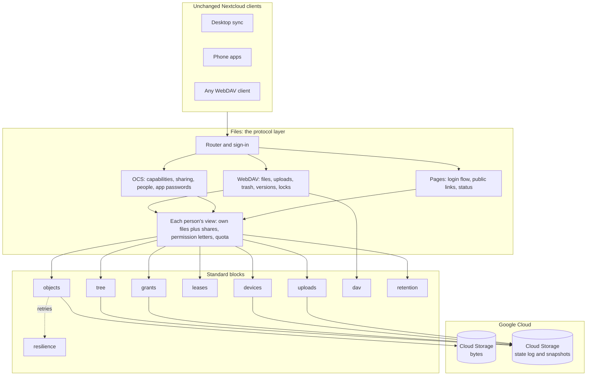
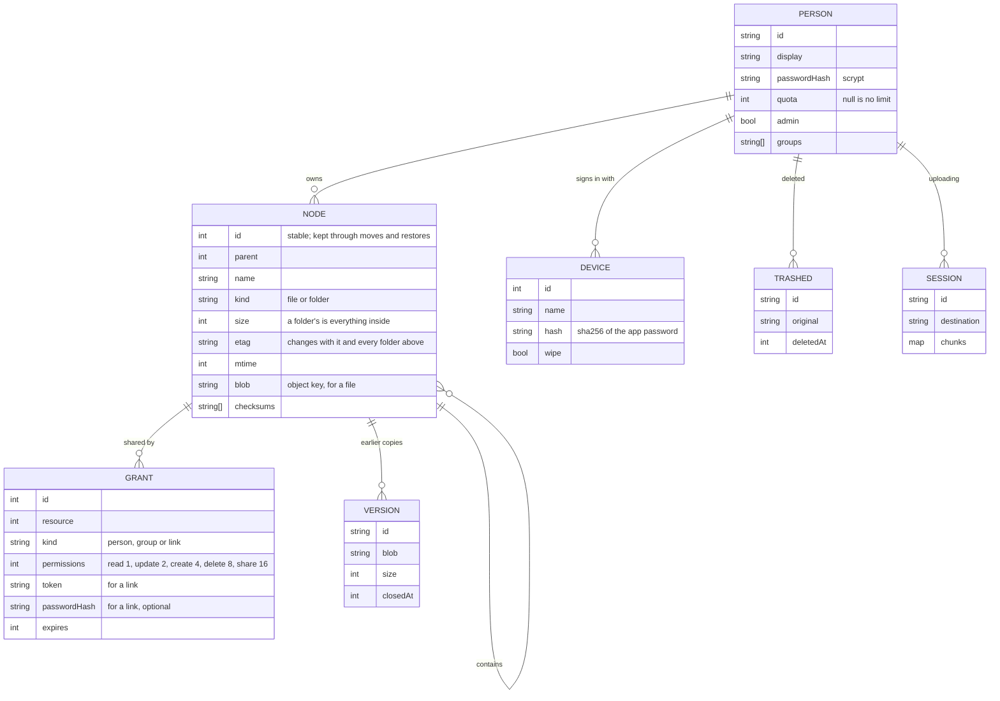
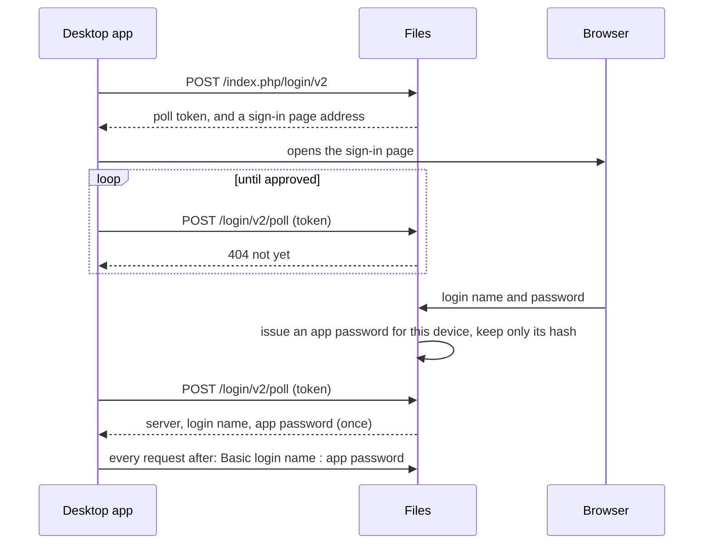
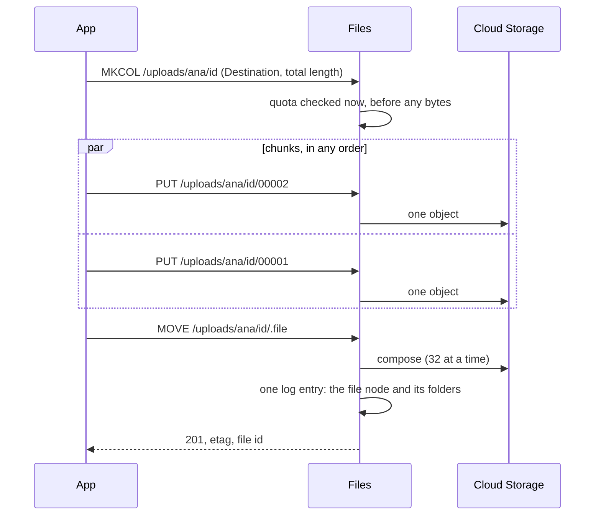

# Files

A file server that the Nextcloud apps you already have connect to and sync with, unchanged. It runs on Cloud Run and Cloud Storage, scales to zero, and costs what its storage costs when nobody is using it.

It is the first product of the ZTHR factory's line: almost all of it is the factory's standard blocks, and what is particular to Files is a thin layer of protocol on top. Clean-room: written from the published client protocols and the observed behaviour of a running server, with no Nextcloud code. Apache 2.0.

## How it fits together



| Block | What it does in Files |
| --- | --- |
| tree | Folders and files with stable ids; a change re-tags every folder above it, so an app skips unchanged folders in one comparison |
| objects | Bytes streamed once with checksums computed on the way; byte ranges; joins done in the bucket |
| uploads | Chunked uploads in any order, resumable, quota checked before the first byte, idle uploads swept |
| leases | WebDAV locks that end on their own |
| grants | Shares with people, groups and links: never more than the giver has; link passwords hashed and throttled; expiry |
| devices | The browser sign-in for a new app, an app password per device, revoke one, wipe one |
| dav | The XML reader (no DTDs, so no external entities) and the multistatus writer |
| retention | Plans what the trash and old versions give up each night |
| resilience | Timeouts and jittered retries on every call to Cloud Storage |
| oracle | Checks Files against a real Nextcloud, request by request |

## What it keeps

Bytes are objects in the bucket, named by random keys, never by file names. Everything else is records in one state, kept as a log.



The state is a write-ahead log: each change appends only the records it touched, a snapshot every 2,000 entries lets the older ones go, and a restart replays the snapshot and what follows it. A request that changes anything is answered only after its entry is written, so nothing a client was told is saved can be lost. A second writer is refused rather than interleaved.

## How an app signs in



## How a large file arrives



## Measured

| Journey | Result | Where |
| --- | --- | --- |
| 25,000 small files, six at a time, as the desktop app sends them | 14.1 s (1,779 a second; p95 7.3 ms) | This machine, disk store, server in process (`node tools/load.ts 25000 disk`) |
| Listing all 100 folders of those files | 0.4 s | Same run |
| Checking that nothing changed | 0.7 ms: one root etag | Same run |
| One small file write, logged | under 2 KB, whatever the tree's size | `test/state.test.ts` |

On Cloud Run each write adds an object upload and a log entry to the bucket; those numbers come from the first deployed run, and the CI job records the in-process run on every change.

## What works, and what does not yet

| Works | Not yet |
| --- | --- |
| Login flow v2, app passwords, revoke, remote wipe | The Nextcloud web interface (it is server-rendered PHP; Files has its own pages only for sign-in and links) |
| Files over WebDAV: list, read, ranges, write, folders, move, copy, delete | Thumbnails and previews (`has-preview` is false) |
| Chunked upload v2, resumable, with quota up front | Bulk upload, and the older chunking v1 |
| If-Match and If-None-Match: no silent overwrite | Downloading a whole folder as a ZIP |
| Versions: every overwrite kept, restore keeps the replaced copy | Calendars and contacts (CalDAV, CardDAV: the dav block is ready for them) |
| Trash: delete, list, restore with the same id, purge, nightly sweep | Push notifications of changes (apps poll instead) |
| Shares with people, groups and links; permissions; passwords; expiry | Federation, end-to-end encryption, group folders, the app store |
| Quotas, admins adding and removing people | Comments and tags beyond favourites |
| WebDAV locks with time limits | |
| Cloud Storage for bytes and state, on Cloud Run | A document database for state at more than one instance |

## Run it

```bash
cd files
FILES_STORE=disk FILES_DIR=./data FILES_ADMIN=admin FILES_ADMIN_PASSWORD='a long password' node src/main.ts
node --test "test/**/*.test.ts"
node tools/load.ts 25000 disk
```

Node 22.18 or later runs it directly: there is no build step and no dependency. Deploying: [deploy/README.md](deploy/README.md).
