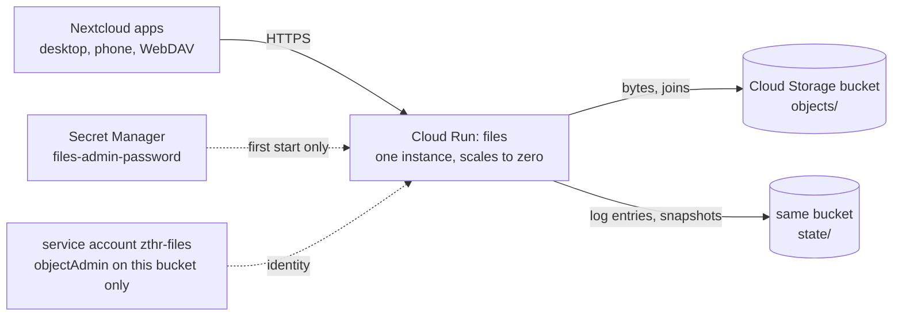

# Deploying Files to Cloud Run

Run in Cloud Shell. It creates a bucket, a service account that can only reach that bucket, a secret holding the first admin's password, and a Cloud Run service that scales to zero. Nothing else in the project is touched.



## 1. Settings

```bash
PROJECT=$(gcloud config get-value project)
REGION=us-central1
BUCKET="${PROJECT}-files"
SA="zthr-files@${PROJECT}.iam.gserviceaccount.com"
```

## 2. One-time setup

```bash
gcloud services enable run.googleapis.com artifactregistry.googleapis.com cloudbuild.googleapis.com secretmanager.googleapis.com storage.googleapis.com

gcloud artifacts repositories describe zthr --location="$REGION" >/dev/null 2>&1 \
  || gcloud artifacts repositories create zthr --repository-format=docker --location="$REGION"

gcloud storage buckets create "gs://${BUCKET}" --location="$REGION" \
  --uniform-bucket-level-access --public-access-prevention

gcloud iam service-accounts create zthr-files --display-name="ZTHR Files"
gcloud storage buckets add-iam-policy-binding "gs://${BUCKET}" \
  --member="serviceAccount:${SA}" --role=roles/storage.objectAdmin

# The first admin's password: at least 10 characters. Read from the terminal, never written to history.
read -rs -p "First admin password: " PW; echo
printf '%s' "$PW" | gcloud secrets create files-admin-password --data-file=-
unset PW
gcloud secrets add-iam-policy-binding files-admin-password \
  --member="serviceAccount:${SA}" --role=roles/secretmanager.secretAccessor
```

## 3. Build and deploy

From a checkout of the repository (the branch with `files/`):

```bash
gcloud builds submit --config files/deploy/build.yaml .

gcloud run deploy files \
  --image "us-central1-docker.pkg.dev/${PROJECT}/zthr/files:latest" \
  --region "$REGION" \
  --service-account "$SA" \
  --allow-unauthenticated \
  --min-instances 0 --max-instances 1 \
  --concurrency 80 --timeout 3600 \
  --memory 1Gi --cpu 1 \
  --set-env-vars "FILES_STORE=gcs,FILES_BUCKET=${BUCKET},FILES_ADMIN=admin,FILES_MAX_CHUNK=30 MB,FILES_PROXY_HOPS=1" \
  --set-secrets "FILES_ADMIN_PASSWORD=files-admin-password:latest"

URL=$(gcloud run services describe files --region "$REGION" --format='value(status.url)')
gcloud run services update files --region "$REGION" --update-env-vars "FILES_ORIGIN=${URL}"
echo "$URL"
```

`--allow-unauthenticated` lets the apps reach the server; every file request still needs a login. `--max-instances 1` is required: the state log has one writer and refuses a second. `FILES_MAX_CHUNK=30 MB` keeps every upload chunk under Cloud Run's 32 MiB request limit. `FILES_PROXY_HOPS=1` says Cloud Run's front end is the one proxy whose X-Forwarded-For entry is trusted, so wrong passwords are counted against the real address and not one the client made up; put a load balancer in front as well and it becomes 2.

## 4. Check it

```bash
curl -s "$URL/status.php"
curl -s -u admin "$URL/ocs/v2.php/cloud/user?format=json" -H 'OCS-APIRequest: true'
```

Then in the Nextcloud desktop app: **Add account**, server address `$URL`. The browser opens to sign in, and the app gets its own app password.

## 5. The oracle against a real Nextcloud (optional)

Record what a real Nextcloud answers once, and every build compares Files against the recording. The empty skeleton must be set before the account first signs in, so its home starts empty:

```bash
docker run -d --name nc -p 8081:80 -e SQLITE_DATABASE=nc -e NEXTCLOUD_ADMIN_USER=oracle -e NEXTCLOUD_ADMIN_PASSWORD=oracle-password nextcloud:32
sleep 60
docker exec -u www-data nc php occ config:system:set skeletondirectory --value=''
docker exec -u www-data nc php occ config:system:set trusted_domains 1 --value=localhost
cd files
node tools/oracle.ts record http://localhost:8081 oracle oracle-password > oracle/nextcloud.json
node tools/oracle.ts compare "$URL" admin "<an app password>" oracle/nextcloud.json
```

## Cost

At rest it is the bucket's storage and nothing else: the service scales to zero. Each request is billed for the time it runs. Each small file written is one object upload and one log entry of a few hundred bytes.
