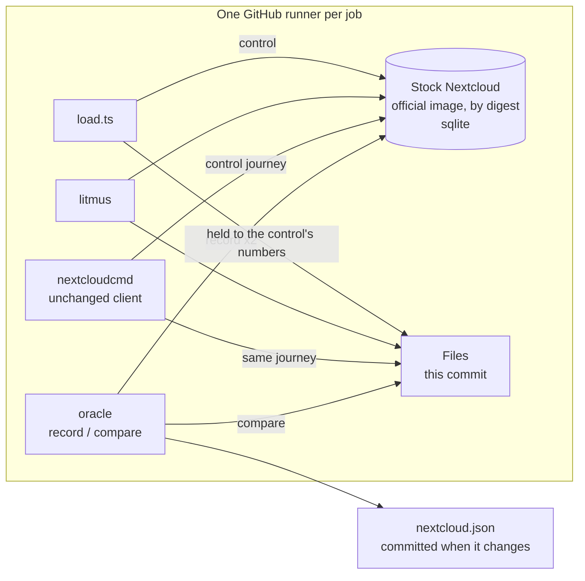
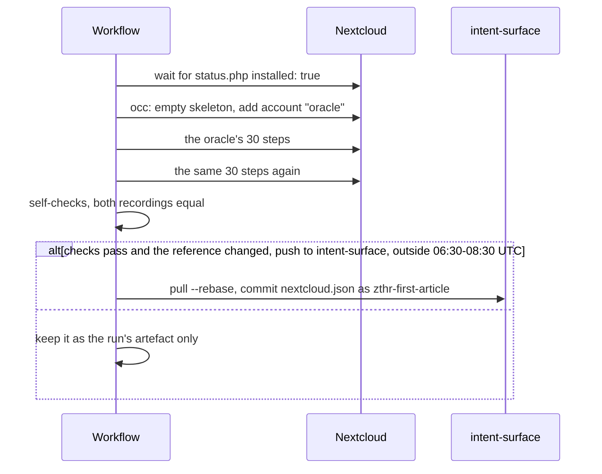
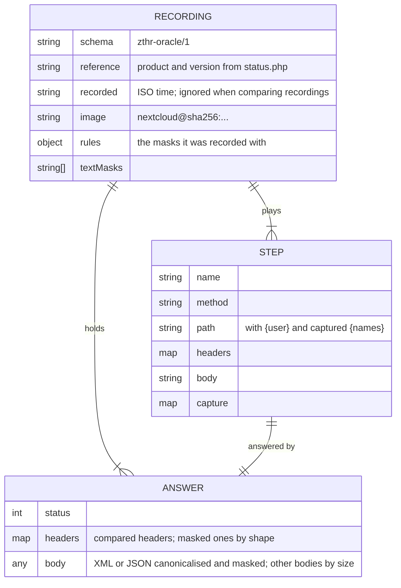

# First-article inspection

A manufacturing first-article inspection measures the first part off a new line against the drawing before the line runs. This one measures Files against the thing it claims to replace: a stock Nextcloud, started fresh on the same GitHub runner, from the official image pinned by digest. The workflow is [`.github/workflows/first-article.yml`](../../.github/workflows/first-article.yml); it runs on every change to Files or the blocks under it, and every step writes what it found to the job summary.

## What it proves

| Claim | How it is checked | Fails when |
| --- | --- | --- |
| Files answers the protocol as Nextcloud does | The oracle's scripted requests ([steps.ts](steps.ts)) are recorded against a real Nextcloud into [nextcloud.json](nextcloud.json), then played against Files from the same commit | Any answer differs once the masks below are applied |
| The recording is a fair reference | The recording is made twice in a row and checked: installed, no server errors, sign-in accepted, account empty, captured values reused, every body parsed, both recordings identical | Any self-check fails; the recording is then neither used nor committed |
| Unchanged Nextcloud apps connect and sync | The real desktop client, `nextcloudcmd` from Ubuntu's `nextcloud-desktop-cmd`, runs one journey against Nextcloud (the control) and the same journey against Files | A step fails on Files and passes on Nextcloud |
| WebDAV is standard, not merely Nextcloud-shaped | The `litmus` suite against both servers | A test passes on Nextcloud and fails on Files |
| The small-files sync is fast | [load.ts](../tools/load.ts) writes 25,000 small files six at a time against both servers on the same runner | Files takes longer, or has a worse p95, than the control on that runner (the factor is an input, 1.0 by default), or any write fails, or the time limit is reached |



A failure on both servers is reported as the reference's own behaviour, not blamed on Files. A step that passes on Files and fails on Nextcloud is shown and does not fail the build.

## The recording



A recording is the same reference as the committed one when everything but its time of recording matches, so an unchanged Nextcloud never produces a commit. The image is named in [nextcloud-image.txt](nextcloud-image.txt). Pinned by tag only, it is resolved on the next push and the digest is committed beside the recording; from then on the digest is the pin, and moving to a new Nextcloud is a one-line change that brings a new recording with it.



## Masks

A masked value is compared by its shape (digits, date, text, empty) rather than its value: an etag must still be there and must not be empty. Everything not listed is compared exactly, including status codes, the `DAV` header, content types, permissions, sizes, share types and error bodies.

| Mask | Where | Why it rightly varies |
| --- | --- | --- |
| `getetag`, `etag`, `oc-etag` | Properties and headers | Each server makes its own change tags |
| `fileid`, `oc:id`, `oc-fileid`; JSON `id`, `file_source`, `item_source`, `file_parent`, `parent`, `storage`, `storage_id` | Properties, headers, share JSON | Database ids, counted per installation |
| `getlastmodified`, `creationdate`, `creation_time`, `upload_time`, `last-modified`, `date`; JSON `stime`, `expiration`, `lastLogin`, `firstLoginTimestamp`, `lastLoginTimestamp`; `trashbin-deletion-time` | Properties, headers, JSON | Clock time of the run |
| `x-request-id` | Header | One per request |
| JSON `token`, `url`; `lock-token`, `lock-time`, `data-fingerprint` | Share and lock answers | Random or derived from the server's address |
| `quota-available-bytes`; JSON `free`, `total`, `relative` | Quota | The runner's free disk, not the protocol |
| JSON `storageLocation` | Who am I | A path on the server's own disk |
| JSON `name`, `productName`, `slogan`, `color`, `color-element`, `color-element-bright`, `color-element-dark` | Capabilities, theming | The product's own name, tagline and brand colours: a server identity |
| JSON `version`, `versionstring`, `edition`, `productname`, `extendedSupport`, `installed`, `maintenance`, `needsDbUpgrade`; `uid_owner`, `displayname_owner`, `uid_file_owner`, `displayname_file_owner`, `mail_send` | Status and shares | Product identity and the people's display names, which the oracle does not test |
| `checksums` | Properties | Present on both; algorithms differ by configuration |
| Text `{base}` | Every body | The server's own address: the two servers listen on different ports |
| Text `.d{time}` | Trash item names and hrefs | Nextcloud names a trash item `name.d<unix seconds of deletion>` |

The last two are applied to the body text before it is parsed ([masks.ts](masks.ts)); the rest are the oracle block's rules plus the additions in the same file. The recording stores the rules it was made with, so a comparison uses exactly those. When the second recording differs from the first, the self-check lists each varying value by step and place: that list is the evidence for a new mask, and nothing is masked without it.

## The sync journey

Each step is pass or fail with its time, on both servers ([sync-journey.ts](../tools/sync-journey.ts)). The client reaches the server through a small recording proxy, so the journey can show what went over the wire.

| Step | Passes when |
| --- | --- |
| Initial sync of the small-files tree (25,000 files, seeded, from [tree.ts](../tools/tree.ts), the same tree the benchmark writes) | The account started empty, the client exits 0, and every file is on the server at its size |
| Resync with nothing changed | No file contents move |
| An edit on each side | The local edit reaches the server and the server's edit reaches the computer |
| The same file edited on both sides | The file holds the server's text and one conflict copy beside it holds the local text |
| An interrupted sync resumed | The client is cut off by the proxy partway through 2,000 new files, and the next run completes them all |
| A large file | 48 MiB goes up as a chunked upload (session opened, more than one chunk, assembled), matches on the server, and the server's copy comes back intact |
| Renames and deletes each way | A local folder rename goes up as a MOVE with no re-upload, a local delete reaches the server, and a server-side move and delete reach the computer |

## Rerunning it

On GitHub: run the **First article** workflow from the Actions tab (inputs: files in the tree, and the factor for the benchmark limits), or push a change under `files/`.

Anywhere with Docker and Node 22.18 or later:

```bash
docker run -d --name nc -p 8081:80 -e SQLITE_DATABASE=nextcloud -e NEXTCLOUD_ADMIN_USER=admin \
  -e NEXTCLOUD_ADMIN_PASSWORD='a long admin password' -e NEXTCLOUD_TRUSTED_DOMAINS='localhost 127.0.0.1' \
  "$(grep -v '^#' files/oracle/nextcloud-image.txt | head -1)"
bash files/oracle/nextcloud-prepare.sh nc http://localhost:8081 oracle 'a long oracle password'
node files/tools/first-article.ts record http://localhost:8081 oracle 'a long oracle password' --out /tmp/nextcloud.json

(cd files && PORT=8080 FILES_STORE=memory FILES_ADMIN=oracle FILES_ADMIN_PASSWORD='a long oracle password' node src/main.ts &)
node files/tools/first-article.ts compare http://localhost:8080 oracle 'a long oracle password' /tmp/nextcloud.json
```

The other checks run the same way, with their options listed at the top of each script: `node files/tools/sync-journey.ts --url <server> --user <u> --password <p> --label <name> --out <result.json>` drives an installed `nextcloudcmd`, and `node files/tools/load.ts 25000 --url <server> --user <u> --password <p> --max-seconds <s> --max-p95-ms <ms>` holds any server to limits. The inspection's own logic is tested without any server: `node --test files/oracle/*.test.ts`, which includes the whole record, self-check and compare cycle run Files against Files.
