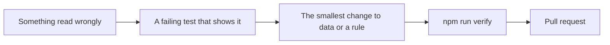

# Contributing to ZTHR Intent

Thank you. The most useful contributions are the ones that make a schematic say more exactly what someone meant:
a feel word the lexicon misreads, a role your field has, a part every app needs, a rule that called for the wrong
part, or a journey that should have been suggested and was not.

1. **Start from a failing test.** Every defect closes a class: write the test that shows it, in `test/`, before the
   fix. Planted cases (a broken input the code must refuse) are as welcome as happy ones.
2. **Prefer data to code.** Most changes belong in `lexicon/`, `catalog/` or one of the rule tables; see
   [docs/extending.md](docs/extending.md).
3. **Keep it deterministic.** The same words, answers and journeys must give the same bytes. Nothing new may call a
   model; a model only ever reads, and a single reading is never taken as fact.
4. **Run `npm run verify`.** Types, tests, a secret scan and a build of all three surfaces.
5. **Write for someone with no backstory.** Plain words in the interface, and in the docs; no jargon a person would
   have to look up, unless the glossary defines it.

Licensed under Apache 2.0; by contributing you agree your contribution is licensed the same way.
