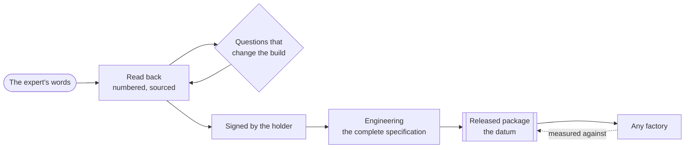
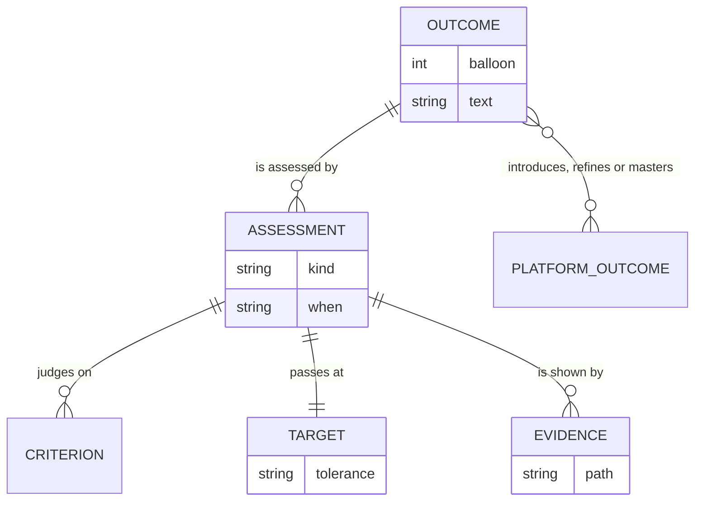
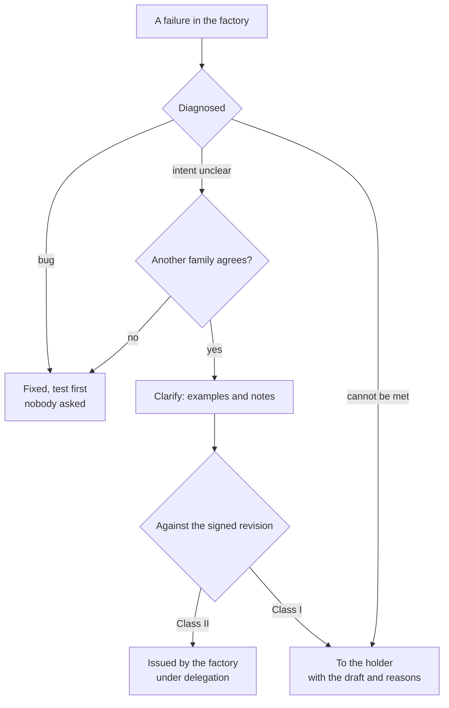
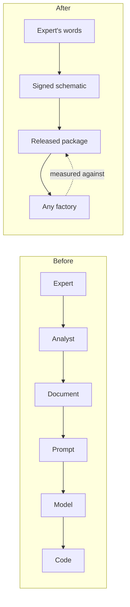

# Intent as the Datum: A Pattern Language for Capturing What Software Must Do

**How a person who knows the work states what software must do, in their own words, and releases it as a signed, measurable specification any factory can build to**

Russ Little · Pattern paper · Draft for review · Nov 26, 2026

v0.1 · Request for comments · © 2026 Russ Little. Licensed under CC BY 4.0. A companion to *ZTHR: A Pattern Language for Autonomous Software Delivery* ([10.5281/zenodo.23826734](https://doi.org/10.5281/zenodo.23826734)).

## Abstract

When software is built by AI, the specification becomes the most valuable thing in the process. Code can be regenerated; what it must do cannot. Yet most specifications lose fidelity at every hand-off: from the person who knows the work, to an analyst, to a document, to a prompt, to a model, to code. Each step paraphrases the one before it. By the end, nobody can say which sentence of the original a line of code serves, or whether the software still does what the person meant.

This paper treats intent as the **datum**: the fixed reference every build is measured against. It rests on two principles.

- **The expert closest to the code.** The person who knows the work states it, in their own words, and signs it. Nothing an analyst, a model or an engineer adds counts as theirs until they confirm it.
- **Measured, not described.** Every statement of intent is numbered, traced to its source, held to a tolerance a machine can check, and joined to the gauge that will measure it. A statement nothing measures is a gap, and it is shown as one.

It then sets out the recurring solutions that implement them as a pattern language: twenty-six patterns in six families, from capturing rough words to handing a signed package to a factory. Each pattern names a problem, the forces acting on it, the solution and its consequences. The paper closes with one intent followed through the whole, what changes for people, how to adopt the approach in stages, how to evaluate it, and what it does not claim.

> **Central proposition.** What software must do is stated once, by the person who knows the work, in their words; read back to them as a numbered, toleranced schematic; settled by the fewest questions that change what gets built; signed as what they mean; and released under change control as the package every build is measured against. Everything else, including the code, is rebuilt to it.

## 1. The problem: fidelity is lost at every hand-off

Generative models have made code cheap. They have not made it right, and the reason is rarely the code. It is that nobody wrote down, in a form a machine can hold a build to, what right means.

### 1.1 Three failure modes

- **Paraphrase drift.** Each hand-off restates the one before it. "Staff should see who is struggling" becomes "an advisor dashboard," then "a risk score," then a table with a column nobody asked for. Every step is reasonable. The result does not do what was meant, and no step can be blamed.
- **The vibe specification.** A prompt or a page of bullets is fast to write and reads as complete. It has no tolerances, no owner for each sentence, no way to tell a requirement from an aside, and no way to know when the software meets it. A model fills every gap with its own plausible guess, differently each time.
- **Specification by code.** When the specification is too loose to judge against, the code becomes the specification. The next change is measured against what the last build happened to do, so bugs become requirements and drift compounds.

### 1.2 Why better models do not close the gap

A better model makes better guesses. It does not know what the person meant where the person did not say it, and it cannot tell the difference between a guess and a fact unless something records which is which. The gap is in the specification, not the author.

### 1.3 What this proposes instead

Treat the specification as an engineering drawing under document control. The person who knows the work states intent in their own words. A deterministic engine reads it back as a numbered schematic, says where every statement came from, and asks only the questions whose answers change what gets built. The person signs it. Engineering completes it into a specification: outcomes and how each is assessed, the information it keeps, the compliance it lives under, how it runs, every measure and test. The result is released as a plain, hashed package. Any factory can build to it, and every build is measured against it.



## 2. Principle one: the expert closest to the code

The person who knows the work is the only authority on what it is for. Every pattern here exists to keep their words intact on the way to code, and to keep anyone else's words from passing as theirs.

### 2.1 Four rules

- **Their words are kept.** Every statement records the words it came from, verbatim, beside any restatement.
- **Supply is recorded.** Every statement says who supplied it: the person, two model readings that agreed, the design lexicon, a derived rule, a part's defaults, or the factory. Only the person's own words, or their explicit confirmation, are *confirmed*.
- **Questions are theirs to answer.** A model, an analyst or an engineer may draft an answer. It counts only when the person confirms it.
- **The signature is theirs.** The schematic is released only with the holder's signature, bound to the exact content they signed. Change one word and it needs signing again.

### 2.2 What it rules out

- A model's reading becoming a requirement because nobody contradicted it.
- An analyst's rewording replacing the expert's words.
- A specification that cannot say, for any line, who asked for it.
- A factory quietly redefining what it is judged by.

## 3. Principle two: measured, not described

A specification is complete when every statement is either measured or deliberately left unmeasured, and nothing is merely described.

### 3.1 From prose to datum

A drawing is not a description of a part. It is a set of dimensions, each with a tolerance, each referenced to a datum, each checked by a named gauge. The same discipline applies to intent. An outcome is not done until it says how it is assessed, the criteria, the passing target and the evidence. A measure is not done until it has a tolerance a machine can read. A constraint marked critical is not done until a control holds it.

### 3.2 Gaps are shown, never filled

The engine never fills a gap with a plausible guess. It shows the gap: an open balloon, an unread tolerance, a measure nothing checks, a record no sentence describes. A gap is a question for the person, or an explicit, labelled assumption, never silence.

### 3.3 Tolerance stack-up

Statements that each look complete can combine into software that fails its users, the way parts that each meet their drawing can fail to assemble. Intent therefore carries whole-activity gauges (journeys) alongside its statement-level measures, generated from the intent itself.

## 4. How to read the patterns

Each pattern is stated in four parts: **Problem**, **Forces**, **Pattern** and **Consequences**. They are written independent of any model provider, language or factory. The families follow the order work moves through them.

| Family | What it settles | Patterns |
| --- | --- | --- |
| Capture | Getting the expert's meaning in, rough as it comes | 1–5 |
| The schematic | A representation a person can sign and a machine can measure | 6–11 |
| Outcomes and information | What counts as done, and what the system keeps | 12–15 |
| Authority and change | Who may change what, and how a change travels | 16–19 |
| Composition | Starting from what exists, designing only the delta | 20–23 |
| Hand-off | A package any factory can build to, and be measured by | 24–26 |

```mermaid
flowchart TB
  subgraph Capture
    P1[1 Rough Is Fine] --> P2[2 Two Readers, Compared] --> P4[4 Ask Only What Changes the Build]
    P3[3 Deterministic Before Model] --> P2
    P5[5 The Lexicon of Feel] --> P4
  end
  subgraph Schematic
    P6[6 Balloon Every Statement] --> P7[7 Say Who Supplied It] --> P8[8 A Tolerance on Every Measure] --> P9[9 Mark the Special Characteristics]
    P10[10 Title and Revision Blocks]
    P11[11 Notes Are Not Requirements]
  end
  subgraph Outcomes and information
    P12[12 Outcomes Before Build] --- P13[13 Information Is the Asset] --- P14[14 Compliance Inside the Intent] --- P15[15 Defined Always, Enabled by Choice]
  end
  subgraph Authority
    P16[16 The Holder Signs] --> P17[17 Release Under Change Control] --> P18[18 Class II by Delegation, Class I by Signature]
    P19[19 Assumptions Are Marked]
  end
  subgraph Composition
    P20[20 Lines Carry Defaults] --> P21[21 Start From the Catalog] --> P22[22 One Part Number, Many Uses] --> P23[23 Journeys From the Intent]
  end
  subgraph Hand-off
    P24[24 The Package Is the Interface] --> P25[25 The Package Carries Its Brief] --> P26[26 Read Back Before Release]
  end
  Capture --> Schematic --> Outcomes and information --> Authority --> Hand-off
  Composition --> Outcomes and information
```

## 5. Capture patterns

### Pattern 1. Rough Is Fine

**Problem.** A process that demands a structured specification before it starts loses the people who know the work best. They write the way they talk, or paste what they already have.

**Forces.** Structure is what makes intent measurable. Demanding it up front makes capture slow and turns the expert into a form-filler.

**Pattern.** Accept intent in whatever form it arrives: a few rough lines, a pasted page, a spoken description, an existing specification in any of the common formats (Gherkin, Spec Kit, Kiro, OpenSpec, plain markdown, an HTML page). One intake reads every form into the same canonical structure, deterministically, keeping each sentence's origin (file and line). Structure is imposed by the engine and the questions, never demanded of the person.

**Consequences.** The expert starts in seconds. Existing documents become inputs instead of rework. The cost is an intake that must be maintained for each form, with tests per form.

### Pattern 2. Two Readers, Compared

**Problem.** A single model's reading of rough intent is confident, plausible and partly invented, and there is no way to tell which part.

**Forces.** Models are good at reading generously. That generosity is exactly what fills gaps with guesses.

**Pattern.** Two model families read the same words, independently, into the same fixed reading schema: the problem, the why, the outcomes, the people on each side, the measures with tolerances, the constraints, the non-goals. Neither sees the other's reading. Where they agree, the statement is recorded as agreed by those two families. Where they differ, the difference becomes a question for the person. A single family's reading is never fact; it is shown as proposals to confirm.

**Consequences.** Disagreement between readers is the cheapest available detector of ambiguity in the person's words. The cost is two readings instead of one; with cheap models it is negligible, and the readings are reused across every revision until the words change.

### Pattern 3. Deterministic Before Model

**Problem.** Sending everything to a model makes capture slow, costly, and different every time.

**Forces.** Much of what a model would do (finding requirements, spotting a missing pairing, mapping a familiar design word to a measure) is rule work.

**Pattern.** Everything that can be worked out by rule is worked out by rule, in the same order every time: intake, gap checks for decision tables, state machines and required pairings, the design lexicon, derived rules, tolerances, journeys, the build manifest and the package. Models only read. The same words always give the same schematic and the same package bytes.

**Consequences.** Capture is reproducible, fast and inspectable, and the person can see why every statement is there. The rule tables become an asset that grows: each confirmed correction can become a rule.

### Pattern 4. Ask Only What Changes the Build

**Problem.** A long questionnaire exhausts the expert, and most of its questions do not change what gets built.

**Forces.** Every open question is a place a builder would guess. Asking all of them is as bad as asking none.

**Pattern.** Every question is raised by a rule or a reading difference, says in the person's terms what a wrong answer would break, and carries a consequence rank. Only the few that matter most are asked at a time; the rest wait. Each offers the likely answers as choices, always with "Other" in the person's words, and branches only where a choice opens a follow-up. An answer the person is unsure of is released on the recommended choice and listed so they can come back.

**Consequences.** Questions are few, specific and answerable in seconds. The cost is ranking logic that must be tested, so that a high-consequence question is never buried.

### Pattern 5. The Lexicon of Feel

**Problem.** People say what software should feel like ("calm, not scary," "snappy on a phone," "at a glance"), and those words are lost because nobody can measure them.

**Forces.** Feel is real intent. Left as prose, a model interprets it differently every build.

**Pattern.** A versioned design lexicon maps human design words to design choices and measures: snappy means feedback within a stated time on a named device class; calm means one primary action per screen and a quiet palette; at a glance means the answer is visible without scrolling. The lexicon is applied by rule, each mapping shown as an assumption the person can confirm or reject, and grown from every confirmed correction.

**Consequences.** Feel becomes measurable without asking the person to speak in measures. The lexicon's version is recorded with every reading, as an instrument is recorded with a measurement.

## 6. Schematic patterns

### Pattern 6. Balloon Every Statement

**Problem.** A requirement that cannot be named cannot be traced. "The third bullet" moves when someone adds a bullet.

**Forces.** Numbering by position is easy and unstable.

**Pattern.** Every statement on the schematic gets a balloon number, as a feature on a drawing does. The number is keyed to the statement's meaning, not its position, so it survives rewording of case and punctuation and is kept across every revision. Code, tests, gauges, evidence and change notices all refer to balloons.

**Consequences.** Anything built can say which balloon it serves; anything measured can say which balloon it measures; a balloon nothing serves is a visible gap.

### Pattern 7. Say Who Supplied It

**Problem.** A specification that mixes the expert's words, a model's reading and a default without marking them cannot be trusted line by line.

**Forces.** Marking provenance adds noise to a document people need to read quickly.

**Pattern.** Every statement records its state (confirmed, open, assumed, default) and its supplier (the person, two agreeing families, the lexicon, a derived rule, a part, the factory). The read-back shows them distinctly but quietly. Only the person's words or their confirmation make a statement confirmed.

**Consequences.** The person signs knowing exactly which lines are theirs. A reviewer can find every assumption in one pass.

### Pattern 8. A Tolerance on Every Measure

**Problem.** "Fast," "most of the time" and "rarely" cannot fail a build.

**Forces.** People rarely state numbers unprompted, and invented numbers are worse than none.

**Pattern.** Every measure carries a tolerance in a form a machine can read: a time ("within 1 second"), a rate ("nine in ten"), a count ("none in a semester"), a relative change ("fewer than last term"), or "exactly as stated." A tolerance that cannot be read is raised as a question with examples, never guessed. Each readable tolerance becomes a working range and, where it bounds something that can only improve, a starting ratchet.

**Consequences.** Every measure can fail a build. The person sets how close is close enough, in their terms.

### Pattern 9. Mark the Special Characteristics

**Problem.** Treating every statement as equally important hides the few whose failure would harm someone.

**Forces.** Marking everything critical is the same as marking nothing.

**Pattern.** As engineering marks special characteristics, statements whose failure would cause harm or loss are marked critical or significant, by the person or by a rule they confirm. Every mark must reach a control in the control plan. A mark with no control fails the release.

**Consequences.** The handful of things that must never fail are visible, and provably held. The cost is a control plan maintained beside the schematic.

### Pattern 10. Title and Revision Blocks

**Problem.** A specification without a revision history cannot say what changed, why, or which version a build was made to.

**Forces.** Version control of files records edits, not meaning.

**Pattern.** The schematic carries a title block (title, end in mind, holder, status, balloons, open redlines, signature, last package) and a revision block (each revision, its reason, its status). Every revision after the first must say why it was made. A change notice lists each balloon added, changed or removed, and what the information it keeps gained or lost.

**Consequences.** Any build can name the exact revision it was made to, and any person can read why it changed.

### Pattern 11. Notes Are Not Requirements

**Problem.** How something is to be built today ("use the database we have until the move") gets confused with what it must do, and becomes permanent.

**Forces.** Practical constraints are real and must be passed on.

**Pattern.** The schematic keeps engineering notes and variants apart from requirements. A note says how, for now, and whether it is the ideal or the practical choice and why; it never changes what the software must do. A variant names where it applies (a campus without SMS consent, a Spanish-first deployment).

**Consequences.** Today's compromise can be revisited without reopening the intent, and variants are built and measured where they apply.

## 7. Outcome and information patterns

### Pattern 12. Outcomes Before Build

**Problem.** Software is judged after it is built against criteria invented after it is built.

**Forces.** Defining assessment up front feels like extra work before anything exists.

**Pattern.** As common outcomes are set for a course before any section is taught, every outcome is set before anything is built: what each person it serves will be able to do, how it is assessed (a journey walked before release, a measure in use), the performance criteria, the target that counts as passing, and the evidence anyone can review. Platform-wide outcomes are mapped to each product as introduced, refined or mastered. Builders may build any way they like; people are measured the same, pre-defined way.

**Consequences.** Success is agreed before the first line of code, so it cannot be redefined by what was built. An outcome missing any of its parts is a gap that blocks release.



### Pattern 13. Information Is the Asset

**Problem.** The interface gets the attention, and the data model is whatever the first build happened to create. Yet the information a system keeps outlives every screen built on it.

**Forces.** Data models are technical, and the expert rarely speaks in tables.

**Pattern.** The information the system keeps is part of the intent and is signed with it. It is built from three sources: patterns common to business applications (people, organisations, obligations, events, tickets), the expert's own sentences about what is kept, and any schema the team already has (for example, in Prisma). Provided structure wins over inference, and every difference is listed with its reason. Every field carries a sensitivity class. A revision's change to the information is a migration that never drops a record, rehearsed before anything ships.

**Consequences.** The one part of the system that cannot be rebuilt is the part most carefully specified. Interfaces can be replaced freely; the information stays whole.

### Pattern 14. Compliance Inside the Intent

**Problem.** Compliance arrives after the build, as an audit, and finds what should have been designed in.

**Forces.** Frameworks are long, and most of their controls are about the organisation, not the software.

**Pattern.** Which frameworks apply is decided on the schematic, partly by the person and partly suggested by the information (health data suggests one framework, education records another). Each control is mapped to the evidence that proves it and to who proves it: the factory on every release, a configuration, a shared platform, or the organisation. The sensitive-data inventory, a gate policy for every read, export and query, and a machine-readable component definition travel in the package. A field that may never be stored is refused at capture.

**Consequences.** An audit reads evidence produced on every release. The controls the software can prove, it proves; the rest are named as the organisation's.

### Pattern 15. Defined Always, Enabled by Choice

**Problem.** APIs, events, agent tools, training and documentation are added late, inconsistently, and without the same security as the screens.

**Forces.** Opening an interface is a decision with risk; not defining it leaves every later team to invent it.

**Pattern.** Every interface the intent implies is defined in the package from the start (an API contract per feature, the event catalogue, agent tools, training modules, documentation for people and for engineers), held to the same roles, row-level rules and audit as the screens. A spec sheet decides which are switched on. A closed contract still exists and answers that it is closed.

**Consequences.** Switching an interface on is a configuration change against something already specified and tested, not a project.

## 8. Authority and change patterns

### Pattern 16. The Holder Signs

**Problem.** A specification nobody owns is changed by whoever touches it last.

**Forces.** Signing slows things down; not signing makes everything negotiable.

**Pattern.** Every intent has a holder: the person who knows the work and answers for it. The schematic is released only with their signature, bound by hash to the exact content signed. Signing says the schematic means what they mean; it is not an approval of the code.

**Consequences.** There is always one person to ask, and a signature cannot be carried over to content it did not see.

### Pattern 17. Release Under Change Control

**Problem.** A specification edited in place cannot be built to, because it changes while it is being built.

**Forces.** Intent must still change as needs change.

**Pattern.** Intent is released as numbered revisions. A factory builds only to a released revision. A later revision must state why it exists and what it serves, and its change notice lists every balloon that moved. Journeys generated from the intent are proposed for the factory's locked set; only a person locks them.

**Consequences.** Every build is reproducible against a fixed reference, and every change of intent is a visible, reasoned act.

### Pattern 18. Class II by Delegation, Class I by Signature

**Problem.** Building surfaces questions the intent did not settle. Sending every one back to the person stalls the work; settling them silently drifts the intent.

**Forces.** Almost all such questions are either bugs (the work missed a clear datum) or clarifications (the datum is silent where the work needs it). Few actually change what the person meant.

**Pattern.** As in engineering change control, a clarification is classified against the signed revision, balloon by balloon. **Class II** leaves form, fit and function as signed: examples and engineering notes added, a tolerance tightened, a mark raised, information added without touching existing records. The factory issues it as the next revision under a standing delegation the holder signs once. **Class I** touches what the holder signed: a balloon removed, reworded or loosened, a mark lowered, new scope, a change existing records would feel, the end in mind or the spec sheet. It goes to the holder with the draft and the reasons. A diagnosis that blames the intent must name its balloons and be confirmed by a reviewer of another model family.

**Consequences.** The person is asked only when the intent cannot be met as signed, or when a change would alter what they signed. Everything else proceeds, and is visible in the revision history.



### Pattern 19. Assumptions Are Marked

**Problem.** Additions made by a factory, a model or a default pass as the expert's words once they are in the document.

**Forces.** Additions are often right, and marking them clutters the document.

**Pattern.** Anything not stated or confirmed by the person (a lexicon mapping, a part's default, a factory clarification) is recorded as an assumption with its source, shown as one in the read-back, and never promoted to confirmed except by the person.

**Consequences.** The person can review every assumption in one pass, and nothing anyone else wrote can be quoted as theirs.

## 9. Composition patterns

### Pattern 20. Lines Carry Defaults

**Problem.** Every new product re-decides what its siblings already decided: who it serves, its compliance, how people sign in, where reports go.

**Forces.** Products in a family share most of their context and differ in the parts that matter.

**Pattern.** A product line states, once, who its products serve, the end they share, and the spec-sheet defaults every product in it starts from. A product started in the line begins from them, and its schematic opens on the line's end in mind. Engineering works out only what is different.

**Consequences.** The intent for a new product is mostly its delta. Changes to the line's defaults are a decision about the whole family.

### Pattern 21. Start From the Catalog

**Problem.** A generator asked to build an application invents its housekeeping, differently every time: paging, edit conflicts, retries, idempotency, retention, expiry, error states. These are where most defects live.

**Forces.** Housekeeping looks easy enough to write from scratch and is tedious to get right.

**Pattern.** Before signing, the person sees the build manifest: every part the intent calls for, from a catalog of known parts, each marked as a standard assembly used as is, one extended, a catalogued part still to make, or a custom assembly made new, and traced to the balloons that call for it. A team minimum, including the housekeeping almost every application needs, is inherited by every product whatever its intent says. Each catalogued part says what goes wrong without it.

**Consequences.** The generator architects the delta. A balloon nothing on the manifest builds is a gap the person sees before signing.

### Pattern 22. One Part Number, Many Uses

**Problem.** A part reused for a purpose it was not designed for passes its own tests and fails the new use.

**Forces.** Reuse is the point of a catalog; misuse is its risk.

**Pattern.** As a part number in manufacturing is qualified for its intended uses, each catalogued part records the uses it was designed for, and the manifest records which use each product makes of it. A new use that does not fit is a new part, or a qualified extension, not a silent stretch.

**Consequences.** Where-used reports show every product a fix will reach, and a part's tests cover the uses it is put to.

### Pattern 23. Journeys From the Intent

**Problem.** Statement-level measures pass while the person still cannot do what they came to do.

**Forces.** Whole-activity checks are slower and look less rigorous than unit checks.

**Pattern.** Every outcome generates a journey: who walks it, the goal in their words, what must never happen on the way, and an action budget. Journeys are added for every kind of person the intent names (new, returning, another language, assistive technology, the other side of an activity). They are proposed to the factory as gauges, locked only by a person.

**Consequences.** The functional gauge comes from the intent, not from the code, so it cannot enshrine what the code happens to do.

## 10. Hand-off patterns

### Pattern 24. The Package Is the Interface

**Problem.** A specification that lives in a tool can be built only by that tool's factory, and cannot be verified by anyone else.

**Forces.** Tools want lock-in; specifications outlive tools.

**Pattern.** The release is a package of plain files: the datum, the read-back, gauges in the factory's card format, the control plan, working ranges and starting ratchets, pending tests, the build manifest, the outcome framework, the information and its migrations, the compliance set, the interface contracts, delivery and operations, and a knowledge bundle. A manifest hashes every file, so the same input gives the same bytes and any change is detectable.

**Consequences.** The same signed intent can go to any factory, and be built again in another technology, and measured the same way.

### Pattern 25. The Package Carries Its Brief

**Problem.** Agents that build to a package need context, and context written separately drifts from the package.

**Forces.** A brief is prose; prose drifts.

**Pattern.** Every package carries a brief for the agents that build it, generated from the package itself: what counts as done, what must never happen, the gauges that judge it, the build order, the spec-sheet choices, how it ships, and the paths no agent may write. It is hashed with the rest.

**Consequences.** Every agent starts from the same, current context, and the brief cannot disagree with what it describes.

### Pattern 26. Read Back Before Release

**Problem.** A person signs a document they skimmed, and the gaps show up in production.

**Forces.** A thorough review is slow; a quick one misses things.

**Pattern.** Before signing, the schematic is read back through several lenses: each person it serves, graded on the same axes (can they find it, grasp it, act on it, carry their context, trust its numbers, reach it with assistive technology, enjoy it); a panel of raters for completeness, measurability and harm; mismatches between the people named and the journeys walked; and the job the software is hired to do, in the terms a leader uses for any hire. Every finding links to the balloon or question that fixes it.

**Consequences.** The person signs having seen the intent as each of its users would meet it. Review is a guided pass, not a reading of the whole document.

## 11. Following one intent through the whole

A director of student success writes five rough lines about bill reminders. The words, the readings and the signature stay hers; everything else is built to them.

```mermaid
sequenceDiagram
  participant D as Director (holder)
  participant S as Intent studio
  participant R as Two readers
  participant E as Engineering
  participant F as Factory
  D->>S: "Remind students before bills are due... Staff should see who is struggling"
  S->>R: the same words, the same schema
  R-->>S: two readings; they differ on who "staff" are
  S->>D: Where do these staff work? (changes who sees it, and from where)
  D-->>S: Counseling, at the college
  S->>D: Snappy: feedback within 1 second on a phone? (assumed from "snappy")
  D-->>S: Yes
  S-->>D: a numbered schematic: outcomes, records kept, journeys, FERPA suggested
  D->>S: signs revision 1
  S->>E: signed schematic
  E-->>E: outcomes assessed, data sheets, controls, measures, spec sheet
  E->>F: releases revision 1 as a package
  F-->>E: a journey fails: cash payments do not stop reminders
  E->>E: Class II: example added (given a cash payment, reminders stop that day)
  E->>F: revision 2, issued under delegation
  F-->>D: both journeys pass; nothing needed you
```

Each sentence she wrote is a balloon. The two readers disagreed about "staff," and that disagreement became the one question about it. "Snappy" became a measure she confirmed. The information it keeps (people, bills, payments, reminders, consent) was drafted from patterns and her sentences, with every field's sensitivity, and FERPA was suggested from it. Engineering completed the specification and released it. When the factory found that cash payments were not covered, the clarification changed nothing she had signed, so the factory issued it and told her afterwards.

## 12. What changes for people



### 12.1 The expert

They write in their own words, answer a handful of questions that each say why they matter, and sign. They are asked again only when the software cannot do what they meant, or when a change would alter what they signed. Their words are on every artifact, and nothing anyone else wrote is quoted as theirs.

### 12.2 The analyst

The analyst no longer translates; they facilitate. They help the expert say what they mean, propose journeys and answers for the expert to confirm, and grow the lexicon and the rules from what they learn.

### 12.3 The engineer

The engineer completes the specification rather than inferring it: outcomes and their assessment, the information and its integrity, compliance and its evidence, operations and their service levels, the spec sheet. They design the delta the catalog does not cover, and they own the patterns, rules and parts that make the next intent cheaper.

### 12.4 The leader

The leader reads a product as a hire: the job, how to know it is done well, and what would make it a good hire a year from now. They see every product's intent completion, and what is waiting on a person.

## 13. Adopting it in stages

| Stage | Adopt | What it buys |
| --- | --- | --- |
| 1 | Read back existing specifications as numbered, sourced schematics (Patterns 1, 6, 7) | Every line traceable; every assumption visible |
| 2 | Two readers and ranked questions (2, 3, 4) | Ambiguity found before it is built |
| 3 | Tolerances, marks and the control plan (8, 9) | Every measure can fail a build |
| 4 | Signatures and revisions (10, 16, 17) | A fixed reference every build names |
| 5 | Outcomes and information signed with the intent (12, 13, 14) | Success agreed first; data specified most carefully |
| 6 | The package as the interface, with journeys and a brief (23, 24, 25) | Any factory can build to it, and be measured |
| 7 | Lines, the catalog and change classes (18, 20, 21) | The delta is all that is designed; the person is asked only what only they can answer |

Each stage stands on its own. A team can stop after any of them and keep what it bought.

## 14. How to evaluate it

| Measure | What it shows | Direction |
| --- | --- | --- |
| Intent completion | How often people complete the activities they came to do | Up |
| Questions per intent | How much the expert is asked | Down, without the next one rising |
| Redlines reopened after signing | Questions that should have been asked | Down |
| Statements traced to a source | Fidelity of the schematic | All of them |
| Balloons with a gauge | Measurability of the intent | All of them, or explicitly left unmeasured |
| Class I share of clarifications | How often building changes what was meant | Down |
| Time from first words to signature | Cost to the expert | Down |
| Parts from the catalog | How much is designed new | Up |
| Packages rebuilt elsewhere and passing | Independence from one factory | Possible at all |

The honest test is a rebuild: hand the same signed package to a second factory, built on a different technology, and measure both against the same journeys.

## 15. What it does not claim

- It does not claim that a signed intent is correct. It claims that it is the expert's, and that every build is measured against it.
- It does not remove the need for engineering judgment. It moves it to completing the specification and growing the parts.
- It does not claim that rule-based capture understands language. It reads what rules can read, shows what they cannot, and asks.
- It does not claim that two model families agreeing makes a statement true. It makes their disagreement visible.
- It does not make compliance automatic. It proves the controls software can prove, and names the rest as the organisation's.
- It does not claim that every intent can be measured. It requires that every unmeasured statement is left unmeasured on purpose, and said so.

## 16. Objections and open questions

### 16.1 Anticipated objections

- **"Experts will not sign things."** They sign forms, budgets and course outcomes already. What makes signing hard is a document they cannot read. The schematic is their words, numbered.
- **"This is waterfall."** A revision is cheap, and most clarifications are issued without asking. What is fixed is the reference, not the plan.
- **"The questions will annoy people."** Only questions that change the build are asked, a few at a time, each saying why.
- **"Real requirements are too fuzzy for tolerances."** Then the tolerance is a question, with examples. Fuzzy is not the same as unmeasurable.
- **"One factory is enough."** The value of the package is that it does not depend on one.

### 16.2 Open questions

- How large can a single intent grow before it should become several, joined by a product line?
- How should agreement between model readers be weighted when one family is much stronger than the other?
- Which lexicon mappings are universal, and which belong to a domain or a culture?
- How can the expert's signature be made verifiable outside the tool that captured it?
- What is the right cadence for re-reading old intents against new rules and parts?

## 17. Conclusion

Code is becoming the cheap part of software. The specification is not, because it holds the one thing no model can supply: what the person who knows the work actually means. Treating that as the datum, numbered, sourced, toleranced, signed and released under change control, turns the specification from a description that drifts into a reference every build is measured against. The expert stays the authority on what the software is for, and every other participant, human or model, builds to their words.

## Appendix A. Pattern index

| # | Pattern | Family | In one line |
| --- | --- | --- | --- |
| 1 | Rough Is Fine | Capture | Accept intent in any form; impose structure by engine, not by form |
| 2 | Two Readers, Compared | Capture | Two families read independently; differences become questions |
| 3 | Deterministic Before Model | Capture | Everything rules can do, rules do; models only read |
| 4 | Ask Only What Changes the Build | Capture | Few questions, ranked by consequence, each saying what it protects |
| 5 | The Lexicon of Feel | Capture | Design words become measures, as confirmable assumptions |
| 6 | Balloon Every Statement | Schematic | A stable number for every statement, kept across revisions |
| 7 | Say Who Supplied It | Schematic | State and supplier on every line; only the person confirms |
| 8 | A Tolerance on Every Measure | Schematic | Machine-readable ranges, or a question, never a guess |
| 9 | Mark the Special Characteristics | Schematic | Critical statements must reach a control |
| 10 | Title and Revision Blocks | Schematic | Every revision with its reason and its change notice |
| 11 | Notes Are Not Requirements | Schematic | How-for-now kept apart from what it must do |
| 12 | Outcomes Before Build | Outcomes and information | Assessment, criteria, target and evidence set first |
| 13 | Information Is the Asset | Outcomes and information | The data the system keeps is signed with the intent |
| 14 | Compliance Inside the Intent | Outcomes and information | Scope, controls and evidence decided on the schematic |
| 15 | Defined Always, Enabled by Choice | Outcomes and information | Every interface specified; the spec sheet switches it on |
| 16 | The Holder Signs | Authority | Release needs the holder's signature on the exact content |
| 17 | Release Under Change Control | Authority | Numbered revisions; a factory builds only to a release |
| 18 | Class II by Delegation, Class I by Signature | Authority | The factory clarifies; only the holder changes what was meant |
| 19 | Assumptions Are Marked | Authority | Nothing anyone else adds passes as the person's words |
| 20 | Lines Carry Defaults | Composition | A product starts from its line; only the delta is designed |
| 21 | Start From the Catalog | Composition | The manifest is previewed before signing; housekeeping is inherited |
| 22 | One Part Number, Many Uses | Composition | Parts are qualified for their uses; a new use is a new part |
| 23 | Journeys From the Intent | Composition | Whole-activity gauges generated from outcomes, locked by a person |
| 24 | The Package Is the Interface | Hand-off | Plain, hashed files any factory can build to |
| 25 | The Package Carries Its Brief | Hand-off | Agents get context generated from the package itself |
| 26 | Read Back Before Release | Hand-off | Read as each person it serves before signing |

## Appendix B. Glossary

| Term | Meaning |
| --- | --- |
| Assumption | A statement not stated or confirmed by the holder, recorded with its source |
| Balloon | The stable number of a statement on the schematic, kept across revisions |
| Build manifest | The bill of materials a factory starts from, traced to the balloons that call for each part |
| Change notice | What a revision changed, balloon by balloon, and why |
| Class I change | A change to what the holder signed; needs their signature |
| Class II change | A clarification that leaves form, fit and function as signed; issued under delegation |
| Datum | The fixed reference every build is measured against: the signed, released intent |
| Holder | The person who knows the work and answers for the intent |
| Journey | A whole activity a person comes to do, with a goal, forbidden outcomes and a budget |
| Lexicon | Versioned mappings from human design words to design choices and measures |
| Product line | A family of products sharing who they serve, their end and their defaults |
| Reading | One model family's structured reading of rough intent |
| Redline | An open question on the schematic |
| Schematic | The numbered, sourced, toleranced read-back of intent |
| Spec sheet | The choices that switch on interfaces and services the intent defines |
| Special characteristic | A statement marked critical or significant, which must reach a control |
| Tolerance | How close is close enough, in a form a machine can check |
