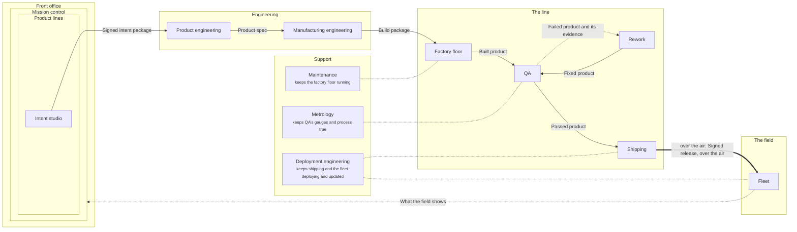
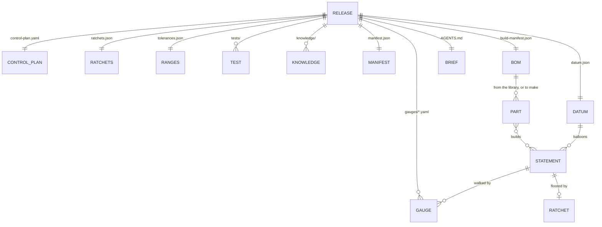
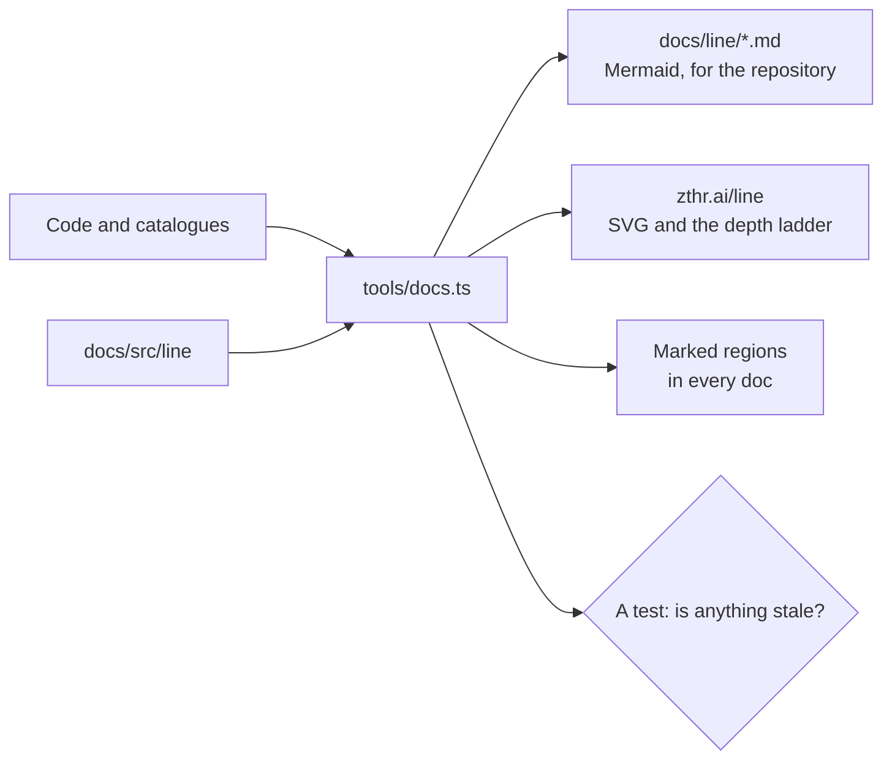

# ZTHR Intent

Capture what people mean, read it back to them, and release it as the datum a factory builds to.

A person writes rough intent in their own words. Two independent readings by different model families, a design
lexicon and decision-table checks turn it into an intent frame: the end in mind, the problem, the people, the
outcomes, the measures and their tolerances, the rules. Every difference and gap becomes a redline the person
answers in a tap. The signed intent package goes to product engineering, which completes it into the product spec; manufacturing
engineering turns that into the build package the factory floor builds to: journey gauges in the factory's own card
format, a control plan, working ranges and starting ratchets, pending tests, and a knowledge bundle.

The whole plant is one model (`src/console/plant-model.ts`): the bar every page carries, the pages, the docs and the
plant view are all drawn from it.

<!-- gen:diagram:plant-flow -->

<!-- /gen -->

## On zthr.ai

The tools are the <!-- fact:area.count -->13<!-- /fact --> areas of one plant, in <!-- fact:group.count -->5<!-- /fact --> groups: the front office, which runs the plant, engineering, the line, the field, and the support crews that each keep a part of it working. Work moves from the intent studio to the fleet; what fails goes to rework and back to QA. [The plant](https://zthr.ai/plant/) shows where each area stands, and how the plant works, and how value compounds as each area is added, is in [the docs](docs/line/README.md), at four depths.

<!-- gen:areas-root -->
| Step | Area | Group | What it does | Open it | How it works |
| --- | --- | --- | --- | --- | --- |
| - | Mission control | Front office | Runs the plant: sets priorities, gives approvals, stops the line when it must and holds the spend. It sees every product line and product, where each stands, and what waits on a person. | [/mission](https://zthr.ai/mission) | [Mission control](docs/line/mission.md) |
| - |   Product lines | Front office | Each product family: who it serves and the defaults every product in it starts from. A family holds many products, each built separately on the line, and each product line has its own Intent studio. | [/lines](https://zthr.ai/lines) | [Product lines](docs/line/lines.md) |
| - |     Intent studio | Front office | Defines the thing: rough words become a numbered schematic, the questions that change the build are settled, and the person signs it as what they mean. | [/intent](https://zthr.ai/intent) | [Intent studio](docs/line/intent.md) |
| 1 | Product engineering | Engineering | Designs the app and its blocks: outcomes, data, compliance, operations, measures, journeys and tests, drawn from the block library, and hands on the product spec. | [/engineering](https://zthr.ai/engineering) | [Product engineering](docs/line/engineering.md) |
| 2 | Manufacturing engineering | Engineering | Defines how to build the thing, then sets up the line to build it, and keeps improving the line and the process from what the line measures. | [/process](https://zthr.ai/process) | [Manufacturing engineering](docs/line/process.md) |
| 3 | Factory floor | The line | An operator agent drives each product down the line, station by station, building to the build package and measuring what was built. | [/factory](https://zthr.ai/factory) | [Factory floor](docs/line/factory.md) |
| 4 | QA | The line | Inspects every product as a person would use it: every journey walked, measured against its reference system, every gate proven able to fail. | [/qa](https://zthr.ai/qa) | [QA](docs/line/qa.md) |
| loop | Rework | The line | Takes back what fails inspection. The fix starts from a failing test, and the whole product goes through QA again. | [/rework](https://zthr.ai/rework) | [Rework](docs/line/rework.md) |
| 5 | Shipping | The line | Packages the code, the tests, the docs and the version history into a signed release, publishes it to the repository and the sites, and deploys it to production with a person approving. | [/shipping](https://zthr.ai/shipping) | [Shipping](docs/line/shipping.md) |
| 6 | Fleet | The field | Everything in service: each app, the blocks it draws on and the data it keeps. Apps are updated over the air, with rollback, and the field reports back to Mission control. | [/fleet](https://zthr.ai/fleet) | [Fleet](docs/line/fleet.md) |
| - | Maintenance | Support | Keeps the factory floor running. The night shift works the backlog within its budget, through the same gates as day work, and reports each morning. | [/maintenance](https://zthr.ai/maintenance) | [Maintenance](docs/line/maintenance.md) |
| - | Metrology | Support | The lab behind QA: defines every measure, traces it to a reference, certifies every gauge before QA may use it, and fixes QA’s quality and process. | [/metrology](https://zthr.ai/metrology) | [Metrology](docs/line/metrology.md) |
| - | Deployment engineering | Support | The cloud and field engineers: stand up where products run, deploy them, send updates over the air, watch them in service and bring back what the field shows. | [/deployment](https://zthr.ai/deployment) | [Deployment engineering](docs/line/deployment.md) |
<!-- /gen -->

The deploy workflow builds every page from this folder (`npm run build`) after typecheck and tests pass. Nothing
built is committed. The factory floor, QA, rework, manufacturing engineering, shipping, the fleet, deployment engineering and mission control read `/reference/factory/factory.json`, which the
reference build writes from its own evidence. Metrology and maintenance read `/maintenance/night.json`, which the site build writes from
the night shift's records in this repository (`eval/mutation/`, `factory/queue/`, `factory/shifts/`, `factory/rulings/`).

## The release package

For the worked example, a released revision is <!-- fact:example.files -->115<!-- /fact --> files:

<!-- gen:package -->
| In the package | Files |
| --- | --- |
| `admin/` | 2 |
| `AGENTS.md` | 1 |
| `analytics/` | 1 |
| `api/` | 3 |
| `balloons.json` | 1 |
| `build-manifest.json` | 1 |
| `build-manifest.md` | 1 |
| `compliance/` | 6 |
| `connections.json` | 1 |
| `connections/` | 2 |
| `context.md` | 1 |
| `control-plan.yaml` | 1 |
| `datum.json` | 1 |
| `delivery/` | 5 |
| `docs/` | 5 |
| `features.yaml` | 1 |
| `gauges/` | 1 |
| `information/` | 12 |
| `knowledge/` | 32 |
| `manifest.json` | 1 |
| `notes.md` | 1 |
| `ops/` | 5 |
| `outcomes/` | 3 |
| `ratchets.json` | 1 |
| `reports/` | 17 |
| `schematic.md` | 1 |
| `spec-sheet.json` | 1 |
| `tests/` | 2 |
| `tolerances.json` | 1 |
| `training/` | 4 |
<!-- /gen -->



Before signing, the studio shows the build manifest: the bill of materials the factory starts from, each part marked from the library, extended, catalogued to make, or made new, and traced to the balloons that call for it. The release carries it exactly as previewed.

The same input always gives the same bytes; the browser and the command line produce the same package hash.

## Command line

```
node src/cli.ts readback intent.md --reading a.json --reading b.json
node src/cli.ts release  intent.md --rev 1 --to out/ --zip
node src/cli.ts init intent.md --workspace ws        # keep the work between sittings
node src/cli.ts agents serve --workspace ws --role builder --family anthropic --agent b1 --factory ../factory
```

Agents run the factory through the agent API: one role per session, its limits held by the API, and every step only a
person takes left as a proposal for them ([how](docs/agents.md)).

## Develop

Node 22.18 or later.

```
npm ci
npm run verify     # types, tests, secret scan, and a build of every page of the site
npm run build      # writes every page of the site into ../docs, behind Google sign-in by invitation
npm run build -- --open   # the same, with no sign-in, for local checks or your own copy
```

- [The release package, file by file](docs/formats.md)
- [The information it keeps: schema from your sentences, patterns and Prisma](docs/information.md)
- [Intent as the Datum: the pattern paper (draft for review)](PAPER.md)
- [The line, in papers: the roll-up and a pattern paper for each area it covers (drafts for review)](papers/README.md)
- [Files: the first product through the whole line, a Nextcloud-compatible server](../files/README.md)
- [Housekeeping blocks: known-good code for what most apps get wrong](blocks/README.md)
- [The parts catalogue](catalog/README.md)
- [How the plant works, at four depths](docs/line/README.md) (also on [zthr.ai/line](https://zthr.ai/line/))
- [The standards map: each area's discipline and standard](docs/line/standards.md)
- [Architecture: the engine, the package and the records](docs/line/architecture.md)
- [How the docs are generated](#how-the-docs-are-generated)
- [The plant, area by area, and the people who walked it](docs/personas.md)
- [The factory, run by agents: roles, the agent API and its guide](docs/agents.md)
- [Agent API: tool reference](docs/agents-tools.md)
- [Report a problem, and triage](docs/feedback.md)
- [Compliance, decided on the schematic](docs/compliance.md)
- [Delivery and operations](docs/operations.md)
- [Connectors to the tools teams already use](docs/connectors.md)
- [Who can use the tools on zthr.ai, and how to invite people](docs/access.md)

Apache 2.0.

## How the docs are generated

Every figure, table and diagram these docs state about the system is computed from the code and the catalogues by
`tools/docs.ts`, never typed. A doc takes generated content three ways:

| Where | How | Example |
| --- | --- | --- |
| Any doc, inline | `<!-- fact:NAME -->…<!-- /fact -->` | the number of parts in the catalogue |
| Any doc, as a block | `<!-- gen:NAME -->…<!-- /gen -->` | the table of delivery stages |
| The line's docs | `docs/src/line/*.md`, with `{{NAME}}`, `{{table:NAME}}` and `{{diagram:NAME}}` | each area at four depths |



Run `node tools/docs.ts --write` after a change; `npm test` fails while any doc is stale.

