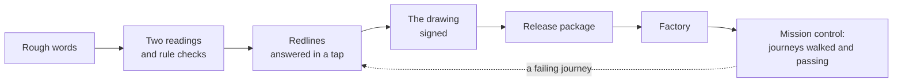
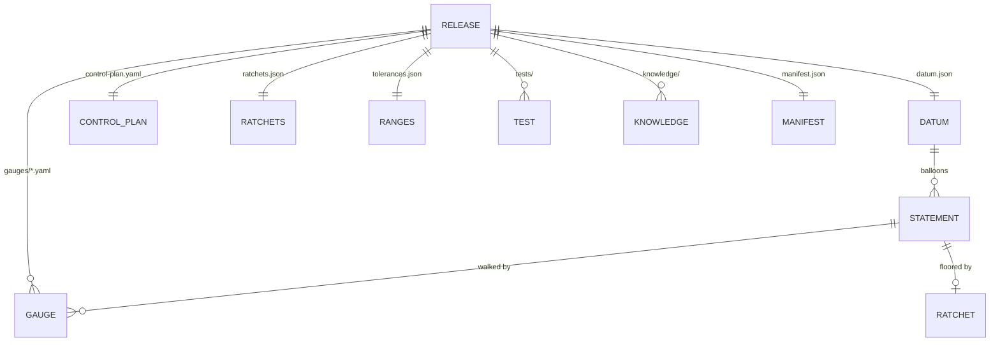

# ZTHR Intent

Capture what people mean, read it back to them, and release it as the datum a factory builds to.

A person writes rough intent in their own words. Two independent readings by different model families, a design
lexicon and decision-table checks turn it into an intent frame: the end in mind, the problem, the people, the
outcomes, the measures and their tolerances, the rules. Every difference and gap becomes a redline the person
answers in a tap. The signed drawing is released as a package the factory consumes: journey gauges in the factory's
own card format, a control plan, working ranges and starting ratchets, pending tests, and a knowledge bundle.



## On zthr.ai

| Surface | What it is |
| --- | --- |
| [/intent](https://zthr.ai/intent) | The studio: from rough words to a released drawing, with the intent map, datum structure, inspection plan and release preview |
| [/factory](https://zthr.ai/factory) | The factory console: the latest build's readings, journeys, phases, gates and ratchets |
| [/mission](https://zthr.ai/mission) | Mission control: intents on the left, the factory on the right, working software the measure |

The deploy workflow builds all three from this folder (`npm run build`) after typecheck and tests pass. Nothing
built is committed. The factory console and mission control read `/reference/factory/factory.json`, which the
reference build writes from its own evidence.

## The release package



The same input always gives the same bytes; the browser and the command line produce the same package hash.

## Command line

```
node src/cli.ts readback intent.md --reading a.json --reading b.json
node src/cli.ts release  intent.md --rev 1 --to out/ --zip
node src/cli.ts init intent.md --workspace ws        # keep the work between sittings
```

## Develop

Node 22.18 or later.

```
npm ci
npm run verify     # types, tests, secret scan, and a build of all three surfaces
npm run build      # writes docs/intent, docs/factory, docs/mission
```

Apache 2.0.
