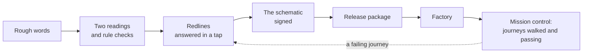
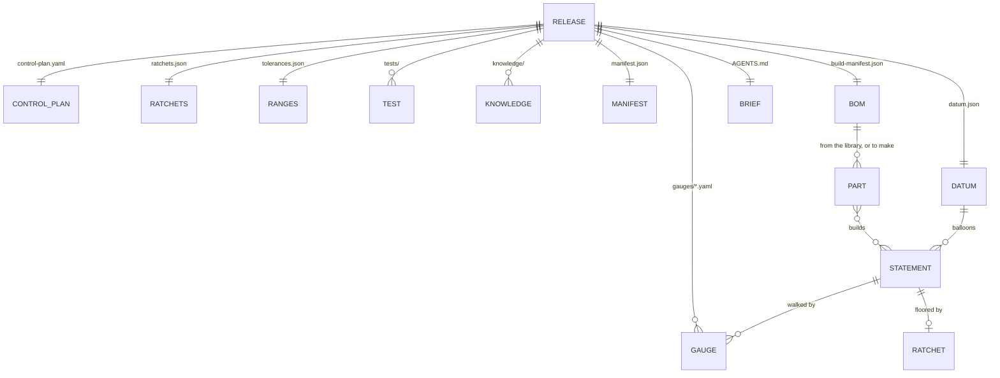
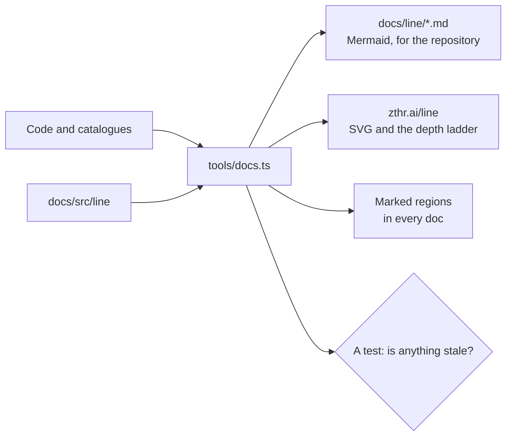

# ZTHR Intent

Capture what people mean, read it back to them, and release it as the datum a factory builds to.

A person writes rough intent in their own words. Two independent readings by different model families, a design
lexicon and decision-table checks turn it into an intent frame: the end in mind, the problem, the people, the
outcomes, the measures and their tolerances, the rules. Every difference and gap becomes a redline the person
answers in a tap. The signed schematic is released as a package the factory consumes: journey gauges in the factory's
own card format, a control plan, working ranges and starting ratchets, pending tests, and a knowledge bundle.



## On zthr.ai

The tools are one line of <!-- fact:dept.count -->8<!-- /fact --> departments, in the order work moves through them. How the line works, and how value compounds as each department is added, is in [the line](docs/line/README.md), at four depths.

<!-- gen:departments-root -->
| # | Department | What it does | Open it | How it works |
| --- | --- | --- | --- | --- |
| 1 | Mission control | Every product line and product, where each stands, and what is waiting on a person. | [/mission](https://zthr.ai/mission) | [Mission control](docs/line/mission.md) |
| 2 | Product lines | Define a line: who it serves, and the defaults every product in it starts from. | [/lines](https://zthr.ai/lines) | [Product lines](docs/line/lines.md) |
| 3 | Intent studio | Say what a product must do, settle the questions, and sign the schematic as what you mean. | [/intent](https://zthr.ai/intent) | [Intent studio](docs/line/intent.md) |
| 4 | Engineering | Turn the signed schematic into a complete specification: outcomes, data, compliance, operations, measures and tests. | [/engineering](https://zthr.ai/engineering) | [Engineering](docs/line/engineering.md) |
| 5 | Factory | Build to the released package, and measure what was built. | [/factory](https://zthr.ai/factory) | [Factory](docs/line/factory.md) |
| 6 | QA | Walk every journey as a person would, prove every gate can fail, hold every ratchet. | [/qa](https://zthr.ai/qa) | [QA](docs/line/qa.md) |
| 7 | Shipping | Move a certified build to the people it is for, stage by stage, with a person approving production. | [/shipping](https://zthr.ai/shipping) | [Shipping](docs/line/shipping.md) |
| 8 | Fleet | Everything in service, the library each app draws on, and the data it keeps. | [/fleet](https://zthr.ai/fleet) | [Fleet](docs/line/fleet.md) |
<!-- /gen -->

The deploy workflow builds every page from this folder (`npm run build`) after typecheck and tests pass. Nothing
built is committed. The factory, QA, shipping, fleet and mission control read `/reference/factory/factory.json`, which the
reference build writes from its own evidence.

## The release package

For the worked example, a released revision is <!-- fact:example.files -->115<!-- /fact --> files:

<!-- gen:package -->
| In the package | Files |
| --- | --- |
| `admin/` | 2 |
| `AGENTS.md` | 1 |
| `analytics/` | 1 |
| `api/` | 3 |
| `balloons.json` | 1 |
| `build-manifest.json` | 1 |
| `build-manifest.md` | 1 |
| `compliance/` | 6 |
| `connections.json` | 1 |
| `connections/` | 2 |
| `context.md` | 1 |
| `control-plan.yaml` | 1 |
| `datum.json` | 1 |
| `delivery/` | 5 |
| `docs/` | 5 |
| `features.yaml` | 1 |
| `gauges/` | 1 |
| `information/` | 12 |
| `knowledge/` | 32 |
| `manifest.json` | 1 |
| `notes.md` | 1 |
| `ops/` | 5 |
| `outcomes/` | 3 |
| `ratchets.json` | 1 |
| `reports/` | 17 |
| `schematic.md` | 1 |
| `spec-sheet.json` | 1 |
| `tests/` | 2 |
| `tolerances.json` | 1 |
| `training/` | 4 |
<!-- /gen -->



Before signing, the studio shows the build manifest: the bill of materials the factory starts from, each part marked from the library, extended, catalogued to make, or made new, and traced to the balloons that call for it. The release carries it exactly as previewed.

The same input always gives the same bytes; the browser and the command line produce the same package hash.

## Command line

```
node src/cli.ts readback intent.md --reading a.json --reading b.json
node src/cli.ts release  intent.md --rev 1 --to out/ --zip
node src/cli.ts init intent.md --workspace ws        # keep the work between sittings
node src/cli.ts agents serve --workspace ws --role builder --family anthropic --agent b1 --factory ../factory
```

Agents run the factory through the agent API: one role per session, its limits held by the API, and every step only a
person takes left as a proposal for them ([how](docs/agents.md)).

## Develop

Node 22.18 or later.

```
npm ci
npm run verify     # types, tests, secret scan, and a build of all three surfaces
npm run build      # writes docs/intent, docs/factory, docs/mission, behind Google sign-in by invitation
npm run build -- --open   # the same, with no sign-in, for local checks or your own copy
```

- [The release package, file by file](docs/formats.md)
- [The information it keeps: schema from your sentences, patterns and Prisma](docs/information.md)
- [Intent as the Datum: the pattern paper (draft for review)](PAPER.md)
- [Housekeeping blocks: known-good code for what most apps get wrong](blocks/README.md)
- [The parts catalogue](catalog/README.md)
- [How the line works, at four depths](docs/line/README.md) (also on [zthr.ai/line](https://zthr.ai/line/))
- [Architecture: the engine, the package and the records](docs/line/architecture.md)
- [How the docs are generated](#how-the-docs-are-generated)
- [The line, department by department, and the people who walked it](docs/personas.md)
- [The factory, run by agents: roles, the agent API and its guide](docs/agents.md)
- [Agent API: tool reference](docs/agents-tools.md)
- [Report a problem, and triage](docs/feedback.md)
- [Compliance, decided on the schematic](docs/compliance.md)
- [Delivery and operations](docs/operations.md)
- [Connectors to the tools teams already use](docs/connectors.md)
- [Who can use the tools on zthr.ai, and how to invite people](docs/access.md)

Apache 2.0.

## How the docs are generated

Every figure, table and diagram these docs state about the system is computed from the code and the catalogues by
`tools/docs.ts`, never typed. A doc takes generated content three ways:

| Where | How | Example |
| --- | --- | --- |
| Any doc, inline | `<!-- fact:NAME -->…<!-- /fact -->` | the number of parts in the catalogue |
| Any doc, as a block | `<!-- gen:NAME -->…<!-- /gen -->` | the table of delivery stages |
| The line's docs | `docs/src/line/*.md`, with `{{NAME}}`, `{{table:NAME}}` and `{{diagram:NAME}}` | each department at four depths |



Run `node tools/docs.ts --write` after a change; `npm test` fails while any doc is stale.

