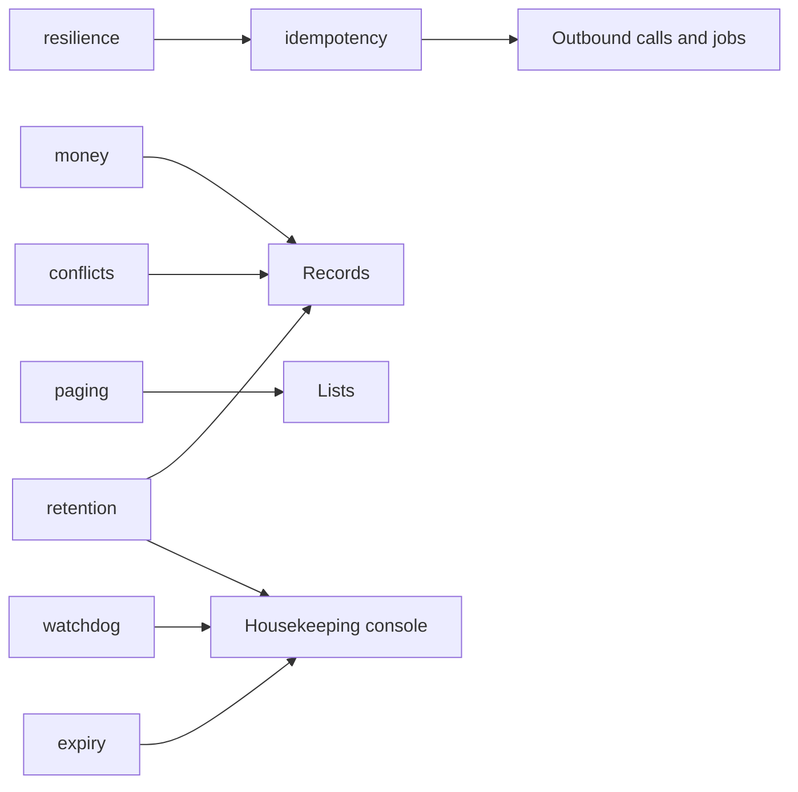

# Housekeeping blocks

Known-good code for the parts almost every app needs and most apps get wrong, so the factory starts from them and
the AI designs only what is different. Each block is plain TypeScript with no dependencies, takes its clock and its
randomness as arguments so every behaviour is testable, and ships with its tests.

<!-- fact:blocks.count -->235<!-- /fact --> blocks, <!-- fact:blocks.tests -->3995<!-- /fact --> tests between them:

<!-- gen:blocks-here -->
| Block | What it holds | Tests |
| --- | --- | --- |
| [resilience](resilience/index.ts) | Timeouts with abort, bounded full-jitter retries, and a circuit breaker that half-opens on its own | 4 |
| [idempotency](idempotency/index.ts) | One result per idempotency key: repeats replay it, different content is refused, concurrent repeats wait | 4 |
| [money](money/index.ts) | Whole minor units per currency, half-even rounding, and splits that always add back to the total | 4 |
| [conflicts](conflicts/index.ts) | Versioned saves with a three-way merge of fields that do not clash, and the exact fields that do | 5 |
| [paging](paging/index.ts) | Stable keyset paging with opaque cursors, and only declared sorts and filters | 3 |
| [retention](retention/index.ts) | Trash with dependents, restore of all of it, and a retention sweep plan with reasons | 3 |
| [watchdog](watchdog/index.ts) | Missed, overlong, failed and overlapping scheduled runs, and a lease so one copy runs at a time | 3 |
| [expiry](expiry/index.ts) | Everything with an expiry date, and the alert each needs today | 2 |
| [tree](tree/index.ts) | Folders and files with stable ids, where a change re-tags every ancestor and keeps folder sizes, so sync skips unchanged subtrees | 12 |
| [objects](objects/index.ts) | Bytes streamed once with checksums computed on the way, byte ranges, and parts joined in the store; memory and disk stores | 10 |
| [uploads](uploads/index.ts) | Resumable chunked uploads: any order, repeats replace, quota checked up front, joined in a tree of compose calls, idle sessions swept | 8 |
| [leases](leases/index.ts) | Exclusive holds with owners, tokens and time limits that end on their own, covering everything below a folder when deep | 6 |
| [grants](grants/index.ts) | Permissions to people, groups and links, never more than the giver has; link passwords hashed and throttled; expiries | 8 |
| [devices](devices/index.ts) | A browser sign-in flow that hands a new app its own hashed password once; revoke one device, or wipe it remotely | 6 |
| [dav](dav/index.ts) | The DAV core: a namespace-aware XML reader that refuses DTDs, the multistatus writer, and the WebDAV headers | 8 |
| [oracle](oracle/index.ts) | Differential checks: the same requests to the reference and the candidate, answers normalised and compared, or recorded once | 4 |
| [ratelimit](ratelimit/index.ts) | Token buckets per key that say how long to wait, and failure counts that slow only mistakes, with bounded memory | 4 |
| [uploadsafe](uploadsafe/index.ts) | Names a client could not hold refused before any bytes are kept, size limits, and the real type read from the first bytes | 4 |
| [validate](validate/index.ts) | One schema per input and one error format: every problem at once, each with its path and a message, as problem details for APIs and field errors for forms | 4 |
| [config](config/index.ts) | Typed settings and secrets by name, refusing to start when one is missing or unsafe, an inventory that never shows a value, rotation dates and drift | 4 |
| [observe](observe/index.ts) | Structured logs redacted where written, errors grouped by kind and place, metrics with percentiles, and traces carried through async work | 4 |
| [health](health/index.ts) | Readiness with deadlines, the running version, graceful drain on shutdown, maintenance windows, the environment badge and the status model | 4 |
| [jobs](jobs/index.ts) | A queue with jittered retries, dead letters and replay, keyed jobs, long tasks with progress and cancel, checkpointed backfills with a dry run, and cron | 5 |
| [audit](audit/index.ts) | A hash-chained audit log of changes and sensitive reads, verifiable end to end and against a published head | 3 |
| [crypto](crypto/index.ts) | Envelope encryption bound to its record with a rotating key ring, purpose-bound expiring signed tokens, constant-time comparison and random ids | 4 |
| [rbac](rbac/index.ts) | Roles and grants declared once, narrowed by record rules, refusals that win, and the same evaluator explaining every decision and filtering lists | 4 |
| [secheaders](secheaders/index.ts) | Strict browser headers with script nonces and features off by default, session cookie attributes, and cross-site request checks | 2 |
| [apikeys](apikeys/index.ts) | Scoped API keys shown once and kept as hashes, found by prefix, rotated with an overlap, expired and revoked | 2 |
| [accounts](accounts/index.ts) | Sign-up with confirmation, sign-in, single-use password resets, organisations and invitations, a role switcher, deactivation and offboarding, and time-boxed act-as and break-glass that are recorded and announced | 5 |
| [sessions](sessions/index.ts) | Sessions with idle and absolute limits and a warning before expiry, ending all sessions, TOTP enrolment and checking (RFC 6238, no replay) and single-use recovery codes | 4 |
| [oidc](oidc/index.ts) | OpenID Connect sign-in: state, nonce and PKCE, a JWKS cache, and ID token checks (RS256/ES256 only; issuer, audience, expiry, nonce) | 3 |
| [webhooks](webhooks/index.ts) | Inbound webhooks believed only when signed, recent and not seen before; outbound delivery signed, retried with backoff, parked with the last answer, replayable, with failing endpoints paused | 2 |
| [flags](flags/index.ts) | Feature flags for people, groups, attributes and stable percentage rollouts, a kill switch, an explanation for every answer, and a list of flags past their removal date | 2 |
| [cache](cache/index.ts) | Read-through cache with one load per key under load, stale-while-refresh, tags, least-recently-used eviction and hit rates; failures are not cached | 2 |
| [consent](consent/index.ts) | Terms and consent by version: agreement recorded with when and how, withdrawal as a new record, required re-agreement when a new version needs it | 2 |
| [refdata](refdata/index.ts) | Versioned code lists with effective and retirement dates, labels as of a day, replacements, and checks that refuse a version which would orphan stored values | 2 |
| [notify](notify/index.ts) | Notifications by template (escaped, nothing missing), per-category channel choices, quiet hours in the person's zone, digests, bounce suppression, one-click unsubscribe (RFC 8058), reminders that stop when done, and receipts | 4 |
| [comments](comments/index.ts) | Threads and replies on any record, @mentions of people who can see it, edits with history, deletion markers, reactions, resolving and unread counts, shown escaped | 2 |
| [history](history/index.ts) | Field-level change history for any record: rebuild any version, compare two, undo as a new change that refuses to overwrite newer edits, and restore | 2 |
| [workflow](workflow/index.ts) | Declared state machines checked so no record can be stranded, guards that explain, approvals by distinct people who did not ask, reasons for rejection, deadlines that escalate, and a trail | 2 |
| [events](events/index.ts) | A CloudEvents 1.0 catalogue that refuses undeclared events or missing fields, a hub with replay for reconnecting clients, server-sent events, and presence | 3 |
| [slo](slo/index.ts) | Objectives, error budgets and multi-window burn-rate alerts; incidents with timelines and public notes; postmortems that need a cause, impact and owned actions | 3 |
| [costmeter](costmeter/index.ts) | Usage priced from a rate card and attributed to feature and tenant, free units, budgets that warn and can stop spending, and a month-end forecast | 2 |
| [tabular](tabular/index.ts) | CSV to RFC 4180 with formula defusing, column mapping suggestions, imports that quarantine bad rows with reasons, rule-based dedupe and merge, and export to CSV, JSON lines and .xlsx | 4 |
| [reports](reports/index.ts) | Grouped reports with count, sum, average, min, max and distinct, filters, totals, small-group suppression, pivots, parameterised templates and scheduled delivery with a log | 3 |
| [search](search/index.ts) | BM25 full-text search with field weights, accent folding and stemming, prefix while typing, phrases, facets and filters, escaped snippets, and a visibility check on every hit | 3 |
| [i18n](i18n/index.ts) | Message catalogues with each language's plural rules, fallback chains with a missing report, Accept-Language negotiation, text direction, Intl formatting, and a completeness check | 3 |
| [time](time/index.ts) | Wall time to instant across daylight-saving changes, RRULE recurrence in wall time (daily, weekly, monthly by day or weekday, yearly, until, count, exceptions), and working days | 4 |
| [booking](booking/index.ts) | Free time inside each person's local hours, find-a-time across zones ranked for everyone's day, and holds and bookings that cannot double-book, with buffers and expiry | 3 |
| [contact](contact/index.ts) | Names kept as written with a name to use and a sort key, addresses formatted and postcodes checked by country, and phone numbers normalised to E.164 | 3 |
| [analytics](analytics/index.ts) | Consent-gated product analytics with pseudonymous ids and allow-listed properties, forgetting, ordered funnels within a time limit, common journeys, and small-count suppression | 2 |
| [payments](payments/index.ts) | Payments behind a provider interface with a tested twin (declines, confirmation, idempotency, partial refunds), integer money, and billing: trials, renewals, prorated plan changes, retries and cancel at period end | 3 |
| [pdf](pdf/index.ts) | PDF 1.7 written directly: headings, wrapped paragraphs, tables with repeated headers, page numbers, escaped WinAnsi text and a correct cross-reference table (checked with qpdf) | 2 |
| [docparse](docparse/index.ts) | Text from .docx (headings, lists) and cells from .xlsx (shared and inline strings), read through a zip reader that refuses bombs, unsafe paths and damaged archives | 3 |
| [imagemeta](imagemeta/index.ts) | Image kind from the bytes, size for PNG, JPEG, GIF and WebP, EXIF orientation, refusal of decompression bombs, and stripping of EXIF, GPS and comments with the colour profile kept | 3 |
| [geo](geo/index.ts) | Great-circle distance, bounding boxes across the antimeridian, nearest places, service areas with holes, geohash, and coarsening a position to an area | 2 |
| [sitemap](sitemap/index.ts) | Head tags for public pages (canonical, Open Graph, Twitter, JSON-LD) escaped, a check for missing, long and duplicate titles, sitemaps with an index past 50,000 URLs, and robots.txt | 2 |
| [apiver](apiver/index.ts) | Date-based API versions with per-change transforms back to a pinned version, Deprecation and Sunset headers, refusal after sunset, and a list of callers still on old versions | 2 |
| [drafts](drafts/index.ts) | Autosaved drafts per person and record, spaced snapshots to restore, a conflict report when the record changed since, a list to pick up from, and sweeping | 2 |
| [palette](palette/index.ts) | A command palette with fuzzy matching, keywords, permission filtering, recent commands first, shortcut conflict detection and a shortcuts sheet | 3 |
| [testdata](testdata/index.ts) | Seeded, repeatable fake data in ranges reserved for fiction (example domains, 555-01xx numbers, published test cards), factories with overrides, and a guard against real-looking values | 3 |
| [privacy](privacy/index.ts) | A registry of personal-data sources; one-archive exports with a manifest and readable summary; erasure that reports removed, kept and why, and is complete only when every source succeeded | 2 |
| [surfaces](surfaces/index.ts) | A registry of every screen with its purpose, audience, help and words for loading, empty and error states, checked; contextual help, what's new once per person, a first-run checklist, and friendly error pages | 3 |
| [upkeep](upkeep/index.ts) | Dependency verdicts from advisories and current versions, expiry warnings for certificates, domains, tokens and keys, and SARIF findings with stable fingerprints, triaged into new, open, accepted and fixed | 4 |
| [backups](backups/index.ts) | Backups with per-collection row counts and order-free hashes, restore drills into scratch timed against a target, and grandfather-father-son retention that says why each backup is kept | 3 |
| [loadsoak](loadsoak/index.ts) | Open-model load runs at a fixed arrival rate with percentile and error-rate limits, and soak verdicts that find a steady climb by fitting a line, ignoring noise | 3 |
| [datagate](datagate/index.ts) | A classified inventory of every field with findings for gaps, a gate that allows, masks or denies each field per destination with the deciding rule, and evidence of every decision | 3 |
| [pipeline](pipeline/index.ts) | The delivery pipeline as stages and events: where each change is, what it waits for, what is stuck, and lead time, deployment frequency, change failure rate and time to restore | 2 |
| [sync](sync/index.ts) | One sync engine for outside systems: paged pulls with a cursor kept only after a page applies, pushes by external id, echo recognition, conflicts settled by a rule and reported, and twins for testing | 2 |
| [feedback](feedback/index.ts) | Problem reports in the person's words with redacted context, grouping of similar reports, a triage board ordered by overdue and severity, and defects with evidence and a failing test skeleton | 2 |
| [cmi5](cmi5/index.ts) | cmi5 training modules: launch URLs, the defined xAPI statements with cmi5 context, the session rules, mastery scores and moveOn | 2 |
| [pwa](pwa/index.ts) | A checked web app manifest, a service worker built from a caching plan with an offline page, and an offline queue that replays in order and sets aside what the server refuses | 3 |
| [ux](ux/index.ts) | Snooze to times people mean, previewed bulk edits, signed shared views, learned defaults, magic paste, honest progress, reading comfort CSS, why am I seeing this, and is it me or is it down | 6 |
| [migrations](migrations/index.ts) | Ordered, checksummed data migrations applied once each under a lock, with verify steps, dry runs, and refusal when an applied migration was edited, removed or arrives out of order | 3 |
| [mcp](mcp/index.ts) | Agent tools over the Model Context Protocol: a JSON-RPC 2.0 handler with initialize, tools/list and tools/call, schema-checked arguments, per-person permissions, read-only hints and a call log | 2 |
| [query](query/index.ts) | A read-only query console: a small query language parsed and checked against declared collections, capped results, masked sensitive fields, no filtering on hidden values, and a log of every query | 2 |
| [uat](uat/index.ts) | Test-environment overrides of flags, clock and role for one tester, time-limited with a reason, shown on a banner, recorded, and refused in production | 2 |
| [importer](importer/index.ts) | One way in for data from anywhere: uploaded bytes or pasted text recognised as CSV/TSV, .xlsx, .docx, JSON, JSON lines, vCard, iCalendar or a pasted table or address list, decoded from UTF-8 or UTF-16, held to size and row limits, matched to fields, with every bad row quarantined by where it was and why | 11 |
| [ask](ask/index.ts) | Plain-language questions over a declared dataset: a model's proposed report is checked against the fields, measures and filters the person may see, small groups are suppressed, and the answer comes with its records, a plain-English description of what was computed, and the report itself | 6 |
| [etl](etl/index.ts) | Declared extract-transform-load pipelines with per-step page checkpoints that resume, idempotent loads by id, capped row-level error capture, dry runs, per-run lineage with an every-row-accounted check, a cron schedule and a watch for stale, failed or drifting runs | 10 |
| [console](console/index.ts) | The model behind the admin console, housekeeping console and feature explorer: sections of items with status, reason, path and permission built from the app's registries, filtered by permission with a summary line, plus a feature explorer that joins and searches features, screens, flags, journeys and evidence | 7 |
| [factoryreports](factoryreports/index.ts) | Feature reports, operations reports and the improvement brief as documents with tables and evidenced findings, rendered to Markdown and delivered on a schedule, with the brief ranking what to change next by weighted evidence and saying why | 7 |
| [walkthrough](walkthrough/index.ts) | A guided, ordered walk through a feature's journey steps showing each claim, its evidence and whether that evidence is current, with step-by-step sign-off refused on stale, failed, missing or untraceable evidence and voided when covered code changes | 5 |
| [speech](speech/index.ts) | Speech transcripts turned into palette commands with spoken confirmation for destructive ones, dictation with spoken punctuation and corrections, and numbers and dates spoken in words, with a feature-detected Web Speech adapter | 9 |
| [router](router/index.ts) | Chooses the cheapest model proven good enough for each kind of task: a dated price table, per-request cost with long-context and regional rates, pass rates per model per task kind trusted on a Wilson lower bound, exploration of cheaper models, escalation through tiers, judges from another family, and a daily budget | 17 |
| [node-registry](node-registry/index.ts) | Node and credential types for workflow engines: parameter schemas checked, defaults filled, credentials redacted and authenticated, versions migrated | 14 |
| [execution-log](execution-log/index.ts) | Workflow runs and steps recorded with secrets redacted as written, size caps, a readable prune plan, pinned runs and replay from any step | 15 |
| [trigger-polling](trigger-polling/index.ts) | Poll and webhook triggers on the job queue: deduplicated polls, test polls and test listening, and an overview of every trigger | 17 |
| [storage-policies](storage-policies/index.ts) | Bucket policies with a decision engine, cleaned paths, sniffed content, signed URLs, and image transforms in one canonical form with size caps | 15 |
| [webrtc-signaling](webrtc-signaling/index.ts) | SDP read and written (RFC 8866), ICE candidates (RFC 8839), TURN credentials, signed room tokens and a signalling hub | 25 |
| [call-rooms](call-rooms/index.ts) | Call rooms with roles, signed join tokens, limits and recording plans | 18 |
| [icalendar](icalendar/index.ts) | iCalendar (RFC 5545): folded content lines, events, recurrence expanded to the RFC's own examples, time zones read and written, and alarms | 25 |
| [caldav](caldav/index.ts) | A CalDAV store: put, get, delete, calendar queries, free-busy, sync tokens and the scheduling inbox and outbox | 19 |
| [rest-filter-syntax](rest-filter-syntax/index.ts) | PostgREST, Strapi and Directus filter syntaxes read into one filter tree, with range headers, an evaluator and a canonical form | 18 |
| [view-engine](view-engine/index.ts) | Saved views shared and defaulted, compiled and run without ever widening access, exported and fingerprinted | 15 |
| [dashboards](dashboards/index.ts) | Dashboards: panels, time ranges, variables, grid layout, shares and public links kept as hashes, and provisioning from files | 18 |
| [dns-wire](dns-wire/index.ts) | DNS messages (RFC 1035) with name compression safe from pointer loops, EDNS(0), zone files read and written, and serial arithmetic | 19 |
| [geoip](geoip/index.ts) | MaxMind database reader, most-specific CIDR tables, special ranges, address truncation, and locations never finer than allowed | 18 |
| [text-diff](text-diff/index.ts) | Myers diff of lines, words or characters, unified patches identical to GNU diff, applied with offsets and reversed, and moved blocks | 16 |
| [oidc-provider](oidc-provider/index.ts) | An OpenID Provider: discovery, rotating keys, the code flow with PKCE, ID tokens, UserInfo, pairwise subjects, revocation and logout | 27 |
| [alert-rules](alert-rules/index.ts) | Alert rules that go pending, firing and resolved, with matchers, fingerprints, silences, grouping, routing and inhibition, as Alertmanager does | 20 |
| [cors-cookies](cors-cookies/index.ts) | CORS decisions by the Fetch standard, and cookies by RFC 6265bis: parsed, written, and kept in a jar with SameSite, domain and path rules | 24 |
| [sun-calc](sun-calc/index.ts) | Sun and moon positions, sunrise and sunset including polar day and night, and moon phases, after Meeus | 17 |
| [prometheus-text](prometheus-text/index.ts) | Prometheus and OpenMetrics text exposition, a registry with a cardinality cap, and a parser safe on hostile input | 16 |
| [svg-writer](svg-writer/index.ts) | A safe SVG writer: everything escaped, accessible titles, shapes and paths built and parsed, and text widths estimated | 18 |
| [chart-spec](chart-spec/index.ts) | Declarative charts drawn to SVG with nice ticks and scales, a colour-blind-safe palette checked for contrast, and alt text | 17 |
| [iam-policy](iam-policy/index.ts) | Policy evaluation as AWS IAM does it: explicit deny wins, wildcards, conditions and IP ranges, and policies validated | 17 |
| [identity-brokering](identity-brokering/index.ts) | Sign-in through other identity providers, with account linking that refuses pre-hijack and issuer mix-up, role mapping and unlinking | 16 |
| [columnar-agg](columnar-agg/index.ts) | A small column store: filters, group-by, approximate distinct counts and time rollups corrected for late data | 16 |
| [access-policy](access-policy/index.ts) | Forward-auth rules: paths normalised and double encoding refused, hosts and address ranges, a guard on slow patterns, and every decision explained | 17 |
| [email-threading](email-threading/index.ts) | Mail threads by the JWZ method, base subjects (RFC 5256), encoded words (RFC 2047), auto-reply rules (RFC 3834) and reply headers | 17 |
| [login-flows](login-flows/index.ts) | Declared login flows with step-up, required actions, brute-force lockout, and failures that never say whether an account exists | 17 |
| [stats-basic](stats-basic/index.ts) | Descriptive statistics and quantiles, common distributions, t and chi-square tests, confidence intervals, effect sizes and power | 20 |
| [cert-store](cert-store/index.ts) | Certificates read with a strict DER reader, chains built and checked, host names matched (RFC 9525), and expiry alerts | 23 |
| [subscriber-lists](subscriber-lists/index.ts) | Mailing lists with double opt-in, one-click unsubscribe (RFC 8058), preferences, suppression kept as keyed hashes, consent evidence and CSV | 22 |
| [webhook-catalog](webhook-catalog/index.ts) | Outgoing webhook events declared once: schemas checked, sample payloads, and a delivery log per subscriber | 17 |
| [template-engine](template-engine/index.ts) | A logic-light template language: escaped by default, filters, includes and a step limit so no template can run away | 18 |
| [tenant-model](tenant-model/index.ts) | Tenant isolation: a store scoped to the tenant, keys per tenant, quotas and fair shares, and permissions through roles | 16 |
| [smtp-protocol](smtp-protocol/index.ts) | SMTP and ESMTP client and server state machines: STARTTLS, AUTH, pipelining and reply parsing | 27 |
| [mail-queue](mail-queue/index.ts) | Outbound mail decisions: the retry curve, state per receiving domain, and sender warm-up | 17 |
| [api-client](api-client/index.ts) | Calls to outside APIs only to allowed hosts, with rate limits honoured, paging, and a circuit breaker | 19 |
| [html-sanitize](html-sanitize/index.ts) | Allow-list HTML cleaning in three strengths, for comments, posts and rich pages | 15 |
| [zip-write](zip-write/index.ts) | ZIP (with ZIP64) and tar written as streams, and read back, checked against Python's zipfile and GNU tar | 20 |
| [jwt](jwt/index.ts) | JSON Web Signatures signed and verified, claims checked, key sets rotated and revoked, JWKS and thumbprints (RFC 7515, 7638, 8037) | 19 |
| [ldap](ldap/index.ts) | LDAP names and filters (RFC 4514, 4515), a directory with scoped and paged search, safe binds, nested groups mapped to roles, and user sync | 19 |
| [webpush](webpush/index.ts) | Web Push: VAPID, payloads encrypted to RFC 8291 byte for byte, requests checked, and subscriptions kept sealed and pruned on 404 and 410 | 18 |
| [credential-vault](credential-vault/index.ts) | Stored credentials sealed to their owner, shared by level with expiry, sent only to their own hosts, refreshed one at a time and rotated | 14 |
| [workflow-graph](workflow-graph/index.ts) | Workflow graphs with branches, merges, loops, waits and per-item retries, validated, and run step by step as plain JSON on the job queue | 19 |
| [timeseries](timeseries/index.ts) | Time series downsampled and rolled up so rollups of rollups agree, counter rates across resets, gaps found and filled, tiered retention | 15 |
| [json-patch](json-patch/index.ts) | JSON Pointer, JSON Patch and Merge Patch (RFC 6901, 6902, 7396) applied atomically, diffed, inverted and merged three ways | 18 |
| [websocket-frames](websocket-frames/index.ts) | WebSocket (RFC 6455): the handshake, frames with masking and length rules, close codes, ping and pong, and backpressure | 24 |
| [ws-rpc](ws-rpc/index.ts) | Requests and subscriptions over WebSocket: sign-in first, allowed topics, signed resume tokens with replay, and slow clients closed | 16 |
| [magic-links](magic-links/index.ts) | Sign-in links and codes by email, stored as keyed hashes, bound to the device, safe from mail scanners, and throttled | 19 |
| [token-service](token-service/index.ts) | Access and refresh tokens: RFC 9068 access tokens, rotating refresh with reuse detection, introspection, revocation, exchange and binding | 18 |
| [webauthn](webauthn/index.ts) | Passkeys: registration and sign-in with COSE keys, authenticator data, counters and backup flags, and none, packed and U2F attestation | 22 |
| [document-templates](document-templates/index.ts) | Document templates merged strictly with roles and repeaters, frozen by content hash, and a stamped PDF footer | 18 |
| [mime](mime/index.ts) | Mail messages read and built (RFC 5322, 2045, 2047, 2231): folding, encoded words, quoted-printable and attachments | 23 |
| [pdf-parse](pdf-parse/index.ts) | PDF read with both kinds of cross-reference, object streams and repair, text extracted, and pages split, merged and rotated | 25 |
| [asn1-der](asn1-der/index.ts) | A strict DER reader and canonical writer, with X.509 certificates and certificate requests | 21 |
| [email-html](email-html/index.ts) | HTML for email: allow-list cleaning, CSS inlined by real specificity, tracked links, a plain-text part and a client-support report | 21 |
| [password-policy](password-policy/index.ts) | Password rules after NIST 800-63B: strength by guess count, breached-password checks by k-anonymity, and reuse history | 16 |
| [argon2id](argon2id/index.ts) | Argon2id, Argon2i and Argon2d (RFC 9106) and BLAKE2b (RFC 7693) in plain TypeScript, with every RFC vector | 17 |
| [password-hash](password-hash/index.ts) | Password hashing over Argon2id, scrypt and PBKDF2 with a rotating pepper, rehash on sign-in, and equal timing for unknown users | 16 |
| [xml-dsig](xml-dsig/index.ts) | XML signatures: exclusive canonicalisation, signing and verifying, with signature wrapping refused | 19 |
| [saml](saml/index.ts) | A SAML 2.0 service provider: signed requests, strict response checks, replay refused, and metadata written and read | 20 |
| [client-registry](client-registry/index.ts) | OAuth clients registered (RFC 7591, 7592), secrets rotated with an overlap, redirect addresses matched exactly, and scopes filtered | 16 |
| [oauth2-server](oauth2-server/index.ts) | An OAuth 2.1 authorisation server: PKCE, the device flow, rotating refresh tokens with reuse detection, introspection and revocation | 24 |
| [thumbnails](thumbnails/index.ts) | Images resized five ways with orientation applied, crop and fit planned, derivatives keyed for the cache, and PNG built in | 18 |
| [markdown](markdown/index.ts) | CommonMark and GitHub-flavoured Markdown read to a tree and written to safe HTML, with heading ids and front matter | 11 |
| [custom-fields](custom-fields/index.ts) | Custom fields people add to records: typed, stored, indexed, redacted and kept unique where asked | 15 |
| [toc-outline](toc-outline/index.ts) | Tables of contents and outlines with stable anchors, section ranges, word counts, reading time and excerpts | 14 |
| [scim](scim/index.ts) | A SCIM 2.0 server (RFC 7643, 7644): filters, patch operations, ETags, bulk requests and discovery | 19 |
| [snapshot-restore](snapshot-restore/index.ts) | Snapshots hashed and compared, and a restore planned, confirmed by code, applied and verified | 13 |
| [expression-engine](expression-engine/index.ts) | A sandboxed expression language for templates and workflows, with allowed methods only and limits on steps, size and memory | 24 |
| [json-schema](json-schema/index.ts) | JSON Schema 2020-12: validation with references and error paths, schemas inferred from samples, examples generated, and breaking changes found | 29 |
| [wiki-pages](wiki-pages/index.ts) | Wiki pages in a tree with revisions, templates, inherited permissions, edit locks and backlinks | 24 |
| [multipart-parse](multipart-parse/index.ts) | Form uploads (RFC 7578) parsed as they stream, with limits enforced as bytes arrive, real types checked and file names made safe | 24 |
| [llm-provider](llm-provider/index.ts) | One request shape over model vendors: streaming, tool calls, structured output with repair, retries and fallbacks, a twin, and cost records | 30 |
| [agent-loop](agent-loop/index.ts) | A bounded agent loop: budgets for steps, tools, cost, tokens and time, repeats caught, tools checked, approvals that suspend and resume, and a trace | 22 |
| [jsonpath](jsonpath/index.ts) | JSONPath (RFC 9535) with slices, filters and typed functions, normalised paths and limits, and a jq-like transform | 17 |
| [entity-registry](entity-registry/index.ts) | A registry of devices, entities and areas as Home Assistant keeps it: devices merged by identifiers, renames that keep old ids, and areas without loops | 16 |
| [automation-engine](automation-engine/index.ts) | Automations: triggers, conditions and actions with single, restart, queued and parallel modes, a safe template language, and traces | 27 |
| [plugin-manifest](plugin-manifest/index.ts) | Plugin manifests checked all at once, permissions reviewed, packages signed with Ed25519 against scoped trust, and install plans in dependency order | 24 |
| [relations](relations/index.ts) | Relations between records: belongs-to, one-to-one, ordered many-to-many and soft links, with delete plans and orphan repair | 18 |
| [media-assets](media-assets/index.ts) | A media library: real types sniffed, dangerous SVG refused, usage tracked, alt text reported, derivatives and srcset planned | 25 |
| [i18n-content](i18n-content/index.ts) | Content in many languages: variants that know when they are stale, review, machine translation with placeholders kept, and alternates | 18 |
| [avatars](avatars/index.ts) | Avatars: Gravatar hashes, identicons and initials on a palette checked for contrast, sizes and srcset | 16 |
| [emoji](emoji/index.ts) | Emoji found whole across joiners and skin tones, shortcodes, a custom set, safe HTML and reactions | 22 |
| [content-versions](content-versions/index.ts) | Content revisions with conflict detection, publish, schedule and roll back, field and text diffs, and signed preview links | 25 |
| [hooks](hooks/index.ts) | Actions and filters as WordPress has them: priorities, run-once, owners, a declared catalogue, deprecations forwarded, and async forms | 20 |
| [spam-heuristics](spam-heuristics/index.ts) | Spam scored by rules: honeypots, fill time, links, text shape, email, rate and duplicates, with reputation and an explanation | 19 |
| [feed-write](feed-write/index.ts) | RSS 2.0, Atom 1.0 and JSON Feed 1.1 written with podcast and media tags, every problem reported first, and conditional GET | 19 |
| [theme-resolver](theme-resolver/index.ts) | Themes: the template hierarchy, child themes with site edits on top, merged theme settings, hashed asset URLs with integrity | 20 |
| [webmention](webmention/index.ts) | Webmention sent and received with the source verified, private hosts refused, microformats read, and replies, likes and reposts sorted | 18 |
| [redirects](redirects/index.ts) | Redirect rules, exact, glob and pattern, safe from open redirects and slow patterns, with loops and chains found and flattened, and CSV | 20 |
| [signing-keys](signing-keys/index.ts) | Signing keys from pending to revoked with usage limits, rotation, JWKS and a revocation list; what a compromised key signed is voided, and algorithm confusion refused | 16 |
| [bounce-classify](bounce-classify/index.ts) | Bounces (RFC 3464), complaints and auto-replies read and classified, soft bounces tracked, and suppression fed to notifications | 17 |
| [realm-model](realm-model/index.ts) | Identity realms: roles that compose without cycles, a group tree, declared user attributes, password policy and lockout | 16 |
| [signature-capture](signature-capture/index.ts) | Signatures drawn, typed or uploaded, with the signer's statement of intent, device evidence and a seal | 16 |
| [unicode-text](unicode-text/index.ts) | Unicode text handled right: normalised, folded, split into graphemes, truncated safely, collated, and look-alike names caught (UTS #39) | 14 |
| [fuzzy-match](fuzzy-match/index.ts) | Fuzzy matching: edit distances, Jaro-Winkler, a trigram index as pg_trgm has it, Soundex and Metaphone, and suggestions | 16 |
| [doc-classify](doc-classify/index.ts) | Documents classified by rules or learned from examples, with slow patterns refused, and stored by path templates | 16 |
| [consume-inbox](consume-inbox/index.ts) | A document inbox: folders and mail polled, content sniffed, pages split by separator or barcode, and work queued | 16 |
| [email-address](email-address/index.ts) | Email addresses read as RFC 5322 has them, international domains in Punycode (RFC 3492), canonical forms and role addresses | 15 |
| [dkim-sign](dkim-sign/index.ts) | DKIM (RFC 6376): canonicalised, signed and verified, key records and selectors, alignment, and a rotation plan | 20 |
| [trusted-timestamp](trusted-timestamp/index.ts) | Trusted timestamps (RFC 3161) asked for, issued and verified, and Merkle trees with proofs (RFC 6962), checked against OpenSSL | 18 |
| [document-seal](document-seal/index.ts) | Documents sealed and verified, with a certificate of the signing as text, HTML or a PDF, and links by seal id | 16 |
| [mqtt](mqtt/index.ts) | MQTT 3.1.1 and 5: packets encoded and decoded, topics matched, shared subscriptions, retained messages, and QoS 1 and 2 sessions | 22 |
| [mdns-ssdp](mdns-ssdp/index.ts) | Local discovery: mDNS and DNS-SD announced, browsed and resolved with caches, and SSDP searches with the device's address checked | 28 |
| [state-store](state-store/index.ts) | Entity states with attributes and change times, change events published, history compacted, and statistics that survive meter resets | 22 |
| [status-pages](status-pages/index.ts) | Status pages: components from monitors, uptime bars, incident feeds in Atom and JSON, subscribers with signed links, and a badge | 18 |
| [push-monitors](push-monitors/index.ts) | Heartbeat monitors: cron schedules and next runs, late, down and overlong runs found, alerts tracked, and signed ping links | 15 |
| [assignment-rules](assignment-rules/index.ts) | Work assigned round-robin, least-loaded, by skill or by weight, within shifts and capacity, with fair shares and overrides | 14 |
| [ua-parse](ua-parse/index.ts) | User agents and client hints read by a versioned rule table, bots detected, with input capped | 16 |
| [sketches](sketches/index.ts) | Probabilistic summaries: HyperLogLog, t-digest, count-min and Bloom filters, serialised and checked | 21 |
| [pdf-sign](pdf-sign/index.ts) | PDF signing to PAdES-B-B with CMS SignedData and incremental updates, verified by OpenSSL, qpdf and pdfsig | 38 |
| [pdf-forms](pdf-forms/index.ts) | PDF forms read, filled, flattened and added, with required fields checked | 30 |
| [esign-envelope](esign-envelope/index.ts) | Signing envelopes: routing order, field checks, signed links, access codes with lockout, reminders, a hash-chained trail and a sealed certificate | 20 |
| [entitlements](entitlements/index.ts) | Plans and entitlements: features resolved, usage metered once per event, overage, trials and safe downgrades | 19 |
| [vault-model](vault-model/index.ts) | A password vault as Bitwarden keeps one: cipher strings, the key hierarchy, items, folders, organisations with key rotation, Send and emergency access | 25 |
| [secret-sharing](secret-sharing/index.ts) | Shamir secret sharing over GF(256) with checksummed shares and a commitment that names a bad share | 15 |
| [password-generator](password-generator/index.ts) | Passwords, passphrases, PINs and usernames generated without bias, with exact strength and site rules | 16 |
| [sequences](sequences/index.ts) | Outreach sequences: email, task and call steps with waits and send windows, a daily cap, and stops on reply, unsubscribe or bounce | 19 |
| [cohorts](cohorts/index.ts) | Cohort analysis: retention by period, growth accounting, churn and Kaplan-Meier survival, with small cells suppressed | 17 |
| [segments](segments/index.ts) | Audience segments as rule trees with references, previewed with counts, refreshed as snapshots, and exported safely with an audit log | 16 |
| [slugs](slugs/index.ts) | Slugs made by transliteration, kept unique, and remembered across renames so old addresses redirect | 14 |
| [permalinks](permalinks/index.ts) | Route patterns that match and build addresses, canonical URLs, paging links and one trailing-slash rule | 14 |
| [options-store](options-store/index.ts) | Typed site settings by scope: autoloaded, versioned, announced on change, and snapshotted | 14 |
| [menus](menus/index.ts) | Menus as trees with conditions and permissions, language, safe links, the active trail and breadcrumbs | 13 |
| [shortcodes](shortcodes/index.ts) | Shortcodes from an allow-list parsed and expanded with limits and escaping | 13 |
| [semver](semver/index.ts) | Semantic versions: strict parsing, npm ranges, a solver that explains conflicts, and calendar versions | 14 |
| [reading-time](reading-time/index.ts) | Reading and listening time across scripts and images, and excerpts cut at sentence, word or grapheme boundaries | 13 |
| [openapi](openapi/index.ts) | OpenAPI 3.1 built from routes and checked, breaking changes found, contract tests generated and responses verified | 15 |
| [crud-from-schema](crud-from-schema/index.ts) | Create, read, update and delete routes from one entity declaration, with validation, filters, paging, relations and field permissions | 14 |
| [html-parse](html-parse/index.ts) | A tolerant HTML reader with limits, CSS selectors, serialising, diffing and entities | 17 |
| [link-preview](link-preview/index.ts) | Link previews fetched safely (private addresses, DNS pinning, every redirect checked), cards read and oEmbed | 15 |
| [accessibility-checks](accessibility-checks/index.ts) | WCAG checks on HTML: contrast, accessible names, focus order and a report | 16 |
| [block-markup](block-markup/index.ts) | Block editor markup as Gutenberg has it: parsed and written, validated by a registry, plain text and a walker | 15 |
| [delta-sync](delta-sync/index.ts) | File sync by rolling checksums as rsync does it, three-way comparison with conflicts named, and ignore rules | 20 |
| [http-cache](http-cache/index.ts) | HTTP caching: dates, ETags, preconditions, Cache-Control and freshness, Vary, ranges and multipart byte ranges | 23 |
| [pricing](pricing/index.ts) | Prices with tiers, customer groups and dates, promotions that stack or exclude, coupons with limits, and every price explained | 15 |
| [ocr-plan](ocr-plan/index.ts) | OCR behind one interface with a twin: hOCR and ALTO read safely, confidence judged, retries, and the plan for a searchable PDF layer | 17 |
| [web-analytics](web-analytics/index.ts) | Privacy-first web analytics: visitor hashes salted daily, sessions, referrers and campaigns, bots and opt-outs filtered, goals and stats | 15 |
| [imap-protocol](imap-protocol/index.ts) | IMAP: responses with literals, fetch and body structure, sequence sets, modified UTF-7, safe commands, search, IDLE and a resync plan | 17 |
| [embed-protocol](embed-protocol/index.ts) | Embedding in other sites: allowed origins, snippets, a sequenced postMessage handshake, resizing and the headers that allow framing | 16 |
| [ledger](ledger/index.ts) | Double-entry bookkeeping: entries posted once and frozen in a hash chain, corrections only by reversal, periods closed, and statements | 13 |
| [inventory](inventory/index.ts) | Stock as moves between places, lots with expiry and serials, FIFO and average cost, reservations that expire, counts, and postings to the ledger | 13 |
| [cart](cart/index.ts) | Shopping carts: lines merged and capped, prices refreshed with changes reported, stock held, carts merged at sign-in, and abandonment | 18 |
| [checkout](checkout/index.ts) | Checkout as a state machine: address, shipping, payment, review and placed, totals computed on the server, charges idempotent and refunded on failure | 15 |
| [formula-engine](formula-engine/index.ts) | Spreadsheet formulas with Excel precedence and dates, a workbook with dependencies and cycles found, and over 80 functions | 21 |
| [form-builder](form-builder/index.ts) | Forms as data: rules by formula, validation, pages, routing, confirmation and prefill, with answers always kept as text | 15 |
| [mail-tracking](mail-tracking/index.ts) | Email opens and clicks tracked with signed links, in full, aggregate or off, proxy opens and bots discounted, and signed opt-out | 14 |
| [campaigns](campaigns/index.ts) | Email campaigns: segments, escaped templates, scheduling, throttled sending with retries, A/B variants, unsubscribe headers and reports | 17 |
| [experiments](experiments/index.ts) | Experiments: stable assignment behind flags, exposures logged, tests that stay valid while you watch, ratio checks, guardrails and a verdict | 17 |
| [uptime-probes](uptime-probes/index.ts) | Uptime probes over HTTP, keywords, JSON, TCP, DNS and certificates, with retries, flap damping, maintenance windows and private addresses refused | 22 |
<!-- /gen -->

