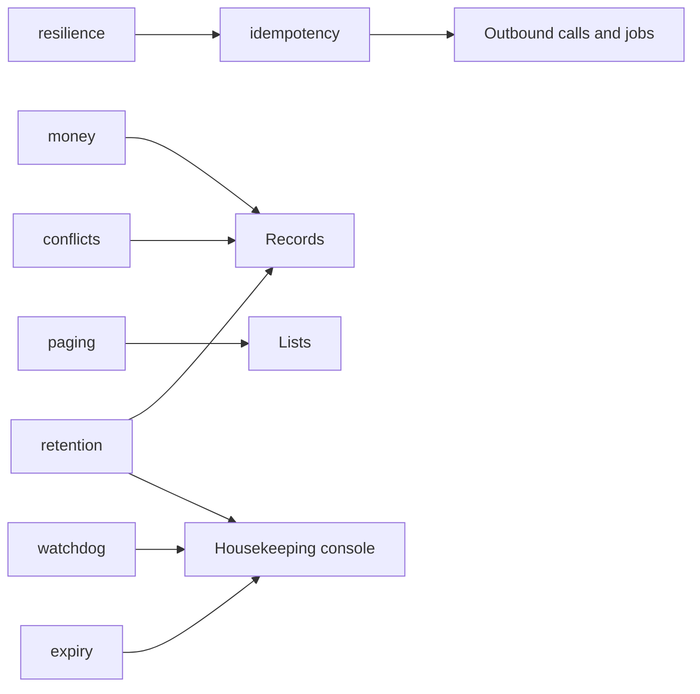

# Housekeeping blocks

Known-good code for the parts almost every app needs and most apps get wrong, so the factory starts from them and
the AI designs only what is different. Each block is plain TypeScript with no dependencies, takes its clock and its
randomness as arguments so every behaviour is testable, and ships with its tests.

<!-- fact:blocks.count -->8<!-- /fact --> blocks, <!-- fact:blocks.tests -->28<!-- /fact --> tests between them:

<!-- gen:blocks-here -->
| Block | What it holds | Tests |
| --- | --- | --- |
| [resilience](resilience/index.ts) | Timeouts with abort, bounded full-jitter retries, and a circuit breaker that half-opens on its own | 4 |
| [idempotency](idempotency/index.ts) | One result per idempotency key: repeats replay it, different content is refused, concurrent repeats wait | 4 |
| [money](money/index.ts) | Whole minor units per currency, half-even rounding, and splits that always add back to the total | 4 |
| [conflicts](conflicts/index.ts) | Versioned saves with a three-way merge of fields that do not clash, and the exact fields that do | 5 |
| [paging](paging/index.ts) | Stable keyset paging with opaque cursors, and only declared sorts and filters | 3 |
| [retention](retention/index.ts) | Trash with dependents, restore of all of it, and a retention sweep plan with reasons | 3 |
| [watchdog](watchdog/index.ts) | Missed, overlong, failed and overlapping scheduled runs, and a lease so one copy runs at a time | 3 |
| [expiry](expiry/index.ts) | Everything with an expiry date, and the alert each needs today | 2 |
<!-- /gen -->

