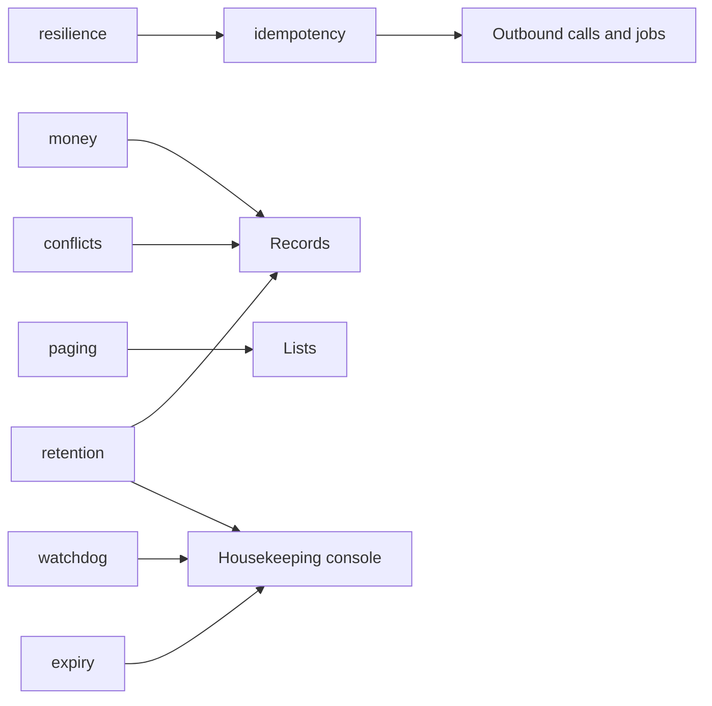

# Housekeeping blocks

Known-good code for the parts almost every app needs and most apps get wrong, so the factory starts from them and
the AI designs only what is different. Each block is plain TypeScript with no dependencies, takes its clock and its
randomness as arguments so every behaviour is testable, and ships with its tests.

| Block | Part it fills | What it holds |
| --- | --- | --- |
| [resilience](resilience/index.ts) | Timeouts, retries and circuit breakers | A deadline on every call, bounded retries with full-jitter backoff, a breaker that fails fast and half-opens on its own |
| [idempotency](idempotency/index.ts) | Idempotent requests | One result per key; a repeat returns it, the same key with different content is refused, a run in flight is not run twice |
| [money](money/index.ts) | Money and rounding | Whole minor units in their currency, half-even rounding, and splits that always add back to the total |
| [conflicts](conflicts/index.ts) | Edit conflicts | Versions on every save, a three-way merge of fields that do not clash, and the exact fields that do |
| [paging](paging/index.ts) | Lists: paging, sorting and filters | A stable order with an id tie-break, opaque cursors, and filters checked against what may be filtered |
| [retention](retention/index.ts) | Trash and restore; Data retention sweeper | Trash with dependents, restore of all of it, and a sweep plan that says what to archive or purge and why |
| [watchdog](watchdog/index.ts) | Cron watchdog | Missed, overlong and overlapping runs from a schedule and the check-ins, and a lease so two copies never run |
| [expiry](expiry/index.ts) | Expiry watch | Everything with an expiry date, and which alert each needs today |

