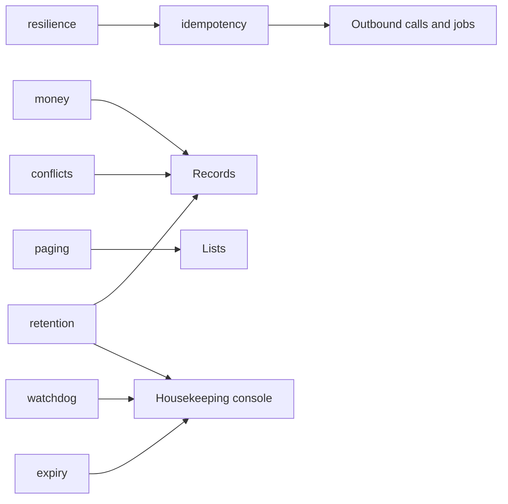

# Housekeeping blocks

Known-good code for the parts almost every app needs and most apps get wrong, so the factory starts from them and
the AI designs only what is different. Each block is plain TypeScript with no dependencies, takes its clock and its
randomness as arguments so every behaviour is testable, and ships with its tests.

<!-- fact:blocks.count -->18<!-- /fact --> blocks, <!-- fact:blocks.tests -->95<!-- /fact --> tests between them:

<!-- gen:blocks-here -->
| Block | What it holds | Tests |
| --- | --- | --- |
| [resilience](resilience/index.ts) | Timeouts with abort, bounded full-jitter retries, and a circuit breaker that half-opens on its own | 4 |
| [idempotency](idempotency/index.ts) | One result per idempotency key: repeats replay it, different content is refused, concurrent repeats wait | 4 |
| [money](money/index.ts) | Whole minor units per currency, half-even rounding, and splits that always add back to the total | 4 |
| [conflicts](conflicts/index.ts) | Versioned saves with a three-way merge of fields that do not clash, and the exact fields that do | 5 |
| [paging](paging/index.ts) | Stable keyset paging with opaque cursors, and only declared sorts and filters | 3 |
| [retention](retention/index.ts) | Trash with dependents, restore of all of it, and a retention sweep plan with reasons | 3 |
| [watchdog](watchdog/index.ts) | Missed, overlong, failed and overlapping scheduled runs, and a lease so one copy runs at a time | 3 |
| [expiry](expiry/index.ts) | Everything with an expiry date, and the alert each needs today | 2 |
| [tree](tree/index.ts) | Folders and files with stable ids, where a change re-tags every ancestor and keeps folder sizes, so sync skips unchanged subtrees | 12 |
| [objects](objects/index.ts) | Bytes streamed once with checksums computed on the way, byte ranges, and parts joined in the store; memory and disk stores | 10 |
| [uploads](uploads/index.ts) | Resumable chunked uploads: any order, repeats replace, quota checked up front, joined in a tree of compose calls, idle sessions swept | 8 |
| [leases](leases/index.ts) | Exclusive holds with owners, tokens and time limits that end on their own, covering everything below a folder when deep | 6 |
| [grants](grants/index.ts) | Permissions to people, groups and links, never more than the giver has; link passwords hashed and throttled; expiries | 8 |
| [devices](devices/index.ts) | A browser sign-in flow that hands a new app its own hashed password once; revoke one device, or wipe it remotely | 6 |
| [dav](dav/index.ts) | The DAV core: a namespace-aware XML reader that refuses DTDs, the multistatus writer, and the WebDAV headers | 8 |
| [oracle](oracle/index.ts) | Differential checks: the same requests to the reference and the candidate, answers normalised and compared, or recorded once | 4 |
| [ratelimit](ratelimit/index.ts) | Token buckets per key that say how long to wait, and failure counts that slow only mistakes, with bounded memory | 4 |
| [uploadsafe](uploadsafe/index.ts) | Names a client could not hold refused before any bytes are kept, size limits, and the real type read from the first bytes | 4 |
<!-- /gen -->

