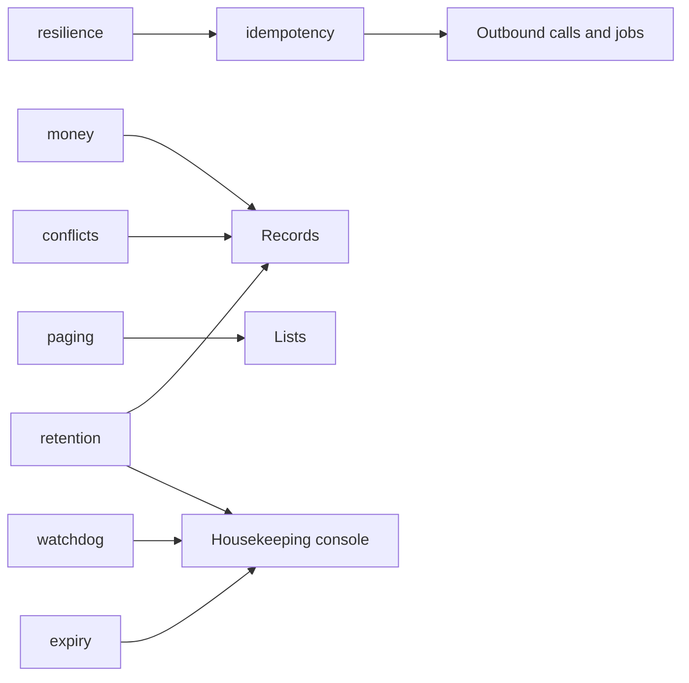

# Housekeeping blocks

Known-good code for the parts almost every app needs and most apps get wrong, so the factory starts from them and
the AI designs only what is different. Each block is plain TypeScript with no dependencies, takes its clock and its
randomness as arguments so every behaviour is testable, and ships with its tests.

<!-- fact:blocks.count -->85<!-- /fact --> blocks, <!-- fact:blocks.tests -->889<!-- /fact --> tests between them:

<!-- gen:blocks-here -->
| Block | What it holds | Tests |
| --- | --- | --- |
| [resilience](resilience/index.ts) | Timeouts with abort, bounded full-jitter retries, and a circuit breaker that half-opens on its own | 4 |
| [idempotency](idempotency/index.ts) | One result per idempotency key: repeats replay it, different content is refused, concurrent repeats wait | 4 |
| [money](money/index.ts) | Whole minor units per currency, half-even rounding, and splits that always add back to the total | 4 |
| [conflicts](conflicts/index.ts) | Versioned saves with a three-way merge of fields that do not clash, and the exact fields that do | 5 |
| [paging](paging/index.ts) | Stable keyset paging with opaque cursors, and only declared sorts and filters | 3 |
| [retention](retention/index.ts) | Trash with dependents, restore of all of it, and a retention sweep plan with reasons | 3 |
| [watchdog](watchdog/index.ts) | Missed, overlong, failed and overlapping scheduled runs, and a lease so one copy runs at a time | 3 |
| [expiry](expiry/index.ts) | Everything with an expiry date, and the alert each needs today | 2 |
| [tree](tree/index.ts) | Folders and files with stable ids, where a change re-tags every ancestor and keeps folder sizes, so sync skips unchanged subtrees | 12 |
| [objects](objects/index.ts) | Bytes streamed once with checksums computed on the way, byte ranges, and parts joined in the store; memory and disk stores | 10 |
| [uploads](uploads/index.ts) | Resumable chunked uploads: any order, repeats replace, quota checked up front, joined in a tree of compose calls, idle sessions swept | 8 |
| [leases](leases/index.ts) | Exclusive holds with owners, tokens and time limits that end on their own, covering everything below a folder when deep | 6 |
| [grants](grants/index.ts) | Permissions to people, groups and links, never more than the giver has; link passwords hashed and throttled; expiries | 8 |
| [devices](devices/index.ts) | A browser sign-in flow that hands a new app its own hashed password once; revoke one device, or wipe it remotely | 6 |
| [dav](dav/index.ts) | The DAV core: a namespace-aware XML reader that refuses DTDs, the multistatus writer, and the WebDAV headers | 8 |
| [oracle](oracle/index.ts) | Differential checks: the same requests to the reference and the candidate, answers normalised and compared, or recorded once | 4 |
| [ratelimit](ratelimit/index.ts) | Token buckets per key that say how long to wait, and failure counts that slow only mistakes, with bounded memory | 4 |
| [uploadsafe](uploadsafe/index.ts) | Names a client could not hold refused before any bytes are kept, size limits, and the real type read from the first bytes | 4 |
| [validate](validate/index.ts) | One schema per input and one error format: every problem at once, each with its path and a message, as problem details for APIs and field errors for forms | 4 |
| [config](config/index.ts) | Typed settings and secrets by name, refusing to start when one is missing or unsafe, an inventory that never shows a value, rotation dates and drift | 4 |
| [observe](observe/index.ts) | Structured logs redacted where written, errors grouped by kind and place, metrics with percentiles, and traces carried through async work | 4 |
| [health](health/index.ts) | Readiness with deadlines, the running version, graceful drain on shutdown, maintenance windows, the environment badge and the status model | 4 |
| [jobs](jobs/index.ts) | A queue with jittered retries, dead letters and replay, keyed jobs, long tasks with progress and cancel, checkpointed backfills with a dry run, and cron | 5 |
| [audit](audit/index.ts) | A hash-chained audit log of changes and sensitive reads, verifiable end to end and against a published head | 3 |
| [crypto](crypto/index.ts) | Envelope encryption bound to its record with a rotating key ring, purpose-bound expiring signed tokens, constant-time comparison and random ids | 4 |
| [rbac](rbac/index.ts) | Roles and grants declared once, narrowed by record rules, refusals that win, and the same evaluator explaining every decision and filtering lists | 4 |
| [secheaders](secheaders/index.ts) | Strict browser headers with script nonces and features off by default, session cookie attributes, and cross-site request checks | 2 |
| [apikeys](apikeys/index.ts) | Scoped API keys shown once and kept as hashes, found by prefix, rotated with an overlap, expired and revoked | 2 |
| [accounts](accounts/index.ts) | Sign-up with confirmation, sign-in, single-use password resets, organisations and invitations, a role switcher, deactivation and offboarding, and time-boxed act-as and break-glass that are recorded and announced | 5 |
| [sessions](sessions/index.ts) | Sessions with idle and absolute limits and a warning before expiry, ending all sessions, TOTP enrolment and checking (RFC 6238, no replay) and single-use recovery codes | 4 |
| [oidc](oidc/index.ts) | OpenID Connect sign-in: state, nonce and PKCE, a JWKS cache, and ID token checks (RS256/ES256 only; issuer, audience, expiry, nonce) | 3 |
| [webhooks](webhooks/index.ts) | Inbound webhooks believed only when signed, recent and not seen before; outbound delivery signed, retried with backoff, parked with the last answer, replayable, with failing endpoints paused | 2 |
| [flags](flags/index.ts) | Feature flags for people, groups, attributes and stable percentage rollouts, a kill switch, an explanation for every answer, and a list of flags past their removal date | 2 |
| [cache](cache/index.ts) | Read-through cache with one load per key under load, stale-while-refresh, tags, least-recently-used eviction and hit rates; failures are not cached | 2 |
| [consent](consent/index.ts) | Terms and consent by version: agreement recorded with when and how, withdrawal as a new record, required re-agreement when a new version needs it | 2 |
| [refdata](refdata/index.ts) | Versioned code lists with effective and retirement dates, labels as of a day, replacements, and checks that refuse a version which would orphan stored values | 2 |
| [notify](notify/index.ts) | Notifications by template (escaped, nothing missing), per-category channel choices, quiet hours in the person's zone, digests, bounce suppression, one-click unsubscribe (RFC 8058), reminders that stop when done, and receipts | 4 |
| [comments](comments/index.ts) | Threads and replies on any record, @mentions of people who can see it, edits with history, deletion markers, reactions, resolving and unread counts, shown escaped | 2 |
| [history](history/index.ts) | Field-level change history for any record: rebuild any version, compare two, undo as a new change that refuses to overwrite newer edits, and restore | 2 |
| [workflow](workflow/index.ts) | Declared state machines checked so no record can be stranded, guards that explain, approvals by distinct people who did not ask, reasons for rejection, deadlines that escalate, and a trail | 2 |
| [events](events/index.ts) | A CloudEvents 1.0 catalogue that refuses undeclared events or missing fields, a hub with replay for reconnecting clients, server-sent events, and presence | 3 |
| [slo](slo/index.ts) | Objectives, error budgets and multi-window burn-rate alerts; incidents with timelines and public notes; postmortems that need a cause, impact and owned actions | 3 |
| [costmeter](costmeter/index.ts) | Usage priced from a rate card and attributed to feature and tenant, free units, budgets that warn and can stop spending, and a month-end forecast | 2 |
| [tabular](tabular/index.ts) | CSV to RFC 4180 with formula defusing, column mapping suggestions, imports that quarantine bad rows with reasons, rule-based dedupe and merge, and export to CSV, JSON lines and .xlsx | 4 |
| [reports](reports/index.ts) | Grouped reports with count, sum, average, min, max and distinct, filters, totals, small-group suppression, pivots, parameterised templates and scheduled delivery with a log | 3 |
| [search](search/index.ts) | BM25 full-text search with field weights, accent folding and stemming, prefix while typing, phrases, facets and filters, escaped snippets, and a visibility check on every hit | 3 |
| [i18n](i18n/index.ts) | Message catalogues with each language's plural rules, fallback chains with a missing report, Accept-Language negotiation, text direction, Intl formatting, and a completeness check | 3 |
| [time](time/index.ts) | Wall time to instant across daylight-saving changes, RRULE recurrence in wall time (daily, weekly, monthly by day or weekday, yearly, until, count, exceptions), and working days | 4 |
| [booking](booking/index.ts) | Free time inside each person's local hours, find-a-time across zones ranked for everyone's day, and holds and bookings that cannot double-book, with buffers and expiry | 3 |
| [contact](contact/index.ts) | Names kept as written with a name to use and a sort key, addresses formatted and postcodes checked by country, and phone numbers normalised to E.164 | 3 |
| [analytics](analytics/index.ts) | Consent-gated product analytics with pseudonymous ids and allow-listed properties, forgetting, ordered funnels within a time limit, common journeys, and small-count suppression | 2 |
| [payments](payments/index.ts) | Payments behind a provider interface with a tested twin (declines, confirmation, idempotency, partial refunds), integer money, and billing: trials, renewals, prorated plan changes, retries and cancel at period end | 3 |
| [pdf](pdf/index.ts) | PDF 1.7 written directly: headings, wrapped paragraphs, tables with repeated headers, page numbers, escaped WinAnsi text and a correct cross-reference table (checked with qpdf) | 2 |
| [docparse](docparse/index.ts) | Text from .docx (headings, lists) and cells from .xlsx (shared and inline strings), read through a zip reader that refuses bombs, unsafe paths and damaged archives | 3 |
| [imagemeta](imagemeta/index.ts) | Image kind from the bytes, size for PNG, JPEG, GIF and WebP, EXIF orientation, refusal of decompression bombs, and stripping of EXIF, GPS and comments with the colour profile kept | 3 |
| [geo](geo/index.ts) | Great-circle distance, bounding boxes across the antimeridian, nearest places, service areas with holes, geohash, and coarsening a position to an area | 2 |
| [sitemap](sitemap/index.ts) | Head tags for public pages (canonical, Open Graph, Twitter, JSON-LD) escaped, a check for missing, long and duplicate titles, sitemaps with an index past 50,000 URLs, and robots.txt | 2 |
| [apiver](apiver/index.ts) | Date-based API versions with per-change transforms back to a pinned version, Deprecation and Sunset headers, refusal after sunset, and a list of callers still on old versions | 2 |
| [drafts](drafts/index.ts) | Autosaved drafts per person and record, spaced snapshots to restore, a conflict report when the record changed since, a list to pick up from, and sweeping | 2 |
| [palette](palette/index.ts) | A command palette with fuzzy matching, keywords, permission filtering, recent commands first, shortcut conflict detection and a shortcuts sheet | 3 |
| [testdata](testdata/index.ts) | Seeded, repeatable fake data in ranges reserved for fiction (example domains, 555-01xx numbers, published test cards), factories with overrides, and a guard against real-looking values | 3 |
| [privacy](privacy/index.ts) | A registry of personal-data sources; one-archive exports with a manifest and readable summary; erasure that reports removed, kept and why, and is complete only when every source succeeded | 2 |
| [surfaces](surfaces/index.ts) | A registry of every screen with its purpose, audience, help and words for loading, empty and error states, checked; contextual help, what's new once per person, a first-run checklist, and friendly error pages | 3 |
| [upkeep](upkeep/index.ts) | Dependency verdicts from advisories and current versions, expiry warnings for certificates, domains, tokens and keys, and SARIF findings with stable fingerprints, triaged into new, open, accepted and fixed | 4 |
| [backups](backups/index.ts) | Backups with per-collection row counts and order-free hashes, restore drills into scratch timed against a target, and grandfather-father-son retention that says why each backup is kept | 3 |
| [loadsoak](loadsoak/index.ts) | Open-model load runs at a fixed arrival rate with percentile and error-rate limits, and soak verdicts that find a steady climb by fitting a line, ignoring noise | 3 |
| [datagate](datagate/index.ts) | A classified inventory of every field with findings for gaps, a gate that allows, masks or denies each field per destination with the deciding rule, and evidence of every decision | 3 |
| [pipeline](pipeline/index.ts) | The delivery pipeline as stages and events: where each change is, what it waits for, what is stuck, and lead time, deployment frequency, change failure rate and time to restore | 2 |
| [sync](sync/index.ts) | One sync engine for outside systems: paged pulls with a cursor kept only after a page applies, pushes by external id, echo recognition, conflicts settled by a rule and reported, and twins for testing | 2 |
| [feedback](feedback/index.ts) | Problem reports in the person's words with redacted context, grouping of similar reports, a triage board ordered by overdue and severity, and defects with evidence and a failing test skeleton | 2 |
| [cmi5](cmi5/index.ts) | cmi5 training modules: launch URLs, the defined xAPI statements with cmi5 context, the session rules, mastery scores and moveOn | 2 |
| [pwa](pwa/index.ts) | A checked web app manifest, a service worker built from a caching plan with an offline page, and an offline queue that replays in order and sets aside what the server refuses | 3 |
| [ux](ux/index.ts) | Snooze to times people mean, previewed bulk edits, signed shared views, learned defaults, magic paste, honest progress, reading comfort CSS, why am I seeing this, and is it me or is it down | 6 |
| [migrations](migrations/index.ts) | Ordered, checksummed data migrations applied once each under a lock, with verify steps, dry runs, and refusal when an applied migration was edited, removed or arrives out of order | 3 |
| [mcp](mcp/index.ts) | Agent tools over the Model Context Protocol: a JSON-RPC 2.0 handler with initialize, tools/list and tools/call, schema-checked arguments, per-person permissions, read-only hints and a call log | 2 |
| [query](query/index.ts) | A read-only query console: a small query language parsed and checked against declared collections, capped results, masked sensitive fields, no filtering on hidden values, and a log of every query | 2 |
| [uat](uat/index.ts) | Test-environment overrides of flags, clock and role for one tester, time-limited with a reason, shown on a banner, recorded, and refused in production | 2 |
| [importer](importer/index.ts) | One way in for data from anywhere: uploaded bytes or pasted text recognised as CSV/TSV, .xlsx, .docx, JSON, JSON lines, vCard, iCalendar or a pasted table or address list, decoded from UTF-8 or UTF-16, held to size and row limits, matched to fields, with every bad row quarantined by where it was and why | 11 |
| [ask](ask/index.ts) | Plain-language questions over a declared dataset: a model's proposed report is checked against the fields, measures and filters the person may see, small groups are suppressed, and the answer comes with its records, a plain-English description of what was computed, and the report itself | 6 |
| [etl](etl/index.ts) | Declared extract-transform-load pipelines with per-step page checkpoints that resume, idempotent loads by id, capped row-level error capture, dry runs, per-run lineage with an every-row-accounted check, a cron schedule and a watch for stale, failed or drifting runs | 10 |
| [console](console/index.ts) | The model behind the admin console, housekeeping console and feature explorer: sections of items with status, reason, path and permission built from the app's registries, filtered by permission with a summary line, plus a feature explorer that joins and searches features, screens, flags, journeys and evidence | 7 |
| [factoryreports](factoryreports/index.ts) | Feature reports, operations reports and the improvement brief as documents with tables and evidenced findings, rendered to Markdown and delivered on a schedule, with the brief ranking what to change next by weighted evidence and saying why | 7 |
| [walkthrough](walkthrough/index.ts) | A guided, ordered walk through a feature's journey steps showing each claim, its evidence and whether that evidence is current, with step-by-step sign-off refused on stale, failed, missing or untraceable evidence and voided when covered code changes | 5 |
| [speech](speech/index.ts) | Speech transcripts turned into palette commands with spoken confirmation for destructive ones, dictation with spoken punctuation and corrections, and numbers and dates spoken in words, with a feature-detected Web Speech adapter | 9 |
| [router](router/index.ts) | Chooses the cheapest model proven good enough for each kind of task: a dated price table, per-request cost with long-context and regional rates, pass rates per model per task kind trusted on a Wilson lower bound, exploration of cheaper models, escalation through tiers, judges from another family, and a daily budget | 17 |
<!-- /gen -->

