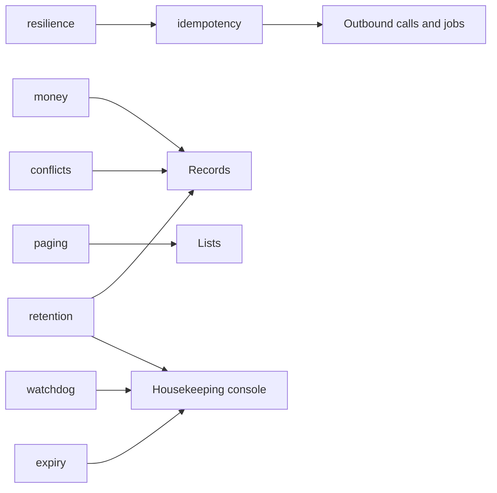

# Housekeeping blocks

Known-good code for the parts almost every app needs and most apps get wrong, so the factory starts from them and
the AI designs only what is different. Each block is plain TypeScript with no dependencies, takes its clock and its
randomness as arguments so every behaviour is testable, and ships with its tests.

<!-- fact:blocks.count -->36<!-- /fact --> blocks, <!-- fact:blocks.tests -->153<!-- /fact --> tests between them:

<!-- gen:blocks-here -->
| Block | What it holds | Tests |
| --- | --- | --- |
| [resilience](resilience/index.ts) | Timeouts with abort, bounded full-jitter retries, and a circuit breaker that half-opens on its own | 4 |
| [idempotency](idempotency/index.ts) | One result per idempotency key: repeats replay it, different content is refused, concurrent repeats wait | 4 |
| [money](money/index.ts) | Whole minor units per currency, half-even rounding, and splits that always add back to the total | 4 |
| [conflicts](conflicts/index.ts) | Versioned saves with a three-way merge of fields that do not clash, and the exact fields that do | 5 |
| [paging](paging/index.ts) | Stable keyset paging with opaque cursors, and only declared sorts and filters | 3 |
| [retention](retention/index.ts) | Trash with dependents, restore of all of it, and a retention sweep plan with reasons | 3 |
| [watchdog](watchdog/index.ts) | Missed, overlong, failed and overlapping scheduled runs, and a lease so one copy runs at a time | 3 |
| [expiry](expiry/index.ts) | Everything with an expiry date, and the alert each needs today | 2 |
| [tree](tree/index.ts) | Folders and files with stable ids, where a change re-tags every ancestor and keeps folder sizes, so sync skips unchanged subtrees | 12 |
| [objects](objects/index.ts) | Bytes streamed once with checksums computed on the way, byte ranges, and parts joined in the store; memory and disk stores | 10 |
| [uploads](uploads/index.ts) | Resumable chunked uploads: any order, repeats replace, quota checked up front, joined in a tree of compose calls, idle sessions swept | 8 |
| [leases](leases/index.ts) | Exclusive holds with owners, tokens and time limits that end on their own, covering everything below a folder when deep | 6 |
| [grants](grants/index.ts) | Permissions to people, groups and links, never more than the giver has; link passwords hashed and throttled; expiries | 8 |
| [devices](devices/index.ts) | A browser sign-in flow that hands a new app its own hashed password once; revoke one device, or wipe it remotely | 6 |
| [dav](dav/index.ts) | The DAV core: a namespace-aware XML reader that refuses DTDs, the multistatus writer, and the WebDAV headers | 8 |
| [oracle](oracle/index.ts) | Differential checks: the same requests to the reference and the candidate, answers normalised and compared, or recorded once | 4 |
| [ratelimit](ratelimit/index.ts) | Token buckets per key that say how long to wait, and failure counts that slow only mistakes, with bounded memory | 4 |
| [uploadsafe](uploadsafe/index.ts) | Names a client could not hold refused before any bytes are kept, size limits, and the real type read from the first bytes | 4 |
| [validate](validate/index.ts) | One schema per input and one error format: every problem at once, each with its path and a message, as problem details for APIs and field errors for forms | 4 |
| [config](config/index.ts) | Typed settings and secrets by name, refusing to start when one is missing or unsafe, an inventory that never shows a value, rotation dates and drift | 4 |
| [observe](observe/index.ts) | Structured logs redacted where written, errors grouped by kind and place, metrics with percentiles, and traces carried through async work | 4 |
| [health](health/index.ts) | Readiness with deadlines, the running version, graceful drain on shutdown, maintenance windows, the environment badge and the status model | 4 |
| [jobs](jobs/index.ts) | A queue with jittered retries, dead letters and replay, keyed jobs, long tasks with progress and cancel, checkpointed backfills with a dry run, and cron | 5 |
| [audit](audit/index.ts) | A hash-chained audit log of changes and sensitive reads, verifiable end to end and against a published head | 3 |
| [crypto](crypto/index.ts) | Envelope encryption bound to its record with a rotating key ring, purpose-bound expiring signed tokens, constant-time comparison and random ids | 4 |
| [rbac](rbac/index.ts) | Roles and grants declared once, narrowed by record rules, refusals that win, and the same evaluator explaining every decision and filtering lists | 4 |
| [secheaders](secheaders/index.ts) | Strict browser headers with script nonces and features off by default, session cookie attributes, and cross-site request checks | 2 |
| [apikeys](apikeys/index.ts) | Scoped API keys shown once and kept as hashes, found by prefix, rotated with an overlap, expired and revoked | 2 |
| [accounts](accounts/index.ts) | Sign-up with confirmation, sign-in, single-use password resets, organisations and invitations, a role switcher, deactivation and offboarding, and time-boxed act-as and break-glass that are recorded and announced | 5 |
| [sessions](sessions/index.ts) | Sessions with idle and absolute limits and a warning before expiry, ending all sessions, TOTP enrolment and checking (RFC 6238, no replay) and single-use recovery codes | 4 |
| [oidc](oidc/index.ts) | OpenID Connect sign-in: state, nonce and PKCE, a JWKS cache, and ID token checks (RS256/ES256 only; issuer, audience, expiry, nonce) | 3 |
| [webhooks](webhooks/index.ts) | Inbound webhooks believed only when signed, recent and not seen before; outbound delivery signed, retried with backoff, parked with the last answer, replayable, with failing endpoints paused | 2 |
| [flags](flags/index.ts) | Feature flags for people, groups, attributes and stable percentage rollouts, a kill switch, an explanation for every answer, and a list of flags past their removal date | 2 |
| [cache](cache/index.ts) | Read-through cache with one load per key under load, stale-while-refresh, tags, least-recently-used eviction and hit rates; failures are not cached | 2 |
| [consent](consent/index.ts) | Terms and consent by version: agreement recorded with when and how, withdrawal as a new record, required re-agreement when a new version needs it | 2 |
| [refdata](refdata/index.ts) | Versioned code lists with effective and retirement dates, labels as of a day, replacements, and checks that refuse a version which would orphan stored values | 2 |
<!-- /gen -->

