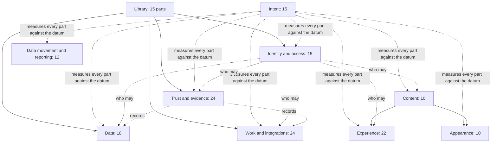

# Parts catalog

150 parts to build, grouped by the shared foundation each one leans on, on top of the 15 parts already in the library. ✓ means a library part covers it today; ◐ means one covers part of it. Every part carries a manifest, purpose notes, tests and planted-defect proofs, and every part is in exactly one group.

## Foundations

| Group | Parts | The one thing every part in it shares |
| --- | --- | --- |
| Intent | 15 | Every part is measured against one locked datum |
| Identity and access | 15 | One permission evaluator decides who may do what, everywhere |
| Data | 18 | One data declaration says what every field means, how sensitive it is and where it came from |
| Work and integrations | 24 | Every outward action goes through one door and is recorded as a run |
| Trust and evidence | 24 | One hash-chained event stream records everything that happens |
| Content | 10 | Every surface and every piece of text has one controlled home, generated from the code |
| Experience | 22 | One component kit, so every delighter works on every surface |
| Appearance | 10 | One set of design tokens behind every visual choice |
| Data movement and reporting | 12 | Every load, export and report goes through the data dictionary, so meaning, sensitivity and permissions travel with the data |

## Intent

Every part is measured against one locked datum.

- **Spec intake** ◐: Spec Kit, Kiro, OpenSpec, Gherkin and plain markdown parsed into one canonical structure, with no model
- **Two-family parse and diff**: Rough intent parsed twice by two model families into the same schema, compared field by field; every difference is a question
- **Gap checks**: Decision-table completeness and overlap, state-machine dead ends and unreachable states, and required pairings, each raised as a question naming what it protects
- **Read-back**: What will be built, rendered from the structure by templates: confirmed, open, assumed and default, with who supplied each
- **Design lexicon**: Human design terms such as calm, snappy and at a glance mapped to design choices and measures, resolved without a model and grown from every confirmed correction
- **Assembly preview**: The chosen parts' wireframes assembled into a clickable skeleton, with each part's documentation as the placeholder for content still to define
- **Connection graph**: Outcomes, measures, journeys, parts, surfaces, entities and roles joined by typed edges; unmeasured outcomes and unused parts stand out
- **Outcomes and measures**: Each outcome in the user's words, each measure compiled to a journey, a metric with a tolerance, or a signal from people
- **Locked datum** ✓: Outcomes, measures, journeys and scenarios pinned by hash; a change to intent cannot change what it judges
- **Held-out sets**: Sealed journeys and corpora no generator can read, added to only by a person, failing the build if copied into a rule
- **Decision tables**: Rules as data with source and effective dates, run by one evaluator, with boundary tests generated at, below and above every threshold
- **State machines**: Flows as data, run by one engine, checked for dead ends, unreachable states and unowned transitions
- **Independent second implementation**: A critical calculation written twice by different model families from the same table, compared on generated inputs every build
- **Intent completion from the state graph** ◐: Each journey decided by searching the explored state graph for a path within its budget that avoids every forbidden outcome
- **Incremental certification**: Only states touched by a changed handler re-explored, so certification is always for the commit being served

## Identity and access

One permission evaluator decides who may do what, everywhere.

- **Authentication**: Sign-in, sessions, sign-out, session expiry
- **Authorization**: Roles, permissions and per-record access checks
- **User accounts**: Sign-up, profile, password reset, invitations
- **Organizations and teams**: Multi-tenancy, membership, invitations, switching
- **Multi-factor sign-in**: One-time codes, passkeys, recovery
- **Single sign-on**: OIDC and SAML with major providers
- **API keys and tokens**: Issue, scope, rotate and revoke keys
- **Roles and permissions (RBAC)**: Roles, permissions and grants declared in one place and enforced by one evaluator
- **Permission explainer**: Why can or can't this person do this action on this record, answered by the same evaluator that enforces it
- **Row-level security controls** ◐: Who can see which rows, enforced in the data layer itself and viewable per person
- **Act as a user**: An admin searches for any user and uses the app as them to reproduce and verify a problem, with every action recorded under both names
- **Role switcher**: People with more than one primary role switch between them from the top bar, next to the environment badge, with search, and see the app exactly as that role does
- **Security headers and CSRF**: Safe defaults for browsers and forms
- **Password hashing and crypto** ◐: Hashing, tokens, signing, encryption at rest
- **Rate limiting and abuse protection**: Per-user and global limits, lockouts

## Data

One data declaration says what every field means, how sensitive it is and where it came from.

- **Validation**: Schemas for every input, one error format
- **Data store and migrations** ◐: Persistence, schema changes, owner-scoped records
- **Caching**: Read-through cache with expiry and invalidation
- **Search**: Full-text search, filters, ranking
- **History and versioning**: Change history, diffs, undo, activity feed
- **Backups and retention**: Scheduled backups, restore drills, retention rules
- **Record inspector** ◐: Open any record by id: every field, its history, its owner, and who has read or changed it
- **Object viewer** ◐: Browse any collection or type with its declared fields, classes and live counts
- **ERD tool** ◐: Entity diagrams generated from the data declaration, so the picture can never drift from the schema
- **Field provenance** ◐: For any value: what the field means, how sensitive it is, which block, endpoint, person or import wrote it, and when
- **What-if editing** ◐: Change any field in the record or object inspector and watch what the application does with it, for this session only, to check automations and updates or find out whether the data is the problem
- **Privacy: consent, export, erasure** ✓: Consent records, whole-record export and deletion
- **Your whole record** *(delighter)*: Download or delete everything about you in one click
- **Ask your data** *(delighter)*: Plain-language questions over your own records, answered with the records shown
- **Bulk edit with preview** *(delighter)*: Change many records at once and see every change before it applies
- **Configuration and secrets** ◐: Typed settings, secrets by name, refuse to start when unsafe
- **Data dictionary** ◐: Every model and field with its meaning, type, sensitivity class, owner, source, allowed values, examples, and every surface and report that uses it, generated from the Prisma schema
- **Prisma schema and ERD** ◐: The Prisma schema is the one data declaration; entity diagrams, the data dictionary, migrations and sensitivity classes are all generated from it

## Work and integrations

Every outward action goes through one door and is recorded as a run.

- **HTTP API and routing**: Endpoints, middleware, request lifecycle
- **Outbound HTTP** ✓: Allow-listed calls with timeouts, retries and records
- **Webhooks**: Signed inbound webhooks and reliable outbound ones
- **Email** ◐: Templated mail, delivery status, bounces
- **Notifications** ◐: In-app, push and SMS with preferences
- **Calendar and booking** ◐: Availability, booking, recurring events, invites
- **Payments**: Charges, refunds, payouts, idempotent calls
- **Subscriptions and billing**: Plans, invoices, proration, dunning
- **Background jobs and scheduling** ◐: Queues, retries, cron, idempotent work
- **Jobs and queues console** ◐: Running, waiting and failed work, with safe retry and cancel
- **Runs** ◐: Every integration sync and data load is a recorded run: what came in, which records it created, changed or removed, which automations it set off, which rows were rejected and why, and whether anything broke afterwards
- **Real-time updates**: Live updates, presence, subscriptions
- **Messaging and comments**: Threads, mentions, read state
- **Maps and location**: Geocoding, distance, maps
- **Document parsing**: Read PDFs, scans and office files into text
- **Image processing**: Resize, crop, convert, strip metadata
- **PDF and documents**: Generated PDFs, letters and receipts
- **AI model gateway** ✓: Approved model access with budgets, logging and a twin
- **Find a time** *(delighter)*: One click finds a slot that works for everyone, from their calendars
- **Reminders that stop** *(delighter)*: Reminders across email, text and calendar that stop the moment it's done
- **File upload and storage**: Uploads, limits, scanning, signed links
- **Approvals and workflow** ◐: Multi-step approvals, state machines, holds
- **Chat** ◐: A conversation that routes deterministically first and uses a model only inside the guard, with next steps on every reply
- **Model guard** ◐: Input schema, field allowlist, scrub and classification before every model call; strict output schema, record check and templates after

## Trust and evidence

One hash-chained event stream records everything that happens.

- **Audit log** ◐: Append-only record of who did what
- **Tamper-evident audit chain** ◐: Every change and every read of sensitive data in a hash-chained log, with the chain head anchored where admins cannot rewrite it
- **Receipts** *(delighter)*: A plain record after every important action of what happened and when
- **Why am I seeing this?** *(delighter)*: Every automated decision explains itself on request
- **Error reporting**: Errors captured with context, grouped, alerted
- **Error monitoring**: Errors grouped with the request, the build and the feature they belong to, linked to the feature registry
- **Logging**: Structured logs with redaction
- **Metrics and tracing**: Request traces, service metrics, dashboards
- **Request tracer**: Follow one request through every block it touched, with timings and outcomes
- **Health and readiness**: Liveness, readiness and version endpoints
- **Is it me or is it down?** *(delighter)*: Live service status inside the app, so nobody wonders
- **Environment badge**: Dev, test, UAT or production shown on every screen in its own colour, linked to the exact commit running. Hover shows the last commit, who made it, when and a link, plus the version running in every other environment
- **Where is my change**: Find a change by commit, pull request or ticket and watch it move through the pipeline: reviews, checks, mutation testing, build, each environment and the post-commit review, each stage linked to its evidence
- **Feature registry console** ◐: Every feature, its walks, its blocks and whether it is proven on the running build
- **Configuration and secrets inventory** ◐: Every setting and secret by name, where it is used and when it was last rotated, never the values
- **Feature flags**: Gradual rollout, kill switches, targeting
- **Product analytics**: Events, funnels, consent-aware tracking
- **Evidence, intents first** ◐: The evidence page leads with intents completed by the graph, a cold agent and real users, then delight, then the fail-safes
- **Safety router** ✓: Crisis messages routed to a safety reply before any account, setup or model, in every supported language
- **Normaliser and phrasing fuzzer**: Contractions, lookalike characters and misspellings normalised before matching, and variants of every corpus line generated, so a fix closes a class
- **Red team**: One test per attack, results to the evidence store, and every attack that got through kept forever; generic corpora ship, domain corpora are configuration
- **Nightly scanner**: garak against the deployed endpoint every night, results recorded as pass, fail or unknown
- **Review panel** ◐: Model families reviewing each change against the locked datum it touches, unknown on a partial view, scored by unique validated findings
- **Preference signals**: People's preference between versions of a surface and their delight after a task, reported beside intent completion

## Content

Every surface and every piece of text has one controlled home, generated from the code.

- **Surface registry**: Every screen, panel, dialog, email and admin tool is registered with its feature, its help and the content it shows; a surface that isn't registered fails the build
- **Content registry** ◐: Every piece of text shown anywhere (labels, help, errors, emails, admin text, docs, every language) has one controlled home; text without one fails the build
- **Contextual help**: An i icon at the top right of every surface opens help for that surface, generated from its code, its feature and its walks on every build, so nobody maintains help text
- **Generated documentation** ◐: Every document (repo, app, admin, API) generated from the code, the intent and the build's evidence; every instruction in it is carried out on the build before it is published
- **Internationalization**: Translated text, plurals, number and date formats
- **Your language** *(delighter)*: Switch language instantly, with every screen translated and checked
- **Explain this screen** *(delighter)*: Help grounded in the generated docs for the screen you're on
- **Knowledge bundle**: Everything the system knows about itself generated into one Open Knowledge Format bundle in git, with read-back states as trust
- **Chat context engine**: Context assembled from fresh concepts the user's role may read, looked up deterministically first, with every factual sentence cited
- **Readability for the audience** ✓: Every text checked against the audience's reading level for the reading setting chosen

## Experience

One component kit, so every delighter works on every surface.

- **UI kit and accessibility** ✓: Themed, accessible components and layouts
- **Forms**: Form state, validation messages, accessible errors
- **Dates and time zones**: Time-zone-safe dates, durations, recurrence
- **Admin console**: Back-office views to find, fix and support
- **Undo anything** *(delighter)*: Every action, not just text, can be undone for a while afterwards
- **Command palette** *(delighter)*: One keystroke to search and run any action in the app
- **Magic paste** *(delighter)*: Paste an email, table or screenshot and the form fills itself
- **Never lose work** *(delighter)*: Drafts save as you type, on every form, across devices
- **Works offline** *(delighter)*: Keep working without a connection; changes sync and merge when it returns
- **Who's here** *(delighter)*: See who else is viewing or editing, live
- **Share a view** *(delighter)*: A read-only link to exactly what you see, expiring when you choose
- **Pick up where you left off** *(delighter)*: Recent items and the exact place you stopped, on any device
- **Smart defaults** *(delighter)*: Forms remember sensible choices, so the common path is one click
- **Snooze** *(delighter)*: Push any item away until a time you choose
- **Teaching empty states** *(delighter)*: First run shows sample data and the next step, never a blank page
- **Speak instead of type** *(delighter)*: Voice input on any field
- **Reading comfort** *(delighter)*: Read aloud, larger text, dyslexia-friendly font and reduced motion, one switch each
- **Progress you can feel** *(delighter)*: Quiet milestones that show what's been done, not just what's left
- **Accessibility conformance** ◐: WCAG 2.2 Level AA on every surface, in every mode, style, palette and layout, checked on every build, with Level AAA wherever the content allows
- **Progressive web features**: Modern browser features where they exist (install as an app, offline, push, share, view transitions, popovers, container queries), each detected before use, on a base that works on any phone without them
- **Audience profile**: Reading level, languages, devices, assistive technology and conditions of use, confirmed in the read-back and setting every default
- **Density budget**: One primary action per surface, ordered headings, short lines, and no more choices than the density allows

## Appearance

One set of design tokens behind every visual choice.

- **Light and dark modes**: Follows the device or the person's choice, on every screen
- **High contrast**: A contrast mode that passes accessibility contrast checks on every screen
- **Design languages**: Switch the whole app between design languages from one token set: Material, Fluent, Carbon, Primer, GOV.UK-style and USWDS
- **Layouts**: Choose between sidebar, top navigation and compact layouts without changing any feature
- **Density**: Comfortable or compact spacing, per person
- **Brand themes**: An organisation's colours, type and logo applied from one file
- **Personal settings**: Each signed-in person picks their language, mode, palette, style, density and reading comfort, remembered on every device
- **Styles**: Fun but professional looks for the whole app: Paper, Studio, Midnight, Blueprint, Garden and Terminal, each a complete set of design tokens
- **Palettes**: Colour palettes such as Ocean, Forest, Ember, Slate and Lavender, plus palettes safe for each common kind of colour blindness
- **Low vision mode**: Text up to 200%, more spacing, one column, stronger focus and large targets, with every journey walked in it

## Data movement and reporting

Every load, export and report goes through the data dictionary, so meaning, sensitivity and permissions travel with the data.

- **Data import**: CSV and spreadsheet import with row-level errors
- **Reports and export**: CSV and spreadsheet export, scheduled reports
- **Import from anywhere** *(delighter)*: Drop a spreadsheet; columns are matched and every row's problem is shown
- **Ingest connectors**: Bring data in from files, APIs, webhooks and scheduled pulls from Cloud Storage, each recorded as a run
- **Mapping studio**: Map incoming columns to fields, with suggestions from the data dictionary, saved and reused for every later load from the same source
- **Quarantine and repair**: Rows that fail validation are held with the reason, fixed in place or rejected, and never silently dropped
- **Deduplicate and merge**: Find likely duplicates across loads, merge them with a preview, and keep the history of every merge
- **Export formats**: Export any permitted data as CSV, Excel, JSON or Parquet, with sensitive fields handled by their class
- **Scheduled exports**: Exports that run on a schedule to Cloud Storage or by email, each recorded as a run
- **Warehouse sync**: Keep BigQuery in step with the application's data for analysis, with sensitivity classes carried across
- **Report builder** ◐: Build reports in the app by choosing fields from the data dictionary: filters, groupings, measures and charts, saved, shared and scheduled
- **Report templates**: Ready-made reports to start from, each with a generated walkthrough showing how it was built

## Report templates

Operational:

- Change lead time: commit to production, by week
- Pipeline health: pass, fail and unknown by stage
- Error rate by feature and build
- Run health: loads, rejected rows and checks newly failing
- Job queue latency and failed jobs
- Intent completion: which journeys people finish, by surface
- Model spend by block and model family

Business:

- Active users by day, week and month
- Sign-up to first value funnel
- Retention by sign-up cohort
- Revenue and refunds by period
- Feature adoption from the feature registry
- Support load: help opened per surface

## Rules

- The permission explainer runs the same code that enforces permissions, never a copy, so an explanation cannot disagree with what actually happens.
- Every admin tool is itself behind roles and permissions, and every use of it is written to the audit chain: looking at a record is recorded like changing one.
- The audit chain is hash-linked so any edit or deletion is detected, and its head is written regularly to storage with a locked retention policy, so even an administrator cannot rewrite history unnoticed.
- Row-level security is enforced in the data layer, not only in the interface, and checked by planted defects: a query that would leak another person's rows must fail the build.
- Field provenance comes from recording every write as it happens, never reconstructed later by guessing.
- Each of these is a block with a manifest, tests and planted-defect proofs, like every other block.
- The badge reads the build fingerprint the running service reports about itself, never a value typed into the page, so it cannot claim a version that isn't running.
- Each environment's colour is paired with its name in text, so the badge is never colour alone, and every colour passes contrast checks.
- In production the badge stays visible, but the commit details on hover are shown only to staff roles, so authors' names are never exposed to the public.
- Where is my change shows a stage as passed only when that stage's evidence exists; a stage that is running or has no evidence yet shows as such, never as passed.
- While acting as a user, every action is written to the audit chain with both identities: the admin who did it and the user it was done as. Authorship is never transferred to the user.
- A banner stays on screen for as long as someone is acting as another user, naming who they are acting as, with a one-click way back.
- An admin can never act as someone with more permission than their own, and acting-as sessions end on their own after a set time.
- The person acted as can see in their own record when it happened, who did it and what was done.
- The role switcher only lists roles the person actually holds; switching role is recorded, and each role sees exactly what that role would see, through the same permission evaluator.
- What-if changes live in a layer over the real data for one session; reads in that session see the change, the stored record never does, and the layer is discarded when the session ends.
- Anything a what-if session would send outward (mail, texts, calendar writes, payments, webhooks) goes to the service twins and is shown on screen, never to the real service.
- Every what-if session is recorded in the audit chain: who opened it, which fields they changed and what the application did in response.
- Every record a run touches is linked to that run, so field provenance can answer "which load wrote this" and a run's full effect can be listed.
- After every run, the application's invariants and a sample of its intent walks are run against the new data and compared with the run before; anything that newly fails is shown against the run that caused it.
- A load can be tried first in a what-if layer: it is applied there, the checks run, and only then is it applied for real or discarded.
- A run whose changes can be reversed can be undone as one unit, and the undo is itself recorded as a run.
- Help and documentation are regenerated on every build from the code, the feature registry and the walks, and carry that build's fingerprint; they are never edited by hand.
- If content has no controlled home, the build fails until one is created: a surface is registered, or the text is moved into the content registry.
- The report builder only offers fields the person may see, applies row-level security to every query, and suppresses small groups for sensitive fields, so a report can never reveal what the person could not see record by record.
- Every ingest and every export is a run: what moved, from where, to where, who started it and what changed.
- Sensitivity classes are written in the Prisma schema itself, as documentation comments on each field, so the classification cannot drift from the schema it describes.
- API keys, tokens and every other secret live only in Google Cloud Secret Manager. Code, configuration, environment files, logs, error reports and anything sent to a browser refer to a secret by name and never contain its value.
- Services read secrets at run time through their own Google Cloud identity; no person or file holds a copy.
- A secret scanner runs on every change, its history included, and any secret-shaped value fails the build; the scanner is itself proven by planting a fake key it must catch.
- Logs and error reports redact anything shaped like a secret before it is written.
- API keys the application issues to its own users are shown once, stored only as a hash, scoped, and revocable at any time.
- Every surface meets WCAG 2.2 Level AA in every mode, style, palette, layout and language. Level AAA is met wherever the content allows; W3C itself advises against requiring AAA for all content, because some content cannot meet every AAA criterion.
- Accessibility is checked on every build with automated rules written to W3C's ACT Rules Format, keyboard-only walks of every journey, walks by accessible name, reflow at 320 pixels wide and 400% zoom, visible and unobscured focus, and target size. Automated checks find only part of what matters, so people who use assistive technology audit the app regularly and their findings are registered and fixed.
- Compliance is claimed only on the evidence of the latest audit and the latest build's checks, never in general.
- The base experience is plain, fast, server-rendered pages that work on any phone, on a slow connection, without the enhanced features; each enhancement is detected before use and the page works the same without it.
- Every layout works from 320 pixels wide upward with no sideways scrolling, every control is at least 24 by 24 pixels and 44 where space allows, and reduced-motion and reduced-data preferences are respected.
- Every screen is rendered in every mode, layout and design language, and compared with the approved picture.
- Every mode passes contrast checks on every screen.
- Every feature's walks pass in every layout, so a layout can never hide a feature.
- Every palette and style passes contrast checks in both light and dark mode before it can be offered.

## The library today

- **egress**: The one door to the network: allow-listed https hosts, named purposes, recorded (12 tests)
- **evidence**: Append-only, pseudonymous record of what the factory and the product did (6 tests)
- **explore**: Walks every action from every state to a fixpoint, checking invariants (5 tests)
- **gates**: Gates that count only after planted defects make them fail; verdicts and ratchets (51 tests)
- **intent**: Locked journey cards: goals in plain words, run in every mode and channel (18 tests)
- **models**: Model calls behind one interface, with a twin, budgets and family labels (9 tests)
- **operator**: Leases, idempotent dispatches confirmed by lookup, and holds (14 tests)
- **plain-language**: Reading grade, phrase rules and carelessness checks for any text (11 tests)
- **privacy**: Canary tracing of sensitive fields and small-cell suppression (6 tests)
- **review**: A multi-family review panel that can fail a change, never pass one alone (15 tests)
- **runtime**: Consent ledger, sealed facts, approvals, outbound gate and refuse-to-start (73 tests)
- **store**: Owner-scoped document store and the classified data declaration (8 tests)
- **twin-service**: Clock, scenarios, health and OpenAPI for synthetic services (10 tests)
- **twins**: Twins of outside services (SMS, mail, calendars) with calibration dates (8 tests)
- **ui**: Accessible, themed page parts shared by the app and the factory console (18 tests)
