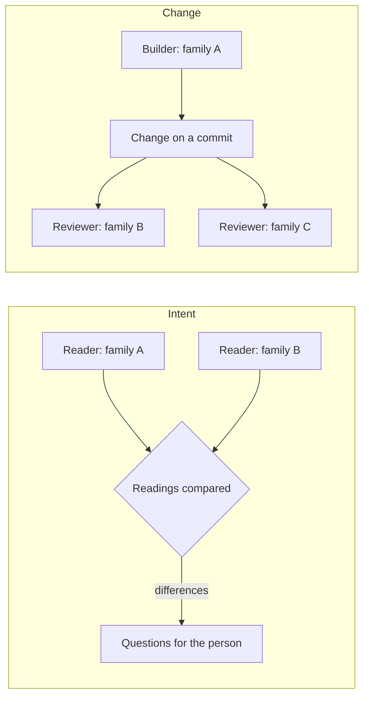
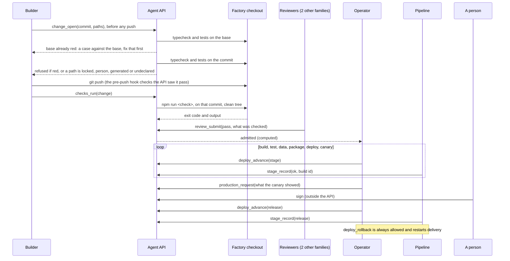
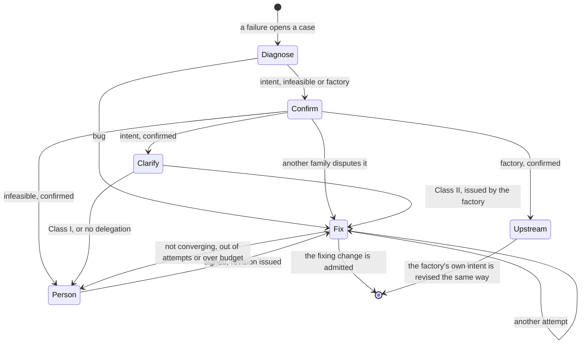
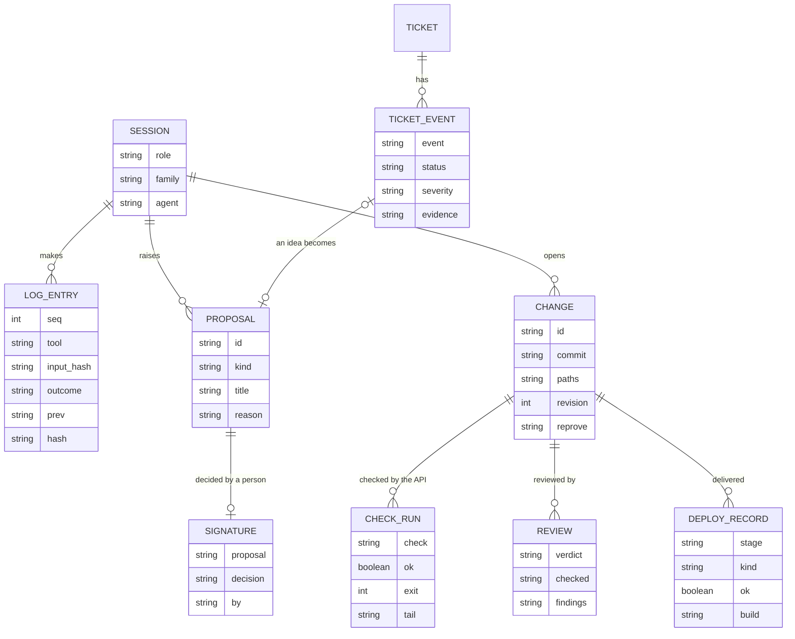

# The factory, run by agents

Agents run the factory: they read the intent, keep it moving, build, review, deliver, watch and triage. The people
who hold the intent set what it is for, sign what it means, and approve it in production. The agent API sits between
the two. It gives each agent the tools of one role and holds that role's limits itself. Anything only a person may do
has no tool: an agent can only propose it.


## Duties kept apart

<!-- fact:agents.roles -->7<!-- /fact --> roles, <!-- fact:agents.tools -->35<!-- /fact --> tools, and <!-- fact:agents.personOnly -->7<!-- /fact --> acts only a person takes, which have no tool at all. Each role and how many tools it sees:

<!-- gen:roles -->
| Role | Does | Tools |
| --- | --- | --- |
| reader | Reads the person's rough intent into the reading schema, independently of every other reader. | 8 |
| steward | Keeps the intent moving: ranks the questions, drafts answers for the person to confirm, issues revisions, proposes journeys. | 13 |
| builder | Builds to the released package: opens changes, runs the required checks, proposes journeys, takes defects. | 15 |
| reviewer | Reviews changes from other families, and says what it checked as well as what it found. | 14 |
| operator | Moves an admitted revision through delivery stage by stage, watches service levels, rolls back. | 12 |
| triager | Sorts what people report: status, severity, duplicates, defects for builders and ideas for the person who holds the intent. | 11 |
| pipeline | The build service's own identity: records what each delivery stage proved, with the build that proved it. | 8 |
<!-- /gen -->

Each role is defined by what it may not do, and the API enforces every limit. A test in `test/agents.test.ts` proves
each one. When a session starts, whoever starts it fixes the role, the model family and the agent's name; the agent
cannot change them. A role is never shown the tools it may not call.

| Role | Does | May not |
| --- | --- | --- |
| Reader | Reads the rough intent into the reading schema | See another reading; read twice, or for another family; answer the person's questions |
| Steward | Ranks questions, drafts answers, clarifies cases, issues revisions, proposes journeys | Answer for the person; sign anything; issue a later revision without a reason; issue a Class I clarification, or any without the person's delegation |
| Builder | Builds to the package, diagnoses cases, opens changes, runs checks, takes defects | Admit its own change; report a check result; touch a locked, person or generated path; change a proven check without re-proving it; blame the intent without naming balloons and another family agreeing |
| Reviewer | Reviews other families' changes, confirms or disputes diagnoses | Review its own family's work; pass without saying what it checked; block without a finding; confirm its own family's diagnosis |
| Operator | Moves admitted changes through delivery, watches, rolls back | Skip a stage; release to everyone without a person's approval; record a stage result; touch credentials or IAM |
| Triager | Sorts reports, marks duplicates, turns bugs into defects and ideas into proposals | Change what a reporter wrote; resolve without evidence; change the intent |
| Pipeline | The build service's identity, recording what each stage proved | Request, approve or roll back a stage |

What only a person does: answer the intent's questions, sign the schematic, sign a gauge or lock a journey, approve a
revision in production, reset a ratchet or lower a floor, change who may sign, and enter a credential or change IAM or
cloud permissions. Each of these reaches the person as a proposal. They decide it with the `sign` or `decline`
command, which no agent tool can reach.

### Three families touch every change



Separate roles that share a model also share its blind spots, so permissions alone don't keep duties apart. The API
also keeps families apart. A reviewer from the author's family is refused, as is an agent reviewing its own change or
a second review from a family that has already reviewed. Admission needs two passing reviews from two other families.

## A change, from commit to production



Before a builder pushes anything, `change_open` runs the existing typecheck and tests twice. It runs them first on
the base, so a test that already fails becomes its own case against the base and is never blamed on the new work,
and the loop doesn't chase it. Then it runs them on the commit, so nothing red is pushed: a push starts the build,
and a red one wastes its minutes and wakes a reviewer for nothing. Both runs take seconds and are reused on an
identical tree. `intent agents hook` installs a pre-push hook in the factory checkout that refuses a commit the API
hasn't seen pass. The hook is a convenience a determined agent could skip with `--no-verify`. What actually holds
is admission: no change is admitted without every check run by the API.

The checks are the factory's required checks (`control/required-checks.yaml`). The API runs them in the factory
checkout and records what each process returned, so a passing result is never an agent's word for it. It refuses to
run them if the checkout isn't on the change's commit or has uncommitted work. It also reads the paths from the
commit itself, not from the change's list. If the commit touches a path the change didn't declare, the change is
refused, so leaving a locked path off the list doesn't get it past its tier.

## Correcting without asking

Most failures don't need a person: a check fails, a review blocks, a stage fails, or someone reports a bug. Each one
opens a case on its own, and the case goes round until it closes or can honestly go no further.



The builder diagnoses, and anything other than a bug has to be confirmed by a reviewer from another family. Blaming
the spec is the easy way out of a hard fix, so the diagnosis must name the balloons it turns on.

A clarification is written as examples (given, when, then) and engineering notes. The API drafts the next revision
and compares it with the signed one, balloon by balloon, the way engineering change control does:

| Class II: the factory issues it | Class I: the person decides |
| --- | --- |
| Examples and notes added, as the factory's own assumptions | A balloon removed or reworded |
| A tolerance tightened | A tolerance loosened, or one that can't be compared |
| A mark added or raised | A mark lost or lowered |
| Information added without touching existing records | A change existing records feel |
| | A new outcome, constraint or other scope |
| | The end in mind, the spec sheet, or anything confirmed changed |

What the factory adds is marked `assumed` and attributed to `factory-clarifications.md`, never to the person. A Class
II revision is issued only under a standing delegation the person signs once
(`intent agents delegate --class-ii on --attempts 5`). Without it, even Class II is asked for.

A case goes to the person in three situations:

- the attempts run out;
- three attempts in a row fail on as much as or more than before;
- it costs more than the per-case ceiling.

Each of these is evidence the intent and the work disagree about something nobody has written down. That's the one
question worth a person's time.

## Spending as little as possible

The seats, from `catalog/models.json`:

<!-- gen:models -->
| Seat | Models, cheapest that fits first |
| --- | --- |
| steward | hydrogen (google) |
| reader | deepseek-flash (deepseek), ollama-llama (llama), hydrogen (google) |
| builder | ollama-qwen (qwen), deepseek-flash (deepseek) |
| reviewer | deepseek-flash (deepseek), ollama-llama (llama), ollama-qwen (qwen), hydrogen (google) |
| operator | deepseek-flash (deepseek) |
| triager | deepseek-flash (deepseek) |
<!-- /gen -->

The fixture judges the work, not the model: the checks, gauges, ratchets and walks. So each seat runs the cheapest
model that can do its job.

| Seat | Model | Where | Per million tokens, in / out |
| --- | --- | --- | --- |
| Steward: planning and orchestration | Gemini 4 Hydrogen | Vertex, global | $1.50 ($0.075 cached) / $7.50 |
| Readers | DeepSeek V4.1 Flash, then Llama | Vertex global; Ollama | $0.30 / $1.20; nothing |
| Builder | Qwen3 Coder, through any MCP coding agent | Ollama | nothing |
| Reviewers | DeepSeek V4.1 Flash, then Llama, then Qwen | Vertex global; Ollama | $0.30 / $1.20; nothing |
| Operator, triager | DeepSeek V4.1 Flash | Vertex global | $0.30 / $1.20 |
| Pipeline | none: it's the build service | Cloud Build | build minutes |

Prices are list prices as published when checked (`catalog/models.json`, 2026-11-26). Hydrogen is also the paid
fallback for a second family when the Ollama machine is off.

Every shortcut here works because a model is only asked what a machine can't answer:

- **An empty agenda wakes nobody.** The supervisor calls a model only for a seat with work waiting.
- **Machines before models.** A reviewer is shown a change only once every required check has passed and no other
  family has blocked it.
- **Cheapest check first, stop at the first failure.** Typecheck, signatures and dependencies take seconds; the walks
  take minutes and run last. Correction attempts are judged by what still fails.
- **Content-addressed checks.** A check that passed on an identical git tree isn't run again, for any change.
- **One family at a time.** Once two families pass a change it's admitted, and the third seat sleeps.
- **A packet, not the repository.** A review is one call: the capped diff, its paths and the balloons.
- **The same prefix every call.** The system prompt is the role's guide, byte for byte, so the provider caches it,
  at a tenth of the price on Hydrogen and DeepSeek.
- **Short wakes.** Output is capped per seat, temperature is 0, tool results are cut at 8 KB, and a wake ends when
  its agenda is done.
- **A ceiling that stops, not warns.** At the daily ceiling (default $1) the agenda pauses and nothing more is called.
  A case over its own ceiling (default $0.25) goes to the person.

A review packet of about 13,000 tokens in and at most 1,500 out costs under a cent on DeepSeek Flash. A whole panel
costs one to two cents.

```sh
intent agents budget   --workspace work/bills --by you@example.com --daily 2 --case 0.5
intent agents delegate --workspace work/bills --by you@example.com --class-ii on --attempts 5
GOOGLE_CLOUD_PROJECT=your-project intent agents drive --workspace work/bills --factory ../factory --rounds 5
```

`drive` wakes each seat with work on its plan's model, through the OpenAI-compatible endpoints Vertex and Ollama
both serve. It uses a short-lived token from `gcloud auth print-access-token` that is never stored. The builder seat
needs a coding agent that edits files. Set `ZTHR_BUILDER_CMD` to one that speaks MCP and points at the local Ollama
model, with the agent API attached as above.

### The factory's own review panel

`intent/factory/review-on-vertex.patch` changes the reference factory's review panel in four ways:

- the panel moves to Vertex: gpt-oss-20b (about $0.07 / $0.30) first, then DeepSeek V4.1 Flash, then Qwen3 Coder,
  with DeepSeek Flash in place after merge;
- seats are asked one at a time, and the panel stops at the first failure;
- each seat is sent a 40 KB diff with three lines of context and at most 12 changed files of 8 KB each, down from
  120 KB and 40 files of 20 KB;
- each seat can have its own endpoint, so a free local Ollama seat can stand in for any of them.

Its tests and all 28 gates pass. `control/review.yaml` is a change to the AI that a listed person signs, so apply it
yourself, in a commit GitHub verifies:

```sh
# In Cloud Shell
gcloud services enable aiplatform.googleapis.com
# In the console, enable DeepSeek V4.1 Flash, gpt-oss 20B and Qwen3 Coder in Model Garden (each accepts terms once).
cd ZTHR && git fetch origin && git checkout reference-implementation
git show origin/intent-surface:intent/factory/review-on-vertex.patch | git apply
GOOGLE_CLOUD_PROJECT=$(gcloud config get-value project) npx tsx tools/review.ts --base HEAD~1   # one panel, a cent or two
git commit -S -am "Review panel on Vertex, cheapest first, stopping at the first failure"
```

Two build-minute savings are yours to choose. Both are changes to `cloudbuild.yaml`, which re-proves its gates:

- **Pushes on `E2_STANDARD_2`.** It costs $0.006 a minute against $0.0156 on `E2_HIGHCPU_8`. Change `CI_MACHINE` and
  `control/ci-rates.json` with it.
- **Skip a nightly with nothing new.** Have the nightly stop at its first step when the commit equals last night's.
  A full nightly can take up to six hours on `E2_HIGHCPU_8`, about $5.60, to re-walk code it already walked.

## What is kept



Everything lives under `agents/` in the intent's workspace, and is only ever appended to. Each call to the API, allowed
or refused, goes into `agents/log.jsonl`, with the hash of the line before it. If a line is edited or removed, the
chain breaks, and `intent agents verify` says where.

Keep the workspace in a repository. Protect `agents/people.json` and `agents/signatures.jsonl` the same way the factory
protects its person-tier files: only commits that GitHub verifies as a listed person's. A local command line can't prove
it's a person typing, but a verified commit can.

## What agents are told

Every agent gets three layers of context:

1. **The guide for its role** (`guide` tool, `zthr://guide` resource): the house rules, its limits, its tools and how
   the work goes. It is generated from the same registry the API serves, so it can't drift from the tools.
2. **The tool reference** ([agents-tools.md](agents-tools.md), `zthr://reference`): every tool, every role, every
   input. A test fails if the reference is stale.
3. **The brief in every package** (`AGENTS.md`): what this revision asks to be built, what counts as done, what must
   never happen, the gauges that judge it, the build order, the spec-sheet choices, how it ships and which paths no
   agent writes. It is part of the signed package, and its hash is in the manifest.

## Running it

An MCP server, one per agent, on standard input and output:

```json
{
  "mcpServers": {
    "zthr-builder": {
      "command": "node",
      "args": ["intent/src/cli.ts", "agents", "serve", "--workspace", "work/bills", "--role", "builder", "--family", "anthropic", "--agent", "builder-1", "--factory", "."]
    }
  }
}
```

For agents that don't speak MCP, `intent agents tools --role <role>` prints the role's tools in the shape model
tool-use APIs take. `intent agents call <tool> --json '{...}'` makes one call from a script.

The pipeline records each stage result from its own build step, under its own identity:

```yaml
- id: record
  name: node:22
  entrypoint: bash
  args: ['-c', 'node intent/src/cli.ts agents call stage_record --workspace work/bills --role pipeline --family cloud-build --agent "$BUILD_ID" --json "{\"change\":\"${_CHANGE}\",\"stage\":\"${_STAGE}\",\"ok\":true,\"build\":\"$BUILD_ID\"}"']
```

A person's commands:

```sh
intent agents proposals --workspace work/bills                       # what waits on you
intent agents sign p-1a2b3c4d5e --workspace work/bills --by you@example.com
intent agents decline p-1a2b3c4d5e --workspace work/bills --by you@example.com --note "not what I meant"
intent agents verify --workspace work/bills                          # the log's chain holds
```
