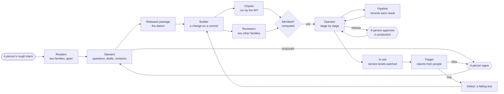
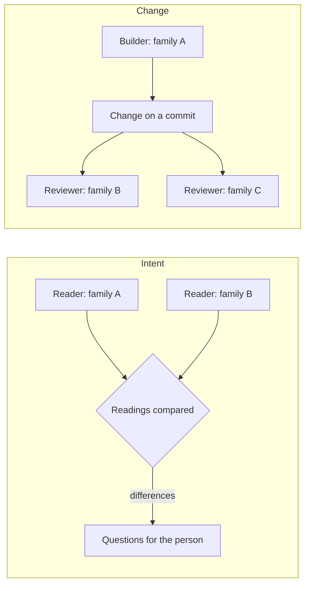
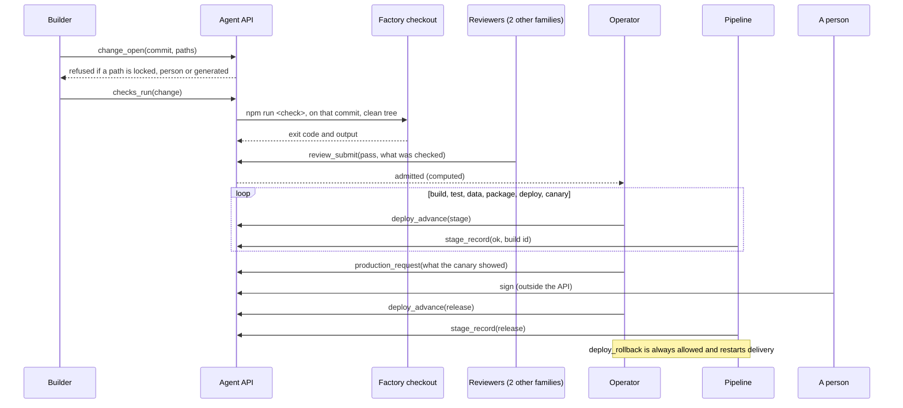
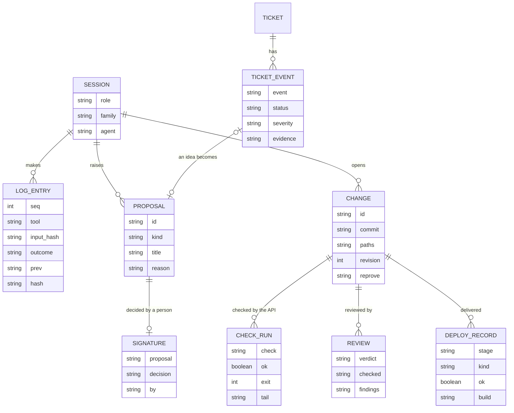

# The factory, run by agents

Agents run the factory: they read the intent, keep it moving, build, review, deliver, watch and triage. The people
who hold the intent set what it is for, sign what it means, and approve it in production. The agent API sits between
the two. It gives each agent the tools of one role and holds that role's limits itself. Anything only a person may do
has no tool: an agent can only propose it.



## Duties kept apart

Each role is defined by what it may not do, and the API enforces every limit. A test in `test/agents.test.ts` proves
each one. When a session starts, whoever starts it fixes the role, the model family and the agent's name; the agent
cannot change them. A role is never shown the tools it may not call.

| Role | Does | May not |
| --- | --- | --- |
| Reader | Reads the rough intent into the reading schema | See another reading; read twice, or for another family; answer the person's questions |
| Steward | Ranks questions, drafts answers, issues revisions, proposes journeys | Answer for the person; sign anything; issue a later revision without a reason |
| Builder | Builds to the package, opens changes, runs checks, takes defects | Admit its own change; report a check result; touch a locked, person or generated path; change a proven check without re-proving it |
| Reviewer | Reviews other families' changes | Review its own family's work; pass without saying what it checked; block without a finding |
| Operator | Moves admitted changes through delivery, watches, rolls back | Skip a stage; release to everyone without a person's approval; record a stage result; touch credentials or IAM |
| Triager | Sorts reports, marks duplicates, turns bugs into defects and ideas into proposals | Change what a reporter wrote; resolve without evidence; change the intent |
| Pipeline | The build service's identity, recording what each stage proved | Request, approve or roll back a stage |

What only a person does: answer the intent's questions, sign the schematic, sign a gauge or lock a journey, approve a
revision in production, reset a ratchet or lower a floor, change who may sign, and enter a credential or change IAM or
cloud permissions. Each of these reaches the person as a proposal. They decide it with the `sign` or `decline`
command, which no agent tool can reach.

### Three families touch every change



Separate roles that share a model also share its blind spots, so permissions alone don't keep duties apart. The API
also keeps families apart. A reviewer from the author's family is refused, as is an agent reviewing its own change or
a second review from a family that has already reviewed. Admission needs two passing reviews from two other families.

## A change, from commit to production



The checks are the factory's required checks (`control/required-checks.yaml`). The API runs them in the factory
checkout and records what each process returned, so a passing result is never an agent's word for it. It refuses to
run them if the checkout isn't on the change's commit or has uncommitted work. It also reads the paths from the
commit itself, not from the change's list. If the commit touches a path the change didn't declare, the change is
refused, so leaving a locked path off the list doesn't get it past its tier.

## What is kept



Everything lives under `agents/` in the intent's workspace, and is only ever appended to. Each call to the API, allowed
or refused, goes into `agents/log.jsonl`, with the hash of the line before it. If a line is edited or removed, the
chain breaks, and `intent agents verify` says where.

Keep the workspace in a repository. Protect `agents/people.json` and `agents/signatures.jsonl` the same way the factory
protects its person-tier files: only commits that GitHub verifies as a listed person's. A local command line can't prove
it's a person typing, but a verified commit can.

## What agents are told

Every agent gets three layers of context:

1. **The guide for its role** (`guide` tool, `zthr://guide` resource): the house rules, its limits, its tools and how
   the work goes. It is generated from the same registry the API serves, so it can't drift from the tools.
2. **The tool reference** ([agents-tools.md](agents-tools.md), `zthr://reference`): every tool, every role, every
   input. A test fails if the reference is stale.
3. **The brief in every package** (`AGENTS.md`): what this revision asks to be built, what counts as done, what must
   never happen, the gauges that judge it, the build order, the spec-sheet choices, how it ships and which paths no
   agent writes. It is part of the signed package, and its hash is in the manifest.

## Running it

An MCP server, one per agent, on standard input and output:

```json
{
  "mcpServers": {
    "zthr-builder": {
      "command": "node",
      "args": ["intent/src/cli.ts", "agents", "serve", "--workspace", "work/bills", "--role", "builder", "--family", "anthropic", "--agent", "builder-1", "--factory", "."]
    }
  }
}
```

For agents that don't speak MCP, `intent agents tools --role <role>` prints the role's tools in the shape model
tool-use APIs take. `intent agents call <tool> --json '{...}'` makes one call from a script.

The pipeline records each stage result from its own build step, under its own identity:

```yaml
- id: record
  name: node:22
  entrypoint: bash
  args: ['-c', 'node intent/src/cli.ts agents call stage_record --workspace work/bills --role pipeline --family cloud-build --agent "$BUILD_ID" --json "{\"change\":\"${_CHANGE}\",\"stage\":\"${_STAGE}\",\"ok\":true,\"build\":\"$BUILD_ID\"}"']
```

A person's commands:

```sh
intent agents proposals --workspace work/bills                       # what waits on you
intent agents sign p-1a2b3c4d5e --workspace work/bills --by you@example.com
intent agents decline p-1a2b3c4d5e --workspace work/bills --by you@example.com --note "not what I meant"
intent agents verify --workspace work/bills                          # the log's chain holds
```
