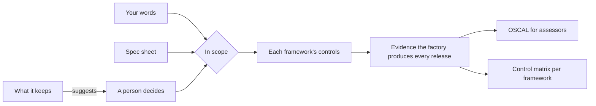
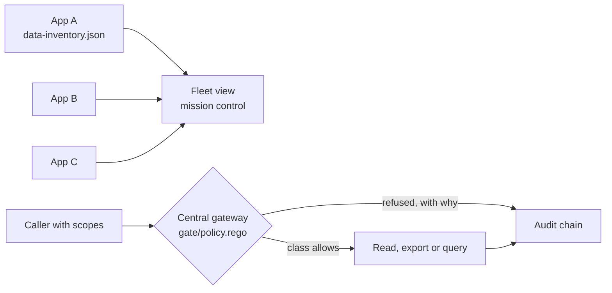

# Compliance, decided on the schematic

Which frameworks apply is part of the intent. The person names them in their own words ("it must meet FERPA and SOC
2"), or chooses them on the spec sheet, and the factory suggests the ones the information calls for: health records
suggest HIPAA, student records FERPA, financial aid GLBA, defense work NIST SP 800-171, card payments PCI DSS. A
suggestion is never scope until someone decides.

## Evidence, collected once

Each control names how it is met. Most are met by evidence the factory already produces on every release, and one piece
of evidence serves every control, in every framework, that needs it: the access rules serve SOC 2 CC6.1, HIPAA
164.312(a)(1), FERPA 99.31, PCI DSS 7, GLBA 314.4(c)(1), NIST 800-171 3.1.1 and NIST 800-53 AC-3 at once.

| Coverage | Meaning |
| --- | --- |
| factory | Proved by the factory on every release, with no one to remember |
| configured | Written by the factory as configuration and a runbook; a person applies it once and confirms |
| shared | The factory proves the technical part; the organization supplies the rest |
| platform | Inherited from the cloud provider's own attestations |
| organization | Policies, training, people and vendors: supplied by the organization |

<!-- fact:frameworks.count -->8<!-- /fact --> frameworks, with <!-- fact:frameworks.controls -->116<!-- /fact --> controls mapped to evidence:

<!-- gen:frameworks -->
| Framework | Controls mapped |
| --- | --- |
| SOC 2 | 24 |
| HIPAA Security Rule | 16 |
| FERPA | 7 |
| PCI DSS | 10 |
| GLBA Safeguards Rule | 12 |
| NIST SP 800-171 (CMMC Level 2) | 19 |
| NIST SP 800-53 (FedRAMP Moderate) | 23 |
| Section 508 (WCAG 2.2 AA) | 5 |
<!-- /gen -->

The versions the controls follow:

| Framework | Version the controls follow |
| --- | --- |
| SOC 2 | Trust Services Criteria (2017, points of focus revised 2022) |
| HIPAA Security Rule | 45 CFR Part 164, Subpart C, as in force; an overhaul is proposed, with final action projected for July 2027 |
| FERPA | 34 CFR Part 99 |
| PCI DSS | 4.0.1; card numbers are never stored, and a hosted payment page keeps most of the standard out of scope |
| GLBA Safeguards Rule | 16 CFR Part 314 |
| NIST SP 800-171 (CMMC Level 2) | Revision 2, as DFARS 252.204-7012 and CMMC Level 2 require |
| NIST SP 800-53 (FedRAMP Moderate) | Revision 5 |
| Section 508 | WCAG 2.2 AA, stricter than the WCAG 2.0 AA it refers to |

Control wording in the catalogue is paraphrased; each framework's official text is the authority.

## Sensitive data across the fleet

Every release carries `compliance/data-inventory.json` in the same form: every field whose sensitivity is contact,
financial, private or health, with the frameworks it falls under, who may read it, where it may flow and how long it is
kept. Because every app reports the same way, mission control reads the fleet as one, and a central gateway enforces one
policy for all of them.

| Action | Needs, for a field of class `c` |
| --- | --- |
| Read someone else's record | `data:c` (a person always reads their own) |
| Export | `export:c` |
| Query in the console | `unmask:c`; health data is never queried in production |
| Events | carry ids only, never values |

## What the release carries

| File | What it is |
| --- | --- |
| `compliance/scope.json` | What is in scope and why, and what is suggested |
| `compliance/<framework>.md` | Every control: coverage, how it is met, the evidence |
| `compliance/oscal/<framework>.component-definition.json` | The same, as an OSCAL 1.2.3 component definition, validated against NIST's schema |
| `compliance/evidence.json` | Each evidence source and every control it serves |
| `compliance/data-inventory.json` | The sensitive-data inventory, the same in every app |
| `compliance/gate/policy.rego`, `compliance/gate/data.json` | The fleet gate policy and this app's data for it |
