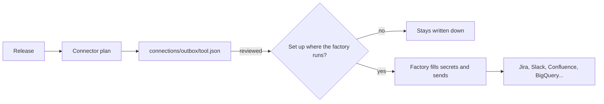

# Connectors: the tools teams already use

Every connector is a stub that works without an account with the tool. Given a release, it writes the exact requests it
would send, in the tool's own documented API, to `connections/outbox/<tool>.json`. Nothing is sent. Where a setup is
needed, the request holds a named placeholder: `{{config.NAME}}` for where (a site, a project), `{{secret.NAME}}` for a
credential, filled from the factory's secret store at the moment of sending. So a release can be read, reviewed and
diffed before anything leaves, and never holds a credential.

| Kind | Connectors | What it sends |
| --- | --- | --- |
| Tickets | Jira, Asana, Linear, GitHub Issues, Azure Boards | One ticket per feature at intent; moved as design, build, QA and release finish |
| Docs | Confluence, Notion, SharePoint, Google Drive, GitHub wiki | The user guide and technical reference, replaced whole on every release |
| Chat | Slack, Microsoft Teams (Workflows), Google Chat | A short note as each station finishes |
| Feeds | Signed webhooks (Standard Webhooks, CloudEvents), BigQuery, Snowflake, Cloud Storage export | Change events and exports for systems already in place |
| Sign-in for the app | Google (default), Microsoft Entra ID, Okta | OpenID Connect settings for how people sign in to what the factory builds |

Each connector names the least access it needs (a single project, channel, space, dataset or bucket) and the vendor
reference its requests follow. The whole list is in `connections/catalogue.json` in every release.

## Adding one

A connector is an object in `src/connectors.ts`: an id, a kind, the API and its reference, the config and secrets it
needs by name, the least access it asks for, and a `plan` that turns a release into requests. The tests check every
connector plans at least one request, speaks HTTPS or to an address set where it runs, and carries no credential, only
the name of one.
