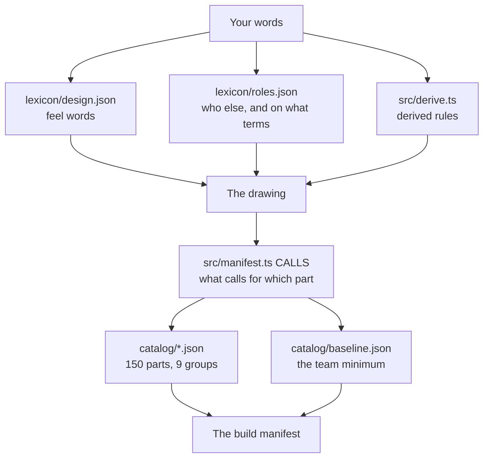

# Extending Intent

Everything that decides what goes on a drawing, or into a build, is data or a short rule table with tests. Change
one, run `npm run verify`, and the studio, the command line and every release use it.

## Add a feel word

`lexicon/design.json` maps a word people use ("calm", "snappy", "at a glance") to design choices for the title
block and to measures with tolerances. Add an entry with `term`, `match` (the patterns that mean it), `meaning`,
`choices` (title block keys it sets, such as palette or density) and `measures` with tolerances. If two words a
person uses set the same title block key to different values, the studio raises a redline instead of guessing.
Tested in `test/readback.test.ts`.

## Add a role

`lexicon/roles.json` holds the people on the other side of an activity, by domain (education, health, workplace),
with the organisations, offices, access directions and ways to revoke a person is asked to choose between. The
staff branch in the studio is built from it.

## Add a derived rule

`src/derive.ts` holds rules like `contacts-people` and `money`: when the words say something, what follows from it
(a never, a prerequisite, an implication) and its mark. Each rule names its trigger words, so every derived
statement shows which of your words it came from.

## Add a part to the catalogue

The catalogue is `catalog/top50.json`, `admin.json`, `delight.json` and `intent.json`, grouped in `groups.json`.
Each part has a `name`, what it `gives`, and whether a standard assembly covers it today (`coverage` and `from`).
`node tools/catalog-page.ts` rewrites `catalog/README.md` from the data and fails if a part is in no group, or two.

## Define your team's minimum

`catalog/baseline.json` lists the parts every app your team builds inherits, each with why. The fleet maintains
them, so a fix reaches every app. A part named here must be in the catalogue; the build manifest fails otherwise.

## Change what calls for a part

`src/manifest.ts` has one table, `CALLS`: each row names the parts and the condition on the drawing that calls for
them (a slot, a derived rule, a feel word, a phrase, or a journey the person added), with the reason the manifest
shows. Every part named is checked against the catalogue when a manifest is made. Test: `test/manifest.test.ts`.

## Run it elsewhere

The engine is plain TypeScript with no service behind it. `src/cli.ts` reads, reads back and releases from the
command line, and keeps work in a workspace between sittings. The studio is the same engine in a page.
