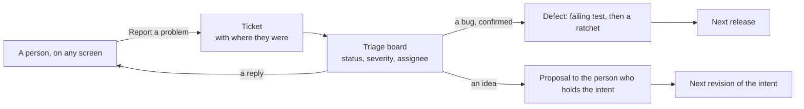
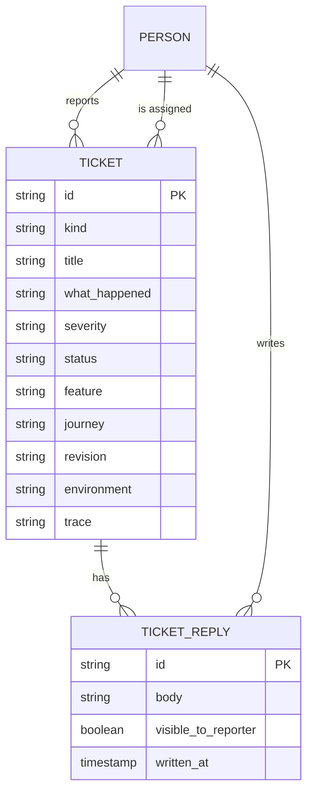

# Report a problem

Every app the factory builds can carry a way for the people who use it to report a problem, suggest an idea, ask a
question or say what works, and a way for the team to manage what comes in. It is on by default, chosen on the spec sheet
for every environment, the testing ones only, or none, and wherever it is built in, a runtime switch turns it off or on at
any time with no release.

| Captured for the person | Never captured |
| --- | --- |
| The feature, journey and step, the screen, the revision running, the environment and a request trace | Anything they had typed into the screen they were on; a screenshot is attached only if they choose to, after seeing it |

What people write is treated as private: masked in reports and the query console, and listed in the sensitive-data
inventory. Tickets are kept two years after they close. A weekly report shows what is reported from which feature, how
fast it is triaged and resolved, and what is still waiting.
