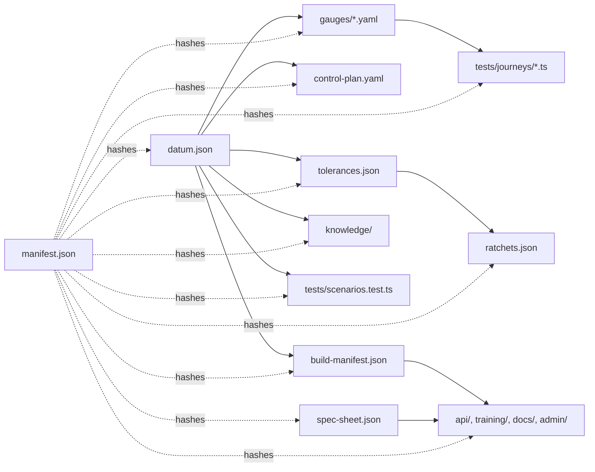
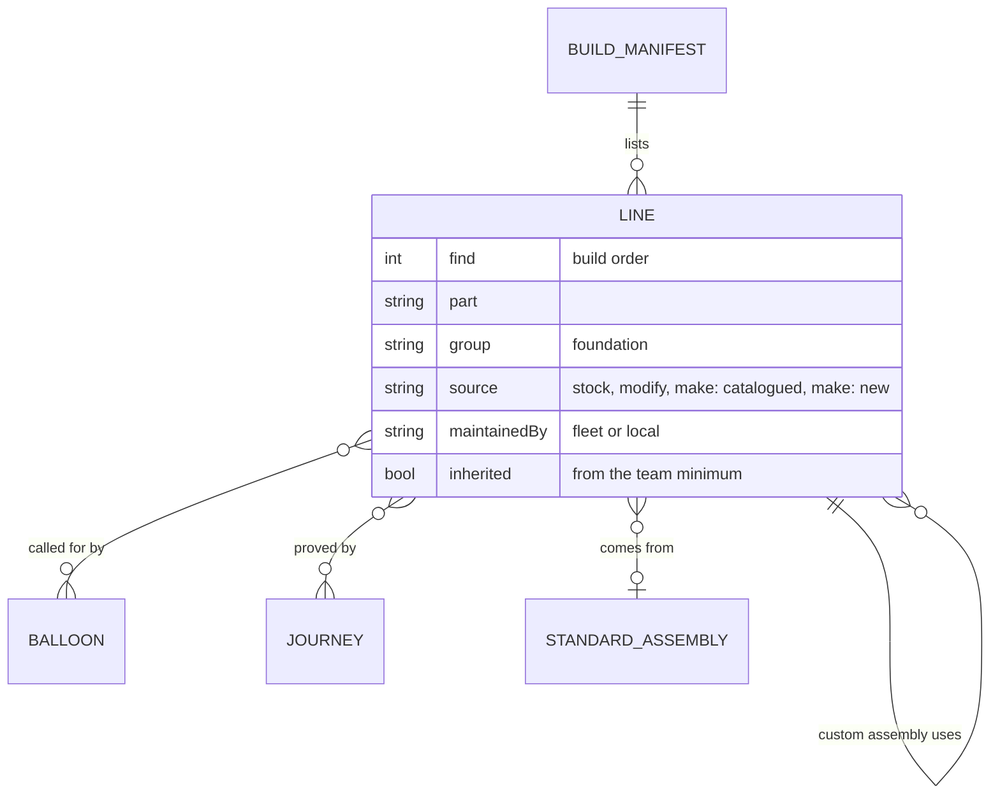
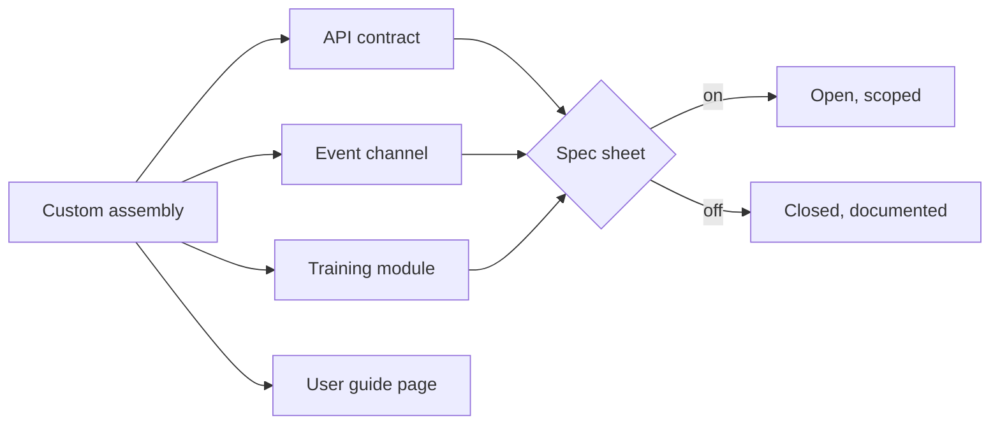

# The release package, file by file

A release is a folder (or a deterministic zip) of plain files. Nothing in it needs this studio to read. The same
schematic, answers and journeys always give the same bytes, and `manifest.json` hashes every file, so a factory can
check it received exactly what was signed.



For the worked example, a released revision is <!-- fact:example.files -->115<!-- /fact --> files:

<!-- gen:package -->
| In the package | Files |
| --- | --- |
| `admin/` | 2 |
| `AGENTS.md` | 1 |
| `analytics/` | 1 |
| `api/` | 3 |
| `balloons.json` | 1 |
| `build-manifest.json` | 1 |
| `build-manifest.md` | 1 |
| `compliance/` | 6 |
| `connections.json` | 1 |
| `connections/` | 2 |
| `context.md` | 1 |
| `control-plan.yaml` | 1 |
| `datum.json` | 1 |
| `delivery/` | 5 |
| `docs/` | 5 |
| `features.yaml` | 1 |
| `gauges/` | 1 |
| `information/` | 12 |
| `knowledge/` | 32 |
| `manifest.json` | 1 |
| `notes.md` | 1 |
| `ops/` | 5 |
| `outcomes/` | 3 |
| `ratchets.json` | 1 |
| `reports/` | 17 |
| `schematic.md` | 1 |
| `spec-sheet.json` | 1 |
| `tests/` | 2 |
| `tolerances.json` | 1 |
| `training/` | 4 |
<!-- /gen -->

File by file:

| File | What it holds | Who reads it |
| --- | --- | --- |
| `datum.json` | The signed schematic: title, revision, end in mind, title block, every statement with its balloon, slot, state, supplier, tolerance and mark | The factory, as the reference everything is judged against |
| `schematic.md` | The same schematic, for people | People reviewing the release |
| `AGENTS.md` | The brief for the factory's agents: what counts as done, what must never happen, the gauges, the build order, the spec-sheet choices, how it ships, and the paths no agent writes ([agents](agents.md)) | Every agent that builds, reviews or delivers this revision |
| `notes.md` | Engineering notes (how, for now) and lettered variants with where they apply | The factory's design step |
| `gauges/<id>.yaml` | One journey card per outcome and per journey the person added, in the factory's own card format | The factory, once a person signs the card into `control/journeys` |
| `tests/journeys/<id>.ts` | A skeleton for each gauge that exports nothing, so the factory reports it unknown until it is built | The factory's journey runner |
| `tests/scenarios.test.ts` | Each confirmed example as a pending test | The factory's test runner |
| `control-plan.yaml` | Every critical or significant statement and the controls it needs | The factory's gates; a characteristic with no control fails the build |
| `tolerances.json` | Each measure's working range (time, rate, count, relative, exact or unread) and how firm it is | The factory, to set starting floors and QA confidence |
| `ratchets.json` | Starting ratchets in the factory's shape: `{ id, metric, direction, floor }` | The factory's ratchet gate |
| `build-manifest.json` and `.md` | The bill of materials the factory starts from (below) | The factory's design step, and people |
| `spec-sheet.json` | The factory spec sheet: which features have their API, events, agent tools and training switched on, where the query console runs, and the connections | The factory, and every interface file below |
| `api/openapi.yaml` | An OpenAPI 3.2 contract for every feature, with read and write scopes; `x-zthr-enabled` says which are switched on | The factory, API gateways, client generators |
| `api/access.md` | Who may call what: deny by default, one access path for screens and API, row-level rules, masking, limits and audit | Security review, integrators |
| `api/asyncapi.yaml` | An AsyncAPI 3.1 contract for each feature's events, as CloudEvents 1.0 envelopes | Event brokers, systems that subscribe |
| `api/agent-tools.json` | When agents are switched on: each switched-on operation as a Model Context Protocol tool, with its scope | Agent hosts |
| `docs/users/` | A guide for the people who use it, one page per feature | People who use the app, and the wiki |
| `docs/technical/README.md` | A reference for the people who run and change it: structure, interfaces, running, changing | Support, engineering, the wiki |
| `training/<feature>.md` and `training/cmi5.xml` | A lesson for every feature from its journeys and measures; the cmi5 course lists only what is published | Learning systems that read cmi5 and xAPI |
| `admin/environments.json` | Which admin tools are built into which environment; the query console is left out of production by default | The factory's build and deploy steps |
| `admin/query.md` | The views each feature answers to the query console, and the guards on every query | Support and analysts |
| `information/` | The information it keeps: `schema.json`, data sheets in `schema.md`, `schema.sql`, `schema.prisma`, `integrity.sql`, migrations from the second revision, and the data pipeline: plan, rehearsal fixtures, preservation, drift, ledger and a CI workflow (see [the information it keeps](information.md)) | The factory's store, people reviewing, and anyone checking the data on its own |
| `compliance/` | Scope, a control matrix and OSCAL per framework in scope, the evidence crosswalk, the sensitive-data inventory and the fleet gate policy (see [compliance](compliance.md)) | Assessors, the central gateway, mission control |
| `delivery/`, `ops/` | The gated pipeline with its Google Cloud adapter, service levels, alerts, log metrics, the nightly watch and the runbook (see [delivery and operations](operations.md)) | The build service, operators |
| `outcomes/framework.json` and `.md` | The outcome framework, set before building: for every outcome, how it is assessed (a journey before release, measures, and use observed after), the performance criteria, the passing target and the evidence to review | People reviewing the release, the factory's QA, and the reports |
| `outcomes/map.md` | The platform outcomes (accessible, plain, private, explainable, reliable, recoverable, inclusive, secure) mapped across every feature as introduced, refined or mastered, with why | Product and QA |
| `reports/catalogue.json`, `reports/<id>.sql`, `reports/README.md` | A report for every feature, for operations, for use as a whole, for journeys as walked, for the measures, and a weekly brief on what to improve: each a saved query with a chart, schedule and audience | The report builder, report delivery, and people |
| `analytics/tracking-plan.json` | What use is recorded at the spec sheet's level, under which keys, what is never recorded, and for how long | Privacy review, and the app's analytics part |
| `connections.json` | Where factory progress, docs and data feeds go: tool names and mappings, never credentials | The factory's release step |
| `features.yaml` | Each outcome as a feature, with the journeys that prove it | The factory's feature registry |
| `knowledge/` | One page per balloon, the end in mind, and an index, as an Open Knowledge Format bundle | Any agent working on the app, as its context |
| `balloons.json` | The balloon register, so numbers stay stable across revisions | The next revision |
| `change-notice.md` | From the second revision: what changed, balloon by balloon, and why | People and the factory |
| `manifest.json` | Title, revision, sources, lexicon versions, open questions, whether it is ready, every file's hash and the package hash | Everyone, first |

## The journey card

```yaml
id: "no-shut-off-from-a-missed-due-date"     # lower case, numbers and dashes
persona: "student"
delight: "feels calm: soft colours, ..."      # optional: how it should feel
phase: 1                                      # 1 to 9
goal: "no shut-off from a missed due date"    # at least ten characters
forbidden:                                    # at least one; any of these happening fails the journey
  - "a message is sent during quiet hours"
budget: { actions: 5, ms: 3000 }
requirements: []
modes: [ "standard" ]                         # brief, standard or walk-me-through
channels: [ "app", "text" ]                   # app or text
```

## The build manifest



```json
{
  "schema": "zthr-build-manifest/1",
  "counts": { "stock": 5, "modify": 15, "make: catalogued": 34, "make: new": 6 },
  "maintained": { "fleet": 54, "local": 6 },
  "baseline": { "name": "ZTHR team minimum", "count": 29 },
  "lines": [
    { "find": 1, "part": "Safety router", "group": "Trust and evidence", "source": "stock", "maintainedBy": "fleet",
      "inherited": false, "uses": [], "library": ["runtime"], "balloons": [1, 2], "journeys": ["..."], "why": ["..."] }
  ],
  "gaps": []
}
```

A balloon that no line builds is listed in `gaps`, and the release is not ready until it is closed.

## Interfaces: defined always, switched on by choice

Every custom assembly gets an API contract, an event channel and a training module, written from the same datum as its
code. The spec sheet decides which are switched on: for no feature, every feature, or the features named. A contract
that is switched off is still documented and deployed closed: it answers 403 to every caller, and no token can hold its
scopes. Documentation for both audiences is always in the package.



Whatever is switched on goes through the same role check, row-level rules, field masking, rate limits and audit chain
as the screens, so nothing the API can reach is outside what the journeys test.

## The factory feed

The reference build writes `factory/factory.json` (schema `zthr-factory/1`) from its own evidence: `commit`,
`builtAt`, `readings[]`, `journeys[]` with each verdict, `phases[]` with features and certificates, `gates[]` with
proofs, and `ratchets[]`. Mission control and the factory console read only this file; anything a build did not
measure is `null` or `"not measured"`.
