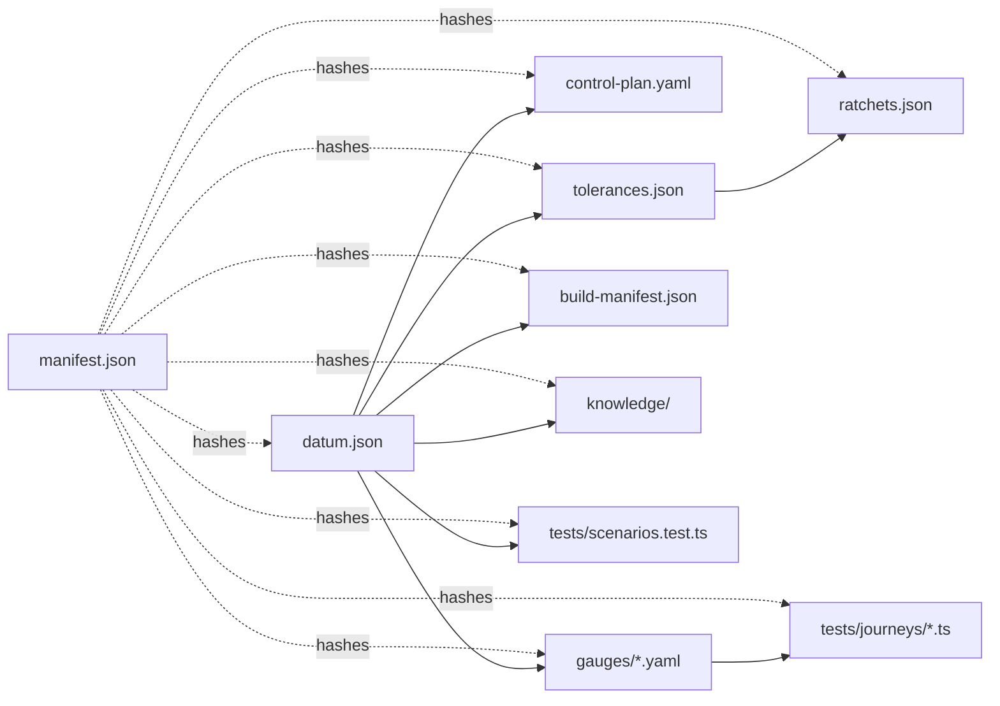
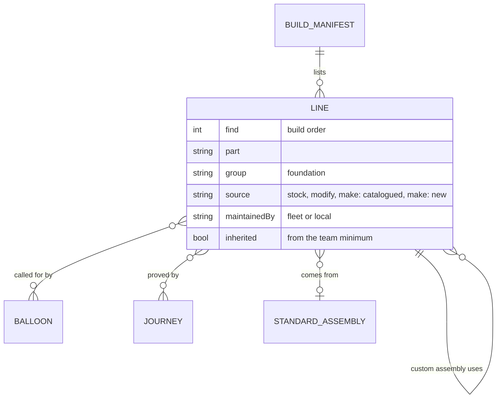

# The release package, file by file

A release is a folder (or a deterministic zip) of plain files. Nothing in it needs this studio to read. The same
drawing, answers and journeys always give the same bytes, and `manifest.json` hashes every file, so a factory can
check it received exactly what was signed.



| File | What it holds | Who reads it |
| --- | --- | --- |
| `datum.json` | The signed drawing: title, revision, end in mind, title block, every statement with its balloon, slot, state, supplier, tolerance and mark | The factory, as the reference everything is judged against |
| `drawing.md` | The same drawing, for people | People reviewing the release |
| `notes.md` | Engineering notes (how, for now) and lettered variants with where they apply | The factory's design step |
| `gauges/<id>.yaml` | One journey card per outcome and per journey the person added, in the factory's own card format | The factory, once a person signs the card into `control/journeys` |
| `tests/journeys/<id>.ts` | A skeleton for each gauge that exports nothing, so the factory reports it unknown until it is built | The factory's journey runner |
| `tests/scenarios.test.ts` | Each confirmed example as a pending test | The factory's test runner |
| `control-plan.yaml` | Every critical or significant statement and the controls it needs | The factory's gates; a characteristic with no control fails the build |
| `tolerances.json` | Each measure's working range (time, rate, count, relative, exact or unread) and how firm it is | The factory, to set starting floors and QA confidence |
| `ratchets.json` | Starting ratchets in the factory's shape: `{ id, metric, direction, floor }` | The factory's ratchet gate |
| `build-manifest.json` and `.md` | The bill of materials the factory starts from (below) | The factory's design step, and people |
| `features.yaml` | Each outcome as a feature, with the journeys that prove it | The factory's feature registry |
| `knowledge/` | One page per balloon, the end in mind, and an index, as an Open Knowledge Format bundle | Any agent working on the app, as its context |
| `balloons.json` | The balloon register, so numbers stay stable across revisions | The next revision |
| `change-notice.md` | From the second revision: what changed, balloon by balloon, and why | People and the factory |
| `manifest.json` | Title, revision, sources, lexicon versions, open questions, whether it is ready, every file's hash and the package hash | Everyone, first |

## The journey card

```yaml
id: "no-shut-off-from-a-missed-due-date"     # lower case, numbers and dashes
persona: "student"
delight: "feels calm: soft colours, ..."      # optional: how it should feel
phase: 1                                      # 1 to 9
goal: "no shut-off from a missed due date"    # at least ten characters
forbidden:                                    # at least one; any of these happening fails the journey
  - "a message is sent during quiet hours"
budget: { actions: 5, ms: 3000 }
requirements: []
modes: [ "standard" ]                         # brief, standard or walk-me-through
channels: [ "app", "text" ]                   # app or text
```

## The build manifest



```json
{
  "schema": "zthr-build-manifest/1",
  "counts": { "stock": 5, "modify": 15, "make: catalogued": 34, "make: new": 6 },
  "maintained": { "fleet": 54, "local": 6 },
  "baseline": { "name": "ZTHR team minimum", "count": 29 },
  "lines": [
    { "find": 1, "part": "Safety router", "group": "Trust and evidence", "source": "stock", "maintainedBy": "fleet",
      "inherited": false, "uses": [], "library": ["runtime"], "balloons": [1, 2], "journeys": ["..."], "why": ["..."] }
  ],
  "gaps": []
}
```

A balloon that no line builds is listed in `gaps`, and the release is not ready until it is closed.

## The factory feed

The reference build writes `factory/factory.json` (schema `zthr-factory/1`) from its own evidence: `commit`,
`builtAt`, `readings[]`, `journeys[]` with each verdict, `phases[]` with features and certificates, `gates[]` with
proofs, and `ratchets[]`. Mission control and the factory console read only this file; anything a build did not
measure is `null` or `"not measured"`.
