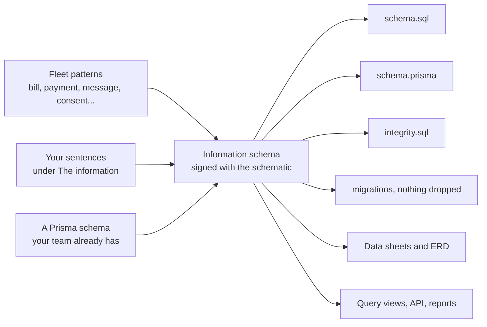
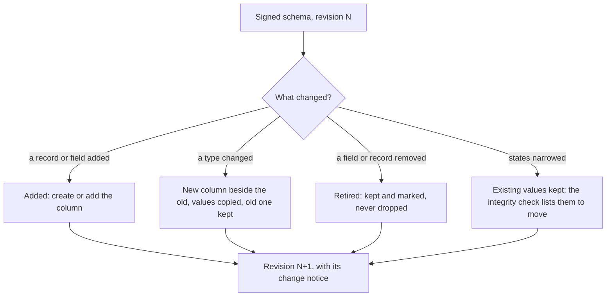
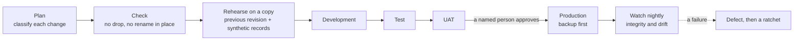
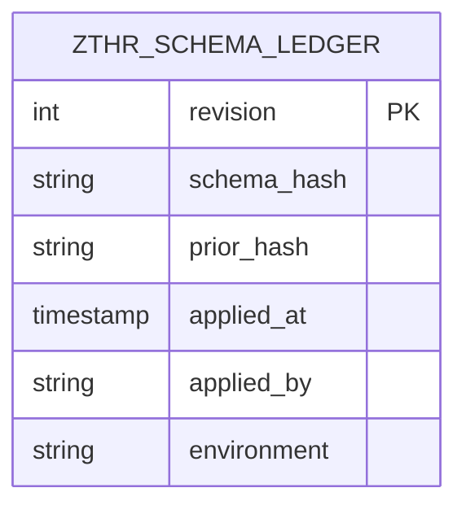

# The information it keeps

What a system keeps is its value. Screens, the API, reports, docs and training are ways of working on that information,
and every one of them can be generated again from the intent. The records cannot. So the information schema is part of
the schematic: written from the intent, in the words of the person who knows the work, signed with everything else, and
changed only with a record of what changed and a migration that never throws data away.



## Three sources, one schema

1. **Patterns.** Business applications keep the same records again and again: people, organisations, things owed,
   payments, messages, consent, access grants, flags, cases, appointments, documents, notes. Each is defined once in
   `catalog/patterns.json` with its fields, states, sensitivity, retention and integrity rules. The fleet maintains
   them. An intent that mentions bills gets the obligation pattern, named **Bill**, not "Obligation".
2. **Your sentences.** Under a heading `## The information`, write the records as plain sentences. These shapes are read:

   | You write | It becomes |
   | --- | --- |
   | A bill has an amount, a due date, a provider and who it is for. | Fields, with types worked out from their names; "who it is for" is a reference to the person |
   | A reminder belongs to one bill. | A reference from reminder to bill |
   | A student can have many bills. | A reference from bill to the student |
   | A bill can be open, paid or overdue. | The states a bill may be in |
   | The amount is private. | The field's sensitivity, which masking, exports and reports obey |
   | Keep bills for 7 years. | Retention |

   A word in brackets sets the type: "a deposit (money)", "a start (date)". A sentence that fits no shape is shown back
   to be rewritten. It is never guessed at.
3. **A Prisma schema your team already has.** Bring in a `.prisma` file beside the intent. Its tables, fields, types and
   relations are kept as provided and win over the patterns. Where your sentences disagree with it (a bill "can be
   open, paid or overdue" while the database says OPEN, PAID, LATE), the difference is shown to settle, and the
   provided one is kept until someone does.

```mermaid
erDiagram
  PERSON ||--o{ BILL : owner
  BILL ||--o{ PAYMENT : for
  BILL ||--o{ REMINDER : bill
  PERSON ||--o{ REMINDER : to
  PERSON ||--o{ CONSENT : person
  PERSON ||--o{ ACCESS_GRANT : grantee
  PERSON ||--o{ FLAG : about
  BILL { string id PK  string owner FK  decimal amount  date due_on  string status  string provider }
  REMINDER { string id PK  string to FK  string bill FK  timestamp send_at  string status }
  CONSENT { string id PK  string person FK  timestamp given_at  timestamp withdrawn_at }
```

## What the release carries

| File | What it is |
| --- | --- |
| `information/schema.json` | The schema itself: records, fields (type, meaning, sensitivity, required, where each came from), relations, rules |
| `information/schema.md` | Data sheets for people, with the ERD and your sentences beside the fields they made |
| `information/schema.sql` | The database, in PostgreSQL, with every table and column commented with its meaning and sensitivity |
| `information/schema.prisma` | The same, as a Prisma schema: the build's one data declaration. Written in the Prisma 7 schema language, which Prisma 8 also reads |
| `information/integrity.sql` | One query per rule, returning the records that break it |
| `information/migrations/revision-N.sql` | From the second revision: what changed and how existing records are kept |

The schema is in `datum.json`, so signing the schematic signs the records too.

## Integrity, on its own

Every rule is a query that returns the records breaking it: every required field present, every reference real, every
state allowed, money never negative, dates in order, nobody granted their own records, no message to someone who has not
agreed to be contacted. They read the data alone, so they hold whatever code wrote it, and they keep holding when that
code is regenerated.

## Change without loss



The factory never drops data. Removing anything for good is a decision a person makes and writes themselves.

## CI/CD for the data

Code is rebuilt; data is carried. So a schema revision is never applied straight to a database. It goes through its own
pipeline, written into every release from the signed schema.



| Stage | What it proves |
| --- | --- |
| Plan | Every change is classified. A breaking change expands now (new column beside the old, values copied); contracting it is a later revision a person writes |
| Check | The migration drops nothing, renames nothing in place, and fills a newly required field before enforcing it |
| Rehearse | On a throwaway copy built from the previous revision and filled with synthetic records: every integrity rule holds, every kept column has the same fingerprint before and after, and the copy matches the signed schema |
| Promote | Environment by environment. Each database keeps a ledger of the revisions applied to it, with each schema hash chained to the one before, so a revision can only follow the one it was planned from |
| Watch | Every night, in every environment, integrity and drift are checked against the revision the ledger says is live |



| File | What it is |
| --- | --- |
| `information/pipeline.yaml` | The plan for this revision: each change, its phase, and every stage with its checks and gate |
| `information/ci/data-pipeline.yml` | The same as a GitHub Actions workflow: a Postgres copy for the rehearsal, then one protected job per environment |
| `information/fixtures/seed.sql` | Synthetic records for the rehearsal, every id marked `syn-`, built to pass every integrity rule |
| `information/preservation.sql` | Row counts and a fingerprint of every kept column, run before and after: the two must be identical |
| `information/integrity-summary.sql` | One row per rule with how many records break it: every count must be 0 |
| `information/drift.sql` | The live database against the signed schema: missing columns, the wrong kind of column, or one that allows empty values when it must not |
| `information/ledger.sql` | Records this revision in the database's own ledger |
| `information/rollback/revision-N.sql` | How to go back. Nothing was dropped, so going back never needs a restore |
