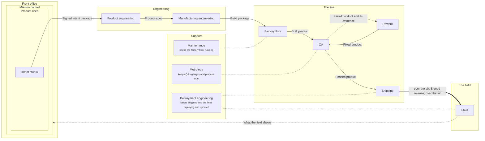
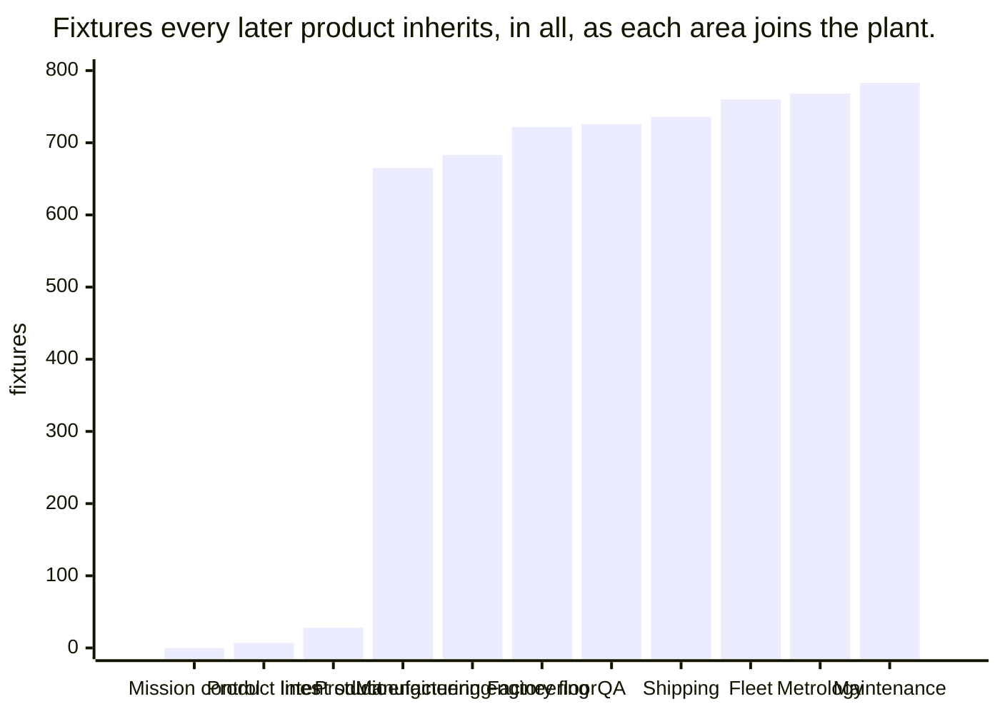
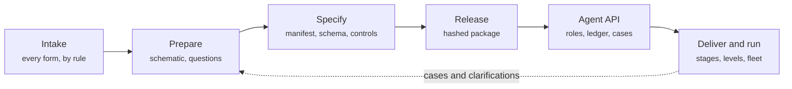

<!-- Generated by tools/docs.ts from docs/src/line/index.md. Edit the source, then run: node tools/docs.ts --write -->

# The plant

> One factory, 13 areas in 5 groups: front office, engineering, the line, the field and support. Work moves from the front office through engineering and the line to the field, what fails goes back for rework, the field reports to the office, and support crews each keep a part of the plant working.

## TL;DR

A person who knows the work says what software must do, in their own words. The plant turns that into software in service. The **front office** runs the plant: mission control sets priorities, gives approvals, stops the line when it must and holds the spend, and inside it each product line has its own intent studio where a product is defined. **Engineering** defines the product, then defines how to build it: product engineering writes the product spec, manufacturing engineering writes the build package. **The line** builds, inspects, reworks and ships: the factory floor, QA, rework and shipping. **The field** is the fleet, updated over the air. **Support** is three crews, each serving the areas it names: maintenance keeps the factory floor running, metrology keeps QA's gauges true, and deployment engineering keeps shipping and the fleet deploying and updated. Each area does one job, hands the next something it can check, and turns what it learns into fixtures every later product inherits. The first product through the plant is the expensive one. Each one after costs less, because most of it is already specified, built and proven.

## Explain it simply

Think of a company that makes bookshelves to order.

The **front office** sees every order at once and runs the whole company. It decides what is made next, signs off what needs the boss, stops the line if something is badly wrong, and holds the money. That is **mission control**.

The company makes **families** of shelves: shelves for schools, shelves for libraries. A school shelf always meets the same safety rules and comes in the same finishes. Defining the family once means a new school order only has to say what is different about it. That is a **product line**, and it sits inside the front office.

The customer describes what they want in their own words: *tall, for picture books, low enough for small children to reach*. Someone reads it back to them, asks only the questions that change what gets built (*how low is low enough?*), and has them sign it. That is the **intent studio**, and each product line has its own.

The **drafting office** turns the signed order into a full drawing: every dimension, its tolerance, which standard parts to use, how it will be inspected. That is **product engineering**, and the drawing is the product spec.

The **process planners** decide how to build it: the order of the steps, the jigs, the gauges at each step, the checks that must pass. They hand the shop a build package, and they keep improving the shop from what it measures. That is **manufacturing engineering**.

The **shop floor** builds to the build package, with an operator who drives each shelf down the line from station to station. That is the **factory floor**.

**Inspection** checks the finished shelf the way a person would use it: a child reaches the bottom shelf; the shelf does not tip when loaded. Inspection tools are tested on purpose-made bad shelves first, so a tool that cannot fail never passes anything. That is **QA**.

A shelf that fails goes to the **rework bench** with a note of what failed. The fix starts from a test that fails, and the whole shelf goes back through inspection. That is **rework**.

The **shipping dock** packs the shelf with its drawings, its test records and its history into a signed shipment, files a copy in the archive, and sends it out in steps, with someone signing for it. That is **shipping**.

Every shelf ever delivered is the **fleet**. Fixes reach it over the air, and a bad update is taken back in one step. What customers report goes to the front office, and the plant runs again.

Three crews serve the parts. The **maintenance crew** keeps the shop floor running: anyone hangs a tag on what is off, and at night the crew fixes it. The **lab** keeps the master gauges that inspection uses, checks each one on parts made wrong on purpose, and puts a dated sticker on every gauge that passes. That is **metrology**. The **installers** stand up the places the shelves go, deliver them, push updates, and watch them once they are in use. That is **deployment engineering**.

The trick is that every area keeps what it learns. The drafting office keeps its standard parts and joints. Inspection keeps its gauges. The shipping dock keeps its checklist. So the hundredth order is mostly assembled from things already proven, and the people only design what is new.

## Engineer

### The areas

| Step | Area | Group | What it does | Open it | How it works |
| --- | --- | --- | --- | --- | --- |
| - | Mission control | Front office | Runs the plant: sets priorities, gives approvals, stops the line when it must and holds the spend. It sees every product line and product, where each stands, and what waits on a person. | [/mission](https://zthr.ai/mission) | [Mission control](../mission.md) |
| - |   Product lines | Front office | Each product family: who it serves and the defaults every product in it starts from. A family holds many products, each built separately on the line, and each product line has its own Intent studio. | [/lines](https://zthr.ai/lines) | [Product lines](../lines.md) |
| - |     Intent studio | Front office | Defines the thing: rough words become a numbered schematic, the questions that change the build are settled, and the person signs it as what they mean. | [/intent](https://zthr.ai/intent) | [Intent studio](../intent.md) |
| 1 | Product engineering | Engineering | Designs the app and its blocks: outcomes, data, compliance, operations, measures, journeys and tests, drawn from the block library, and hands on the product spec. | [/engineering](https://zthr.ai/engineering) | [Product engineering](../engineering.md) |
| 2 | Manufacturing engineering | Engineering | Defines how to build the thing, then sets up the line to build it, and keeps improving the line and the process from what the line measures. | [/process](https://zthr.ai/process) | [Manufacturing engineering](../process.md) |
| 3 | Factory floor | The line | An operator agent drives each product down the line, station by station, building to the build package and measuring what was built. | [/factory](https://zthr.ai/factory) | [Factory floor](../factory.md) |
| 4 | QA | The line | Inspects every product as a person would use it: every journey walked, measured against its reference system, every gate proven able to fail. | [/qa](https://zthr.ai/qa) | [QA](../qa.md) |
| loop | Rework | The line | Takes back what fails inspection. The fix starts from a failing test, and the whole product goes through QA again. | [/rework](https://zthr.ai/rework) | [Rework](../rework.md) |
| 5 | Shipping | The line | Packages the code, the tests, the docs and the version history into a signed release, publishes it to the repository and the sites, and deploys it to production with a person approving. | [/shipping](https://zthr.ai/shipping) | [Shipping](../shipping.md) |
| 6 | Fleet | The field | Everything in service: each app, the blocks it draws on and the data it keeps. Apps are updated over the air, with rollback, and the field reports back to Mission control. | [/fleet](https://zthr.ai/fleet) | [Fleet](../fleet.md) |
| - | Maintenance | Support | Keeps the factory floor running. The night shift works the backlog within its budget, through the same gates as day work, and reports each morning. | [/maintenance](https://zthr.ai/maintenance) | [Maintenance](../maintenance.md) |
| - | Metrology | Support | The lab behind QA: defines every measure, traces it to a reference, certifies every gauge before QA may use it, and fixes QA’s quality and process. | [/metrology](https://zthr.ai/metrology) | [Metrology](../metrology.md) |
| - | Deployment engineering | Support | The cloud and field engineers: stand up where products run, deploy them, send updates over the air, watch them in service and bring back what the field shows. | [/deployment](https://zthr.ai/deployment) | [Deployment engineering](../deployment.md) |

Every area is a page on zthr.ai with the same bar across the top: the areas of the plant by group, the product in focus, and a lamp for where that product stands in each. The front office and the support crews carry no step number, because work does not pass through them; the rest are numbered in the order work moves. Each page on the work path ends with one handoff to the next area, enabled only when the work is ready to move on.

### What each area hands the next

| From | To | What is handed over | How it travels |
| --- | --- | --- | --- |
| Intent studio | Product engineering | Signed intent package | Forward, as the work |
| Product engineering | Manufacturing engineering | Product spec | Forward, as the work |
| Manufacturing engineering | Factory floor | Build package | Forward, as the work |
| Factory floor | QA | Built product | Forward, as the work |
| QA | Rework | Failed product and its evidence | Back for rework |
| Rework | QA | Fixed product | Forward, as the work |
| QA | Shipping | Passed product | Forward, as the work |
| Shipping | Fleet | Signed release, over the air | Out to the field, over the air |
| Fleet | Mission control | What the field shows | Back to the office as a report |

Each area checks what it takes in before it goes on:

- The signed intent package is signed by the person who holds the intent. The signature is bound to the exact content; one changed word needs signing again.
- The product spec is a plain, hashed package. The manifest hashes every file, and manufacturing engineering builds only from a released revision.
- The build package carries the routing, the fixtures, the gates and the required checks. A gate counts only after planted defects make it fail.
- The built product is an admitted change: every required check run by the API, two other model families agreeing. Admission is computed from the record; no one can set it.
- The passed product has every journey walked as a person would. A fail goes back as a return, with its failing evidence.
- The signed release is stage by stage approved in production by a named person, and each stage's result is recorded by the pipeline, never by the operator.
- What the field shows comes to mission control as reports and alerts. Each becomes a bug for rework or an idea for the holder.

### The support crews

| Crew | Serves | What it does for them |
| --- | --- | --- |
| Maintenance | Factory floor | keeps the factory floor running |
| Metrology | QA | keeps QA’s gauges and process true |
| Deployment engineering | Shipping and Fleet | keeps shipping and the fleet deploying and updated |

Anyone, in any area, tags what is wrong: what, where, the evidence and the test that will prove it fixed. A tag is a source of work for the crew whose area it concerns. Maintenance accepts tags as work orders for the factory floor; metrology raises tags itself when a gauge fails calibration; deployment engineering raises one for anything in service that burns an error budget.

### Why it compounds

Every area turns its work into **fixtures**: things the next product does not have to make again, and checks it does not have to invent. A product line's defaults, the design lexicon's terms, the catalogued parts, the information patterns, the compliance controls, the library's blocks, the gauges, the gates, the delivery stages, the connectors. Counted from the code today:

| Area | What it adds that every later product inherits | Fixtures | In all, so far |
| --- | --- | --- | --- |
| Mission control | one view of every product, and what waits on a person | none | 0 |
| Product lines | spec-sheet defaults a product line hands every product in it | 7 | 7 |
| Intent studio | intake forms, design-lexicon terms and derivation rules | 21 | 28 |
| Product engineering | catalogued parts, information patterns, compliance controls, platform outcomes and library blocks | 637 | 665 |
| Manufacturing engineering | required checks and proven gates in the control plan | 18 | 683 |
| Factory floor | agent tools and the models the router chooses between | 39 | 722 |
| QA | gauges generated from every intent, and the review families | 4 | 726 |
| Shipping | delivery stages, each with its gate, and the service levels the example is held to | 10 | 736 |
| Fleet | connectors and the sensitive-data classes every app is governed by | 24 | 760 |
| Metrology | measures defined once, and the reference standards they trace to | 8 | 768 |
| Maintenance | maintenance stations and task kinds, each with what it must prove before a change is accepted | 15 | 783 |

The effect shows in a single product. For the worked example (five rough lines about bill reminders), 98% of its 131 manifest lines are already specified by the catalogue or the library before anyone designs anything, and 120 of those are already built. 3 are new. As the library grows, lines of its manifest move from *still to make* to *used as is*.

| Where a line of the example’s manifest comes from | Lines |
| --- | --- |
| Standard assembly, used as is | 92 |
| Standard assembly, extended | 28 |
| Catalogued part, still to make | 8 |
| Custom, designed new | 3 |

Each area also makes the others cheaper:

- **Product lines make the intent studio cheaper.** The defaults are settled once for every product in the line, so the studio asks only what is different.
- **The intent studio makes product engineering cheaper.** Every statement arrives numbered, sourced and toleranced, so engineering completes the spec instead of inferring it.
- **Product engineering makes manufacturing engineering cheaper.** The spec names every part, record and gauge, so the build package only has to route them.
- **Manufacturing engineering makes the factory floor cheaper.** The package names every step and check, so builders design only the delta and test against a fixed reference.
- **The factory floor makes QA cheaper.** Nothing red is pushed and nothing unreviewed is admitted, so QA walks journeys instead of chasing build failures.
- **QA makes rework and shipping cheaper.** A return arrives with its failing evidence, and only passed products ship, so each stage confirms what is already known instead of discovering it.
- **Shipping makes the fleet cheaper.** Every app arrives with the same stages, service levels and rollback, so one way of running serves all of them.
- **The fleet makes everything cheaper.** A fix to a shared part reaches every app that uses it, and every report becomes a test, a part or a clarification for the next product.
- **Maintenance, metrology and deployment engineering make the areas they serve worth trusting.** Nothing waits on a stopped floor; a gauge proven to reject planted defects, the same way every time, is a gauge whose pass means something; and a product that runs where it was deployed runs the same way in every environment.

### One word per idea

The docs, the pages and the bar use these names and no others.

| Term | What it means | Never called |
| --- | --- | --- |
| **area** | One part of the plant, with its own discipline, its own page and its own doc. | department |
| **station** | The place in a product’s flow where an area reports a lamp, and one of the inspection stations maintenance works. | nothing else |
| **stage** | One of the eight stages of a delivery, from build to operate. | nothing else |
| **product line** | A family of products that share defaults. Never "a line" on its own; "the line" is the production line. | nothing else |
| **signed intent package** | What the Intent studio hands to product engineering once the holder has signed. | signed schematic |
| **product spec** | What product engineering hands to manufacturing engineering: the complete specification. | nothing else |
| **build package** | What manufacturing engineering hands to the factory floor: routing, fixtures, gates and required checks. | released package |
| **return** | A failed product sent from QA to rework, with its failing evidence. The agent API records one as a case. | nothing else |
| **tag** | Something wrong noticed anywhere, with its evidence and the test that will prove it fixed. | nothing else |
| **work order** | A tag accepted for maintenance to work. | nothing else |
| **release** | The signed package shipping publishes and deploys. | nothing else |

## Architect

### One engine, many surfaces

Every area runs on the same deterministic engine. The same words always give the same schematic and the same package bytes; models only read. The surfaces (the intent studio, product engineering, the consoles, the agent API) are views and controls over that one engine and its records.

### Authority along the line

Each area's authority is limited by what it is denied, not by what it is told.

- **Mission control** may set priorities, give approvals, stop the line and hold the spend. It cannot sign an intent or approve production for anyone: those acts have no tool.
- The **holder** alone answers the intent's questions, signs the intent package, approves production and resets a ratchet.
- **Product engineering** releases the product spec; it cannot sign.
- **Manufacturing engineering** writes the build package from a released spec; it cannot change the spec.
- **Builders**, driven by the line's operator agent, cannot admit their own change, report a check result, or touch a locked, person-only or generated path.
- **Reviewers** cannot review their own family's work.
- **Rework** fixes what QA returned; it cannot pass its own fix. Only QA passes a product.
- The **operator** cannot skip a stage or record a result.
- The **pipeline** records results; it cannot request or approve.

The factory's agents run in 7 roles through 35 tools, and 7 acts have no tool at all. See [the factory, run by agents](../agents.md).

### Change travels backwards on purpose

Work moves forward; what is learned moves back, through defined routes only:

- A failing journey in QA becomes a **return**: the failed product goes to rework with its failing evidence, the fix starts from a failing test, and QA inspects the whole product again.
- A return that blames the intent must name its balloons and be confirmed by another model family. A Class II clarification (nothing the holder signed is removed, reworded, loosened or re-marked, and no scope is added) is issued by the factory under the holder's standing delegation. A Class I clarification goes to the holder.
- What the field shows, from alerts and from what people report, goes back to mission control. A bug becomes a failing test first; an idea goes to the holder.
- Updates go out the other way, over the air, with rollback.

Nothing moves backwards by editing a document in place.

### What is measured where

| Area | Measures | Never claims |
| --- | --- | --- |
| Mission control | Every area's lamp; what waits on a person; the spend | A lamp for an area that measured nothing |
| Product lines | The defaults a family sets, and the products in it | That a product is right because its family is |
| Intent studio | Statements traced to a source; open questions; signature | That the intent is correct, only that it is the holder's |
| Product engineering | Outcomes complete; information read; controls mapped; balloons with a gauge | That a gap is filled when it is only assumed |
| Manufacturing engineering | Gates proven able to fail; required checks; the routing | Process capability it has not measured |
| Factory floor | Checks run by the API; reviews by family; admission | A result an agent reported |
| QA | Journeys walked; gates proven; ratchets held | Pass for anything not measured |
| Rework | Returns open; fixes made from a failing test; re-inspections | A fix passed by anyone but QA |
| Shipping | The release's contents; each stage's result, from the pipeline | A stage passed that was not recorded |
| Fleet | Service levels; where each part is used; sensitive data by class | That a fix reached an app before its tests prove it |
| Maintenance | Tags by station; fixes accepted; mutation scores per block; pass rate per model per kind; cost per accepted change; time from tag to fix | A fix that skipped a gate, or a shift that did not run |
| Metrology | Certificates per gauge; measures and their references; control charts; the claims audit | A gauge certified that was not calibrated, or a claim proven that has no evidence |
| Deployment engineering | Environments defined; deploys approved; updates and rollbacks; what is monitored | A deploy no person approved, or a product in service that nothing watches |

### Reading further

- [Architecture: the engine, the package and the records](architecture.md)
- Each area, at the same four depths: [mission control](mission.md), [product lines](lines.md), [intent studio](intent.md), [product engineering](engineering.md), [manufacturing engineering](process.md), [factory floor](factory.md), [QA](qa.md), [rework](rework.md), [shipping](shipping.md), [fleet](fleet.md), and the support crews, [maintenance](maintenance.md), [metrology](metrology.md) and [deployment engineering](deployment.md)
- [The standards map: each area's discipline and standard, and where the factory stands on each](standards.md)
- [Intent as the Datum: the pattern paper](../../PAPER.md)
