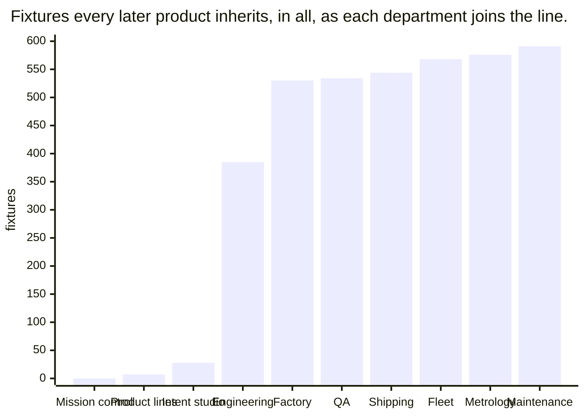
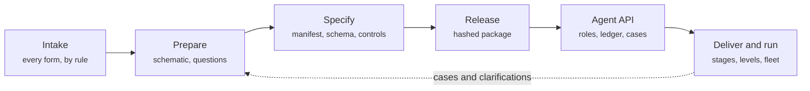

<!-- Generated by tools/docs.ts from docs/src/line/index.md. Edit the source, then run: node tools/docs.ts --write -->

# The line

> One factory, 8 departments, in the order work moves through them: from what a person means to software in service, and back. Beneath them, a metrology lab and a maintenance crew that serve every one.

## TL;DR

A person who knows the work says what software must do, in their own words. The line turns that into software in service, one department at a time: Mission control, Product lines, Intent studio, Engineering, Factory, QA, Shipping and Fleet. Each department does one job, hands the next one something it can check, and turns what it learns into fixtures every later product inherits. Beneath every department are two more. Metrology defines every measure QA uses and certifies every gauge before QA may use it. Maintenance, the night shift, works what is tagged through the same gates as day work and reports each morning, so a defect never has to stop the line to be fixed. The first product through the line is the expensive one. Each one after costs less, because most of it is already specified, built and proven.

```mermaid
flowchart LR
  mission["1 Mission control"]
  lines["2 Product lines"]
  intent["3 Intent studio"]
  engineering["4 Engineering"]
  factory["5 Factory"]
  qa["6 QA"]
  shipping["7 Shipping"]
  fleet["8 Fleet"]
  mission --> lines
  lines --> intent
  intent --> engineering
  engineering --> factory
  factory --> qa
  qa --> shipping
  shipping --> fleet
  qa -.->|failing journeys become cases| factory
  engineering -.->|Class I clarifications| intent
  fleet -.->|reports and alerts| mission
  metrology["Metrology: the lab<br><small>defines the measures, certifies every gauge</small>"]
  maintenance["Maintenance: the night shift<br><small>works every tag through the same gates</small>"]
  fleet -.->|tags, from every department| metrology
  metrology -.->|tags| maintenance
  maintenance -.->|certificates and the morning report| mission
```

## Explain it simply

Think of a company that makes bookshelves to order.

The **front office** sees every order at once: where each one is, and who it is waiting on. That is **mission control**.

The company makes **lines** of shelves: shelves for schools, shelves for libraries. A school shelf always meets the same safety rules and comes in the same finishes. Defining the line once means a new school order only has to say what is different about it. That is **product lines**.

The customer describes what they want in their own words: *tall, for picture books, low enough for small children to reach*. Someone reads it back to them, asks only the questions that change what gets built (*how low is low enough?*), and has them sign it. That is the **intent studio**.

The **drafting office** turns the signed order into a full drawing: every dimension, its tolerance, which standard parts to use, which joints carry weight, how it will be inspected. That is **engineering**.

The **shop floor** builds to the drawing, from standard parts where it can. That is the **factory**.

**Inspection** checks the finished shelf the way a person would use it: a child reaches the bottom shelf; the shelf does not tip when loaded. Inspection tools are tested on purpose-made bad shelves first, so a tool that cannot fail never passes anything. That is **QA**.

The **shipping dock** delivers it in steps: to one classroom first, then to the school, with someone signing for it. If anything is wrong, it comes back in one step. That is **shipping**.

Every shelf ever delivered is the **fleet**. When one school finds a wobbly bracket, the fix is made to the standard bracket, and every shelf that uses it gets the fix. What customers report comes back to the front office, and the line runs again.

The **lab** keeps the master gauges, checks every inspection gauge on parts made wrong on purpose, and puts a dated sticker on each one that passes. Inspection may only use a gauge with a current sticker. That is **metrology**.

Nobody stops the line for a small fault. Whoever finds it hangs a tag on it and carries on. At night the **maintenance crew** walks the tags, fixes what it can the way the day crew would have to, and tests the inspectors' gauges on bad parts made on purpose. In the morning the front office has a sheet: fixed, with the proof; waiting for a person, and why; and the new tags. That is **maintenance**.

The trick is that every department keeps what it learns. The drafting office keeps its standard parts and joints. Inspection keeps its gauges. The shipping dock keeps its checklist. So the hundredth order is mostly assembled from things already proven, and the people only design what is new.

## Engineer

### The departments

| # | Department | What it does | Open it | How it works |
| --- | --- | --- | --- | --- |
| 1 | Mission control | Every product line and product, where each stands, and what is waiting on a person. | [/mission](https://zthr.ai/mission) | [Mission control](mission.md) |
| 2 | Product lines | Define a line: who it serves, and the defaults every product in it starts from. | [/lines](https://zthr.ai/lines) | [Product lines](lines.md) |
| 3 | Intent studio | Say what a product must do, settle the questions, and sign the schematic as what you mean. | [/intent](https://zthr.ai/intent) | [Intent studio](intent.md) |
| 4 | Engineering | Turn the signed schematic into a complete specification: outcomes, data, compliance, operations, measures and tests. | [/engineering](https://zthr.ai/engineering) | [Engineering](engineering.md) |
| 5 | Factory | Build to the released package, and measure what was built. | [/factory](https://zthr.ai/factory) | [Factory](factory.md) |
| 6 | QA | Walk every journey as a person would, prove every gate can fail, hold every ratchet. | [/qa](https://zthr.ai/qa) | [QA](qa.md) |
| 7 | Shipping | Move a certified build to the people it is for, stage by stage, with a person approving production. | [/shipping](https://zthr.ai/shipping) | [Shipping](shipping.md) |
| 8 | Fleet | Everything in service, the library each app draws on, and the data it keeps. | [/fleet](https://zthr.ai/fleet) | [Fleet](fleet.md) |
| beneath | Metrology | The lab: defines every measure QA uses, traces it to a reference, certifies every gauge, and charts the factory for drift. | [/metrology](https://zthr.ai/metrology) | [Metrology](metrology.md) |
| beneath | Maintenance | The night shift: works what every department tagged, through the same gates as day work, and reports each morning. | [/maintenance](https://zthr.ai/maintenance) | [Maintenance](maintenance.md) |

Every department is a page on zthr.ai with the same bar across the top: the line in order, the product in focus, and a lamp for where that product stands in each department. Each page ends with one handoff to the next department, enabled only when the work is ready to move on.

### What each department hands the next

| From | To | What is handed over | How the next one checks it |
| --- | --- | --- | --- |
| Product lines | Intent studio | A product with its line's end in mind and spec-sheet choices | The schematic shows them as the line's, until the holder confirms them |
| Intent studio | Engineering | The schematic, signed by the person who holds the intent | The signature is bound to the exact content; one changed word needs signing again |
| Engineering | Factory | A released revision: a plain, hashed package | The manifest hashes every file; the factory builds only to a release |
| Factory | QA | An admitted change: every required check run by the API, two other model families agreeing | Admission is computed from the record; no one can set it |
| QA | Shipping | A certified phase: every journey walked as a person would, every gate proven able to fail | A gate counts only after planted defects make it fail |
| Shipping | Fleet | A build released stage by stage, approved in production by a named person | Each stage's result is recorded by the pipeline, never by the operator |
| Fleet | Mission control | Reports, alerts and cases | Each becomes a case: a bug for the factory, an idea for the holder |
| Metrology | QA | Certified gauges: each measure defined and traced to a reference, each gauge with a dated certificate | QA uses a gauge only while its certificate is current |
| Every department, and metrology | Maintenance | Tags: what is wrong, where, the evidence, and the test that will prove it fixed | A tag missing any of the four is refused |
| Maintenance | Every department, and mission control | Fixes, and the morning report | Each fix carries its failing-first test and a check by another model family; the report links every fix to its evidence |

### Why it compounds

Every department turns its work into **fixtures**: things the next product does not have to make again, and checks it does not have to invent. A product line's defaults, the design lexicon's terms, the catalogued parts, the information patterns, the compliance controls, the library's blocks, the gauges, the delivery stages, the connectors. Counted from the code today:

| Department | What it adds that every later product inherits | Fixtures | In all, so far |
| --- | --- | --- | --- |
| Mission control | one view of every product, and what waits on a person | none | 0 |
| Product lines | spec-sheet defaults a line hands every product in it | 7 | 7 |
| Intent studio | intake forms, design-lexicon terms and derivation rules | 21 | 28 |
| Engineering | catalogued parts, information patterns, compliance controls and platform outcomes | 357 | 385 |
| Factory | library blocks, agent tools and required checks | 145 | 530 |
| QA | gauges generated from every intent, and the review families | 4 | 534 |
| Shipping | delivery stages, each with its gate, and the service levels the example is held to | 10 | 544 |
| Fleet | connectors and the sensitive-data classes every app is governed by | 24 | 568 |
| Metrology | measures defined once, and the reference standards they trace to | 8 | 576 |
| Maintenance | maintenance stations and task kinds, each with what it must prove before a change is accepted | 15 | 591 |

The effect shows in a single product. For the worked example (five rough lines about bill reminders), 98% of its 131 manifest lines are already specified by the catalogue or the library before anyone designs anything, and 120 of those are already built. 3 are new. As the library grows, lines move from *still to make* to *used as is*.

| Where a line of the example’s manifest comes from | Lines |
| --- | --- |
| Standard assembly, used as is | 92 |
| Standard assembly, extended | 28 |
| Catalogued part, still to make | 8 |
| Custom, designed new | 3 |

Each department also makes the others cheaper:

- **Lines make intent cheaper.** The defaults are settled once for every product in the line, so the studio asks only what is different.
- **The studio makes engineering cheaper.** Every statement arrives numbered, sourced and toleranced, so engineering completes the specification instead of inferring it.
- **Engineering makes the factory cheaper.** The package names every part, record and gauge, so builders design only the delta and test against a fixed reference.
- **The factory makes QA cheaper.** Nothing red is pushed and nothing unreviewed is admitted, so QA walks journeys instead of chasing build failures.
- **QA makes shipping cheaper.** Only certified phases ship, so each stage confirms what is already known instead of discovering it.
- **Shipping makes the fleet cheaper.** Every app arrives with the same stages, service levels and rollback, so one way of running serves all of them.
- **The fleet makes everything cheaper.** A fix to a shared part reaches every app that uses it, and every report becomes a test, a part or a clarification for the next product.
- **Metrology makes QA worth trusting.** A gauge proven to reject planted defects, the same way every time, is a gauge whose pass means something, in every product that inherits it.
- **Maintenance makes every department cheaper.** Nothing waits on a stopped line, the gauges every product inherits are calibrated, and code that does nothing is removed before the next product assembles it.

## Architect

### One engine, many surfaces

Every department runs on the same deterministic engine. The same words always give the same schematic and the same package bytes; models only read. The surfaces (studio, engineering, the consoles, the agent API) are views and controls over that one engine and its records.

### Authority along the line

Each department's authority is limited by what it is denied, not by what it is told.

- The **holder** alone answers the intent's questions, signs the schematic, approves production and resets a ratchet.
- **Engineering** releases; it cannot sign.
- **Builders** cannot admit their own change, report a check result, or touch a locked, person-only or generated path.
- **Reviewers** cannot review their own family's work.
- The **operator** cannot skip a stage or record a result.
- The **pipeline** records results; it cannot request or approve.

The factory's agents run in 7 roles through 35 tools, and 7 acts have no tool at all. See [the factory, run by agents](../agents.md).

### Change travels backwards on purpose

Work moves forward; what is learned moves back, through defined routes only:

- A failing journey in QA becomes a **case** in the factory.
- A case that blames the intent must name its balloons and be confirmed by another model family. A Class II clarification (nothing the holder signed is removed, reworded, loosened or re-marked, and no scope is added) is issued by the factory under the holder's standing delegation. A Class I clarification goes to the holder.
- What people report in service becomes a defect (a failing test first) or an idea for the holder.

Nothing moves backwards by editing a document in place.

### What is measured where

| Department | Measures | Never claims |
| --- | --- | --- |
| Intent studio | Statements traced to a source; open questions; signature | That the intent is correct, only that it is the holder's |
| Engineering | Outcomes complete; information read; controls mapped; balloons with a gauge | That a gap is filled when it is only assumed |
| Factory | Checks run by the API; reviews by family; admission | A result an agent reported |
| QA | Journeys walked; gates proven; ratchets held | Pass for anything not measured |
| Shipping | Each stage's result, from the pipeline | A stage passed that was not recorded |
| Fleet | Service levels; where each part is used; sensitive data by class | That a fix reached an app before its tests prove it |
| Metrology | Certificates per gauge; measures and their references; control charts; the claims audit | A gauge certified that was not calibrated, or a claim proven that has no evidence |
| Maintenance | Tags by station; fixes accepted; mutation scores per block; pass rate per model per kind; cost per accepted change; time from tag to fix | A fix that skipped a gate, or a shift that did not run |

### Reading further

- [Architecture: the engine, the package and the records](architecture.md)
- Each department, at the same four depths: [mission control](mission.md), [product lines](lines.md), [intent studio](intent.md), [engineering](engineering.md), [factory](factory.md), [QA](qa.md), [shipping](shipping.md), [fleet](fleet.md), and beneath them [metrology](metrology.md) and [maintenance](maintenance.md)
- [The plant map: each plant function, its equivalent here, and where the factory stands](plant.md)
- [Intent as the Datum: the pattern paper](../../PAPER.md)
