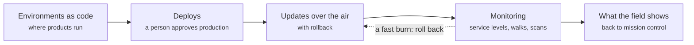

<!-- Generated by tools/docs.ts from docs/src/line/deployment.md. Edit the source, then run: node tools/docs.ts --write -->

# Deployment engineering

> The cloud and field engineers: they stand up where products run, deploy them with a person approving, send updates over the air with rollback, and watch everything in service.

## TL;DR

Deployment engineering is the support crew for [shipping](shipping.md) and the [fleet](fleet.md). It keeps four things: the **environments**, written as code, never clicked together; the **deploys**, which go out in stages and need a named person to approve production; the **updates over the air**, which reach products already in service and can always be rolled back in one step; and the **monitoring** of everything in service, which watches each product against its service levels and brings back what the field shows to mission control. Where it stands: zthr.ai deploys from main and is walked and scanned on a schedule; no product of the line is deployed yet.

## Explain it simply

The shelves are made and signed for. Somebody has to build the places they go, carry them there, put them up, and come back every so often to check they have not started to wobble. The installers do that. They never improvise a room: every room is drawn up and can be rebuilt from the drawing. They never put a shelf in a school until the person responsible has watched it hold in one classroom and said yes. And when a new bracket is sent to shelves already standing, they can put the old one back in a single trip.

## Engineer

### What deployment engineering keeps

| It | Means |
| --- | --- |
| Environments as code | Where products run is written down. Anything that grants access or creates cloud resources is written as commands for a person to run in Cloud Shell, with the least access each identity needs |
| Deploys a person approves | A signed image deploys with no traffic, is tried by a few, and is released to everyone only when a named person approves production and the error budget is not burning |
| Over-the-air updates with rollback | A release reaches products in service in stages; the previous revision stays ready to take traffic back in one step |
| Monitoring of everything in service | Service levels watched from the first canary on; a fast burn of any budget rolls back first; every alert has a runbook; every incident becomes a defect, a test and a ratchet |

### The pipeline it keeps

The same stages for every product, written once and neutrally; each cloud is an adapter over them:

| Stage | What it proves | Gate |
| --- | --- | --- |
| Build | dependencies install from the lock file; types check; no secret-shaped value in the source or its history | every check passes |
| Test | every test passes; mutation scores hold their floors; every ratchet holds or tightens; every journey passes on the twins | every gate in the control plan passes |
| Rehearse the data | the schema revision migrates a copy with nothing lost; every integrity rule holds; no drift from the signed schema | the data pipeline rehearsal passes |
| Package and sign | the image is built by the build service, with signed provenance; a bill of materials is recorded; no critical or high vulnerability in the image | the image is signed and clean |
| Deploy without traffic | only a signed image can run; the new revision starts and is healthy; journeys pass against it, before anyone is sent to it | smoke journeys pass on the candidate |
| Canary | a small share of people use it; service levels hold: no fast burn of any error budget | a named person approves in production; the error budget is not burning |
| Release | everyone is moved to it; the previous revision stays ready to take traffic back in one step | service levels hold for the watch window |
| Operate | service levels watched continuously; integrity and drift checked nightly; every alert has a runbook; every incident becomes a defect, a test and a ratchet | an alert opens an incident |

### What the deployment page shows

The environments and where each is defined, the deploys and whether a person approved them, over-the-air updates and rollbacks, and the workflows that watch what is in service, with how often each runs: all read from the repository when the site is built. It adds the last delivery zthr.ai verified for the reference build. Anything with no record shows *not measured yet*; nothing is in service from the line yet, so there are no updates to show.

## Architect

- **It serves two areas, and does not stand in the flow.** Work does not pass through deployment engineering; it keeps shipping's pipeline and the fleet's path out working, and reports what the field shows.
- **Environments are artefacts.** An environment that cannot be rebuilt from its definition is a risk, so none is hand-made.
- **Agents never hold deployment credentials.** The pipeline acts; agents request and read, and a person approves production.
- **Rollback is a design requirement.** Every update, whether to a new deploy or to a product in service, is only allowed because the previous revision is ready to take traffic back.
- **Monitoring is part of delivery.** A product with nothing watching it is not in service in any sense the fleet accepts.

See [how delivery and operations work](../operations.md).
