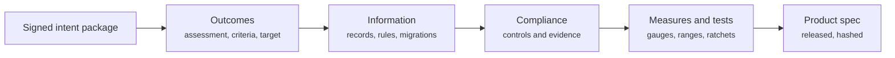
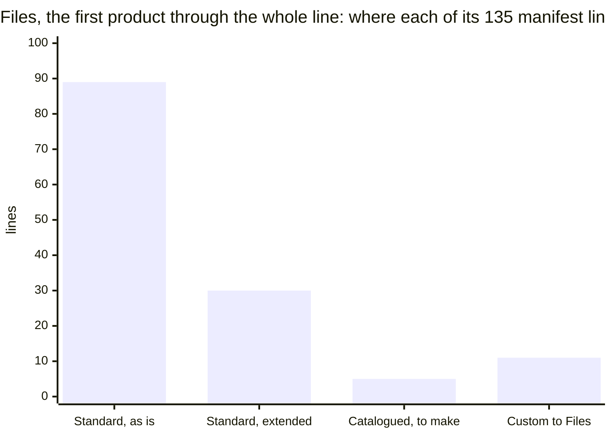
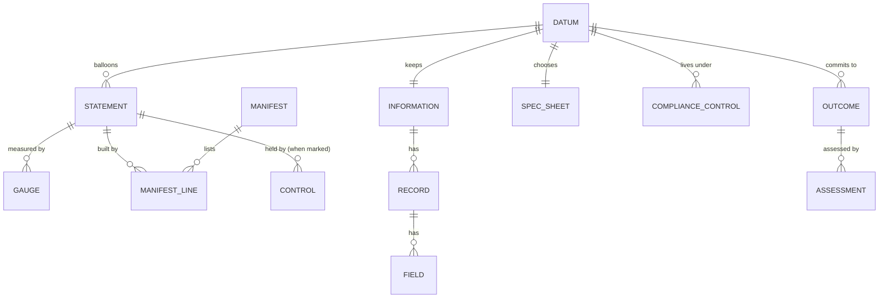

<!-- Generated by tools/docs.ts from docs/src/line/engineering.md. Edit the source, then run: node tools/docs.ts --write -->

# Product engineering

> Turn the signed intent package into the product spec: outcomes and how each is assessed, the information it keeps, the compliance it lives under, how it runs, every measure and test. Then release it to manufacturing engineering.

## TL;DR

Product engineering takes the signed intent package and completes it. Every outcome gets its assessment, criteria, passing target and evidence. The information the product keeps is drafted, signed and given migrations that never drop a record. Compliance is decided with controls mapped to evidence. Operations get service levels. Every measure gets a gauge. A checklist shows what still holds and what is open, and the release is the product spec, which [manufacturing engineering](process.md) turns into the build package.

## Explain it simply

The customer signed what they want. The drafting office now draws it properly: every dimension with its tolerance, the standard parts it uses, how the joints are tested, which safety rules apply and how inspection will check each one. When the drawing is complete, it is released with a number. The process planners work from that number, never from a draft, and they decide how the shop will build it.

## Engineer

### The checklist

| Item | Holds when |
| --- | --- |
| Outcomes | Every outcome has how it is assessed, its criteria, a passing target and its evidence |
| Information | Every sentence about what is kept is read into records, fields and integrity rules |
| Compliance | Every control in scope maps to evidence; nothing that may never be stored is asked for |
| Operations | Service levels from the schematic, delivery stages and gates, alerts and a runbook |
| Measures and tests | Every measure has a tolerance a machine can check, and the gauges exist |
| Housekeeping | The parts almost every app needs are on the manifest, most from tested blocks |
| Spec sheet and build manifest | Every balloon is built by a manifest line; interfaces are switched on or closed by choice |
| The product spec | No problem stands between it and release, and the holder has signed |

### Starting from what exists

The catalogue holds 219 parts in 9 groups. 93 are a team minimum every product inherits, including 34 housekeeping parts: paging, edit conflicts, retries, idempotency, retention, expiry and the rest. 280 of them ship as tested code. The library holds 280 blocks built here, and 295 counting the plant's own; product engineering draws every product from it, and keeps it. The information is drafted from 14 patterns common to business applications. Compliance draws on 8 frameworks with 116 controls mapped to evidence. Platform outcomes come from a list of 8, each mapped as introduced, refined or mastered.

| Group | Parts |
| --- | --- |
| Intent | 15 |
| Identity and access | 21 |
| Data | 34 |
| Work and integrations | 38 |
| Trust and evidence | 40 |
| Content | 13 |
| Experience | 28 |
| Appearance | 10 |
| Data movement and reporting | 20 |

### The first product through the whole line

Files, a file server the Nextcloud apps connect to unchanged, was specified here from eleven rough lines. Its manifest is mostly parts the catalogue already describes; what is custom to it is a thin layer of protocol joining library blocks. [The Files server](https://github.com/russlittle/ZTHR/tree/main/files).

### The product spec

For the worked example, a released revision is 115 files:

| In the package | Files |
| --- | --- |
| `admin/` | 2 |
| `AGENTS.md` | 1 |
| `analytics/` | 1 |
| `api/` | 3 |
| `balloons.json` | 1 |
| `build-manifest.json` | 1 |
| `build-manifest.md` | 1 |
| `compliance/` | 6 |
| `connections.json` | 1 |
| `connections/` | 2 |
| `context.md` | 1 |
| `control-plan.yaml` | 1 |
| `datum.json` | 1 |
| `delivery/` | 5 |
| `docs/` | 5 |
| `features.yaml` | 1 |
| `gauges/` | 1 |
| `information/` | 12 |
| `knowledge/` | 32 |
| `manifest.json` | 1 |
| `notes.md` | 1 |
| `ops/` | 5 |
| `outcomes/` | 3 |
| `ratchets.json` | 1 |
| `reports/` | 17 |
| `schematic.md` | 1 |
| `spec-sheet.json` | 1 |
| `tests/` | 2 |
| `tolerances.json` | 1 |
| `training/` | 4 |

The spec carries the schematic, the specification, the gauges in the factory's own format, working ranges and starting ratchets, pending tests, and the knowledge bundle. Manufacturing engineering builds the control plan, the routing and the agents' brief (`AGENTS.md`) around it, into the build package; both are hashed.

### Releasing

Only product engineering releases the product spec, and only from an intent package the holder signed. A later revision must say why it exists, and its change notice lists every balloon added, changed or removed. A draft can be issued unsigned; it cannot be built from.

## Architect

Product engineering is where the intent becomes measurable in full, and where most compounding happens: every part, pattern, control and outcome added here is one the next product starts from.

- **Completion, not inference.** Product engineering works from numbered, sourced statements. Every addition is visible as an assumption until the holder confirms it, so the specification never quietly grows beyond what was meant.
- **The information is the asset.** The schema is signed with the intent; a change to it is a migration rehearsed before anything ships, and a migration never drops a record. Interfaces can be rebuilt freely; the information stays whole.
- **Compliance is a property of the specification.** Scope is suggested by the information (the worked example suggests SOC 2 and FERPA), and each control is owned by the factory, a configuration, the shared platform or the organisation, so an audit reads evidence produced on every release.
- **Defined always, enabled by choice.** API contracts, events, agent tools, training and documentation are specified for every feature and switched on by the spec sheet. A closed interface still exists and answers that it is closed.
- **Change classes are decided here.** A clarification is compared balloon by balloon with the signed revision. Class II is issued under delegation; Class I goes to the holder.

