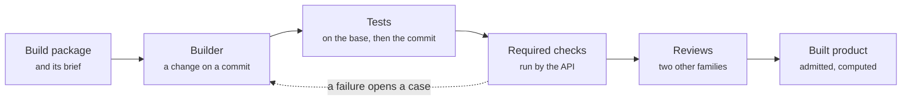
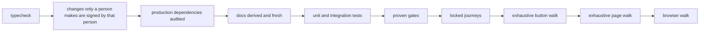
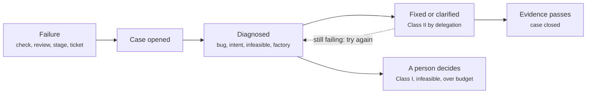

<!-- Generated by tools/docs.ts from docs/src/line/factory.md. Edit the source, then run: node tools/docs.ts --write -->

# Factory floor

> Build to the build package, and measure what was built. An operator agent drives each product down the line; nothing red is pushed, and nothing is admitted on anyone's word.

## TL;DR

An operator agent drives each product down the line, station by station, and agents build to the build package, each in a role defined by what it is denied. A builder runs the existing tests on the base and then on its own commit before anything is pushed. The factory's API runs every required check itself and records what the process returned. Two reviewers from model families other than the author's must pass the change. Admission is computed from that record; nobody can set it. A failure in a change opens a case and is corrected without asking anyone; a failure QA finds in the built product goes to [rework](rework.md).

## Explain it simply

The shop floor builds to the process planners' binder. An operator walks each shelf along the line. Before a part leaves a bench, the worker checks it against the drawing, and checks the bench itself is true first. Then the part goes through gauges the worker does not control, and two inspectors from different shops look at it. If any of that fails, it goes back with a ticket saying what failed. Most tickets are a mistake to fix. A few say the drawing is unclear, and those go back to the drafting office through the front office.

## Engineer

### The operator and the roles

The operator agent is the one seat that sees a product from the build package to the built product: it requests each station in order, within its budget and by the model router's choice of the cheapest model that passes, and it cannot skip a station or record a result. Every other agent has a role:

| Role | Does | Tools |
| --- | --- | --- |
| reader | Reads the person's rough intent into the reading schema, independently of every other reader. | 8 |
| steward | Keeps the intent moving: ranks the questions, drafts answers for the person to confirm, issues revisions, proposes journeys. | 13 |
| builder | Builds to the released package: opens changes, runs the required checks, proposes journeys, takes defects. | 15 |
| reviewer | Reviews changes from other families, and says what it checked as well as what it found. | 14 |
| operator | Moves an admitted revision through delivery stage by stage, watches service levels, rolls back. | 12 |
| triager | Sorts what people report: status, severity, duplicates, defects for builders and ideas for the person who holds the intent. | 11 |
| pipeline | The build service's own identity: records what each delivery stage proved, with the build that proved it. | 8 |

Every call to the API is logged in a hash chain. A refusal says why and what to do instead.

### Before a push

`change_open` runs typecheck and tests on the base first: a test already failing there becomes its own case against the base, and the new work waits on a green base. Then it runs them on the commit; a red commit is refused. The paths a commit touches are read from git, not from the builder's list, so a locked path cannot be left off. A pre-push hook refuses any commit the API has not seen pass.

### Required checks

| # | Required check | Step |
| --- | --- | --- |
| 1 | typecheck | npm run typecheck |
| 2 | changes only a person makes are signed by that person | npm run person-signed |
| 3 | production dependencies audited | npm run dependencies |
| 4 | docs derived and fresh | npm run docs |
| 5 | unit and integration tests | npm run test |
| 6 | proven gates | npm run gates |
| 7 | locked journeys | npm run journeys |
| 8 | exhaustive button walk | npm run explore |
| 9 | exhaustive page walk | npm run crawl |
| 10 | browser walk | npm run walk |

Manufacturing engineering defines these checks; the floor runs them. They run cheapest first, stop at the first failure, and are not run again on an identical tree. A model reviews a change only after every check has passed.

### Correction without asking

A failure opens a case. The builder diagnoses it: a **bug** (the work misses a clear datum) is fixed, test first, with nobody asked. **Intent**, **infeasible** or **factory** must name the balloons and be confirmed by a reviewer of another family. A confirmed intent case is clarified with examples and notes; the API compares the draft with the signed revision, and a Class II clarification is issued by the factory under the holder's delegation. A case goes to a person when the intent cannot be met, a change would be Class I, three attempts in a row fail no better, or it passes its spending ceiling.

### Cost

The fixture judges the work, not the model, so each seat runs the cheapest model that can do its job, and every token is metered against a ceiling that pauses the agenda when it is reached.

| Seat | Models, cheapest that fits first |
| --- | --- |
| steward | hydrogen (google) |
| reader | deepseek-flash (deepseek), ollama-llama (llama), hydrogen (google) |
| builder | ollama-qwen (qwen), deepseek-flash (deepseek) |
| reviewer | deepseek-flash (deepseek), ollama-llama (llama), ollama-qwen (qwen), hydrogen (google) |
| operator | deepseek-flash (deepseek) |
| triager | deepseek-flash (deepseek) |

## Architect

The factory is where Symmetric Zero Trust is enforced: no participant gains authority by asserting success.

- **Results are measured, not reported.** The API runs checks and records exit codes; the pipeline records stage results; admission is computed. An agent can read every result and write none.
- **Independence is structural.** Readers never see each other's readings; reviewers are of other families than the author; 3 families touch every change.
- **Authority by absence.** The 7 acts only a person takes have no tool. Locked, person-only and generated paths are refused at `change_open` from the commit's real diff.
- **The cheap path is the default.** Machines before models; cheapest check first; content-addressed reuse; one review family at a time; an empty agenda wakes nobody.
- **Builds are reproducible.** The same package gives the same bytes, so a build can be checked byte for byte anywhere.
- **Every miss becomes a fixture.** A bug becomes a failing test and a ratchet; a clarification becomes a revision; a new capability becomes a part or a block for the next product.

See [the factory, run by agents](../agents.md) and the [tool reference](../agents-tools.md).
