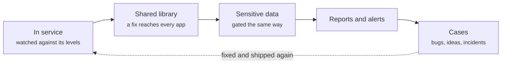
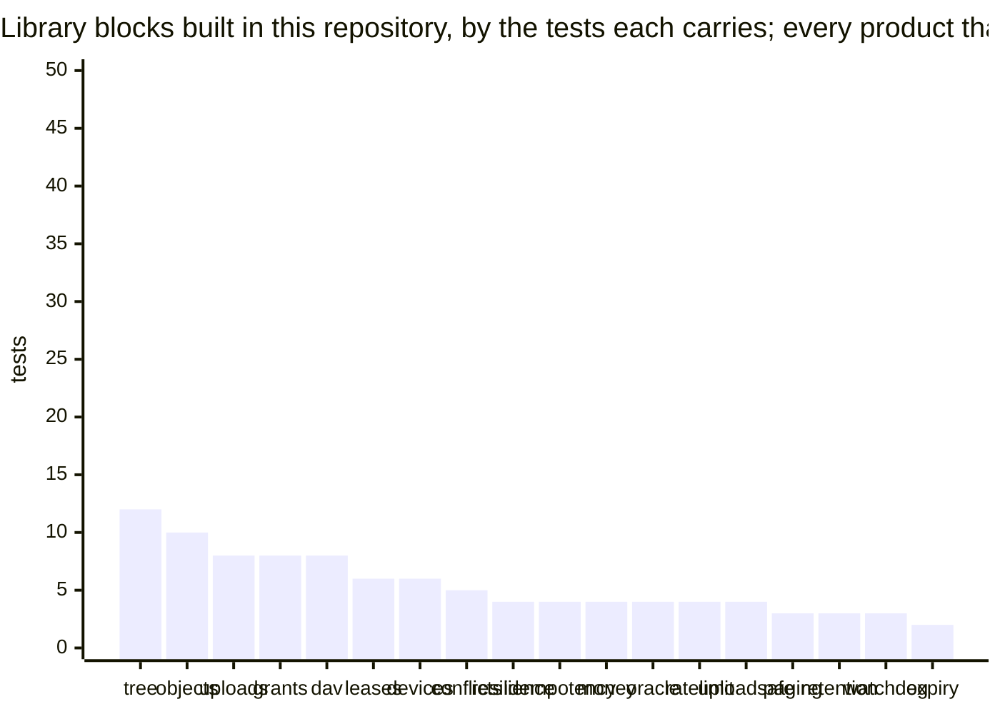

<!-- Generated by tools/docs.ts from docs/src/line/fleet.md. Edit the source, then run: node tools/docs.ts --write -->

# Fleet

> Everything in service, as one fleet: one library, one governance, and everything learned in service sent back to the start.

## TL;DR

Every app the line ships joins the fleet. They share a library, so a fix to a standard assembly reaches every app that uses it, proven by each app's own tests. Sensitive data is classified the same way in each (contact, financial, private and health), gated and audited by the same rules. What people report and every alert come back as cases: a bug to the factory, an idea to the holder, and the line runs again.

## Explain it simply

Every shelf the company ever delivered is listed in one book, with the parts it used. When a school reports a bracket that wobbles, the fix is made to the standard bracket, and the book says exactly which other shelves have that bracket. Each gets the new bracket, and each is checked again before anyone says it is fixed.

## Engineer

### What the fleet page shows

- **In service.** Each app, its build, where it is served, and its journeys.
- **On the way.** Products not yet in service, with where each stands.
- **The library, where used.** Each standard assembly and the apps that use it, with its tests.
- **Sensitive data across the fleet.** Every field by class, by app, and whether it is gated.

### Connectors

Every app can reach the tools people already use, through 20 connectors of 5 kinds, each a stub with its configuration and secrets named, never stored:

| Kind | Tools |
| --- | --- |
| tickets | Jira, Asana, Linear, GitHub Issues, Azure Boards |
| docs | Confluence, Notion, SharePoint, Google Drive, GitHub wiki |
| chat | Slack, Microsoft Teams, Google Chat |
| feed | Signed webhooks, BigQuery, Snowflake, Cloud Storage export |
| identity | Google, Microsoft Entra ID, Okta |

### Housekeeping blocks

The fleet maintains the code most apps get wrong, as tested blocks every product starts from (95 tests between them):

| Block | What it holds | Tests |
| --- | --- | --- |
| [resilience](../../blocks/resilience/index.ts) | Timeouts with abort, bounded full-jitter retries, and a circuit breaker that half-opens on its own | 4 |
| [idempotency](../../blocks/idempotency/index.ts) | One result per idempotency key: repeats replay it, different content is refused, concurrent repeats wait | 4 |
| [money](../../blocks/money/index.ts) | Whole minor units per currency, half-even rounding, and splits that always add back to the total | 4 |
| [conflicts](../../blocks/conflicts/index.ts) | Versioned saves with a three-way merge of fields that do not clash, and the exact fields that do | 5 |
| [paging](../../blocks/paging/index.ts) | Stable keyset paging with opaque cursors, and only declared sorts and filters | 3 |
| [retention](../../blocks/retention/index.ts) | Trash with dependents, restore of all of it, and a retention sweep plan with reasons | 3 |
| [watchdog](../../blocks/watchdog/index.ts) | Missed, overlong, failed and overlapping scheduled runs, and a lease so one copy runs at a time | 3 |
| [expiry](../../blocks/expiry/index.ts) | Everything with an expiry date, and the alert each needs today | 2 |
| [tree](../../blocks/tree/index.ts) | Folders and files with stable ids, where a change re-tags every ancestor and keeps folder sizes, so sync skips unchanged subtrees | 12 |
| [objects](../../blocks/objects/index.ts) | Bytes streamed once with checksums computed on the way, byte ranges, and parts joined in the store; memory and disk stores | 10 |
| [uploads](../../blocks/uploads/index.ts) | Resumable chunked uploads: any order, repeats replace, quota checked up front, joined in a tree of compose calls, idle sessions swept | 8 |
| [leases](../../blocks/leases/index.ts) | Exclusive holds with owners, tokens and time limits that end on their own, covering everything below a folder when deep | 6 |
| [grants](../../blocks/grants/index.ts) | Permissions to people, groups and links, never more than the giver has; link passwords hashed and throttled; expiries | 8 |
| [devices](../../blocks/devices/index.ts) | A browser sign-in flow that hands a new app its own hashed password once; revoke one device, or wipe it remotely | 6 |
| [dav](../../blocks/dav/index.ts) | The DAV core: a namespace-aware XML reader that refuses DTDs, the multistatus writer, and the WebDAV headers | 8 |
| [oracle](../../blocks/oracle/index.ts) | Differential checks: the same requests to the reference and the candidate, answers normalised and compared, or recorded once | 4 |
| [ratelimit](../../blocks/ratelimit/index.ts) | Token buckets per key that say how long to wait, and failure counts that slow only mistakes, with bounded memory | 4 |
| [uploadsafe](../../blocks/uploadsafe/index.ts) | Names a client could not hold refused before any bytes are kept, size limits, and the real type read from the first bytes | 4 |

## Architect

The fleet is where compounding pays out: every fix, part and rule made once applies everywhere it is used.

- **Where-used is the unit of maintenance.** A fix is made to the shared part, and the list of apps using it says what must re-prove itself, so no app is patched alone.
- **Governance is uniform.** One classification of sensitive data, one gate policy and one audit trail across every app; the central APIs can refuse a read anywhere on the same rule.
- **Service is the measure.** An app is in service when what is running is what passed, and it stays there while its service levels hold.
- **The loop closes here.** Reports and alerts become cases with defined routes back: a failing test first for a bug, a proposal to the holder for an idea, a Class II revision when the intent only needed clarifying.
