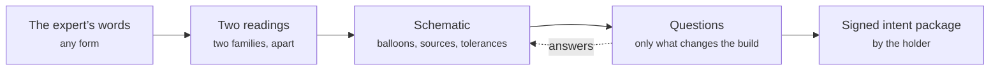

<!-- Generated by tools/docs.ts from docs/src/line/intent.md. Edit the source, then run: node tools/docs.ts --write -->

# Intent studio

> Say what a product must do, in your own words; settle the few questions that change what gets built; sign the schematic as what you mean. What you sign is the signed intent package.

## TL;DR

The person who knows the work writes rough lines. Two model families read them, apart; a deterministic engine reads them back as a numbered schematic, says where every statement came from, and asks only the questions whose answers change what gets built. The holder signs it, and the signed intent package goes to product engineering. Each product line has its own intent studio, and the studio sits inside it. Their words are kept on every artifact, and nothing anyone else wrote passes as theirs.

## Explain it simply

You tell a tailor what you want: *something warm for winter, not too heavy, with pockets I can reach on a bike*. The tailor reads it back as a list, each line numbered: *1. warm for winter; 2. light; 3. pockets reachable while cycling*. Then they ask only what changes the cut: *how cold is your winter?* They do not ask your favourite colour unless it matters. When the list says what you mean, you sign it, and that signed list is what the coat is measured against.

## Engineer

### Capture

- **Any form.** Rough lines, a pasted page, or an existing specification: plain markdown, Spec Kit, Kiro, OpenSpec, Gherkin, HTML and Prisma. One intake reads every form into the same structure, keeping each sentence's file and line.
- **Two readings, compared.** Two model families each read the words into a fixed schema, without seeing the other. Agreement is recorded with both families' names; disagreement becomes a question. One reading alone is shown as proposals, never as fact.
- **Rules before models.** 6 derivation rules, decision-table and state-machine gap checks, and a design lexicon of 8 terms run the same way every time. Models only read.

### The schematic

Every statement is a numbered **balloon**, keyed to its meaning so the number survives revisions. Each records its **state** (confirmed, open, assumed, default) and its **supplier** (the holder, two agreeing families, the lexicon, a rule, a part, the factory). Each measure carries a **tolerance** a machine can read. Statements whose failure would harm someone are **marked** critical or significant and must reach a control.

### Questions

Each question is raised by a rule or a reading difference, says what a wrong answer would break, and is ranked by consequence. A few are asked at a time, with the likely answers as choices and *Other* in the holder's words. For the worked example, 7 questions remain open before any are answered, and its schematic holds 30 statements.

### Review and signature

Before signing, the schematic is read back as each person it serves would meet it, graded on seven axes, with every finding linked to the balloon or question that fixes it. The signature is bound by hash to the exact content signed.

## Architect

The studio's job is fidelity: the holder's meaning, intact, in a form a machine can hold a build to.

- **Provenance is structural.** State and supplier are fields on every statement, not annotations. Only the holder's words or explicit confirmation make a statement confirmed; a factory clarification is always *assumed*, attributed to `factory-clarifications.md`.
- **Determinism is the default.** Given the same words, readings and answers, the engine produces the same schematic and package bytes. That makes every change of meaning visible as a diff, and lets the same intent be rebuilt anywhere.
- **Disagreement is the ambiguity detector.** Two families reading apart find the places the holder's words support more than one reading, which is exactly where a single reader would guess.
- **The question budget is a design constraint.** A question is worth asking only if it changes the build; ranking by consequence keeps the holder's time for the questions only they can answer.
- **The signature is narrow on purpose.** It says the schematic means what the holder means. It does not approve code, and it cannot be carried over to content it did not see. The signed intent package is the first thing product engineering takes in.

See [Intent as the Datum](../../PAPER.md), patterns 1 to 11 and 16.
